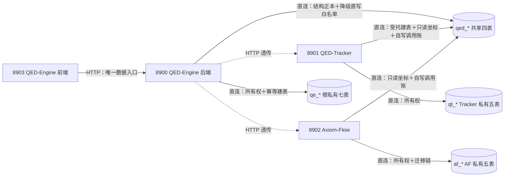
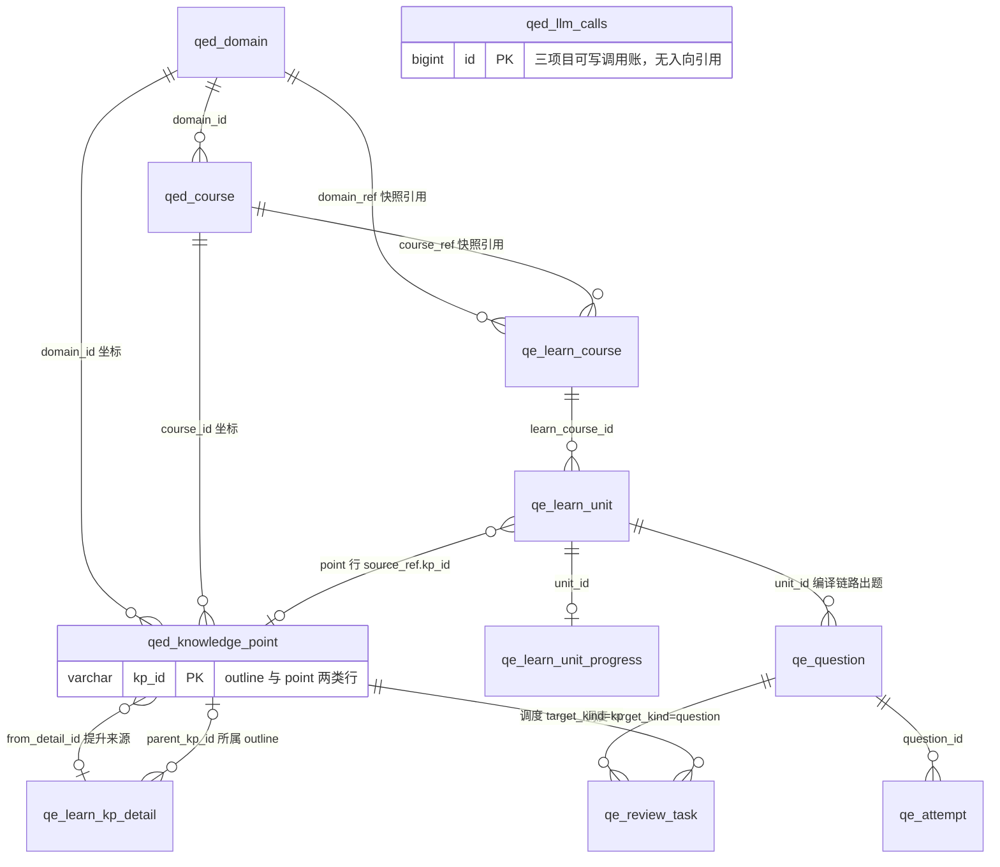
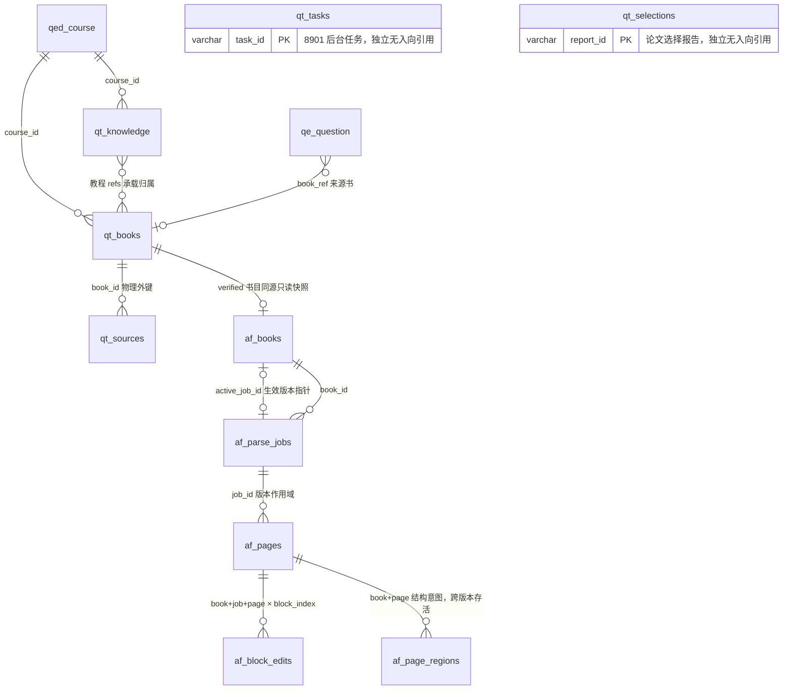

# 数据库总设计（三项目共享 `qed` 库）

设计状态：Accepted
实现状态：In Progress
最后更新：2026-10-21
需求方：QED-Engine（根私有 `qe_*` 七表 + `qed_knowledge_point` + `qed_llm_calls`）、QED-Tracker（受托建表的 `qed_domain`/`qed_course`、私有 `qt_*` 五表）、Axiom-Flow（私有 `af_*` 五表）
确认状态：已确认
关联代码：`backend/qed_engine/services/learn/base.py`、`backend/qed_engine/services/learn/knowledge.py`、`backend/qed_engine/services/learn/practice.py`（八张根侧表的可执行 DDL；第九张 `qed_llm_calls` 的 DDL 归属 LLM 网关模块，见五章该表小节）、`QED-Tracker/src/qed_tracker/db/models.py`（`qed_domain`/`qed_course` 形状事实源）、`QED-Tracker/src/qed_tracker/db/schema.py`（受托建表面 `ensure_schema`）、`.env.example`（`QED_DB_*` 变量模板）
关联测试：`tests/contract/test_architecture_documents.py`、`tests/test_learn.py`、`tests/test_learn_knowledge.py`、`tests/test_learn_practice.py`、`tests/test_llm_call_log.py`
关联 ADR：`docs/history/adr/v0.1/0003-shared-qed-database-independence.md`、`docs/history/adr/v0.1/0009-shared-qed-tables.md`、`docs/history/adr/v0.1/0010-documentation-versioning.md`、`docs/adr/0014-parsing-ownership-and-model-boundary.md`、`docs/adr/0017-design-doc-structure-contract.md`、`docs/adr/0024-preschema-rebuild-tiers-and-demo-gate.md`、`docs/adr/0025-database-design-master-doc-and-ddl-ownership.md`

> 本文件是三个项目共用的 MySQL 库（业务库 `qed`、工作库 `qed_test`）的**数据库总设计正本**：
> 全库表清单与所有权、命名空间与访问拓扑、跨族数据主线、关系视图、读写矩阵、本文正本 11 张表的
> 逐列定义与建表语句、他项目表族的同步契约，以及数据库变更与运维规范。`qt_*`／`af_*` 两族的列级
> 内容仍在其各自仓库文档，本文只做总览登记与路由。
> 本文是稳定文档：正文只写已确定的事实与规则，不写裁决过程与编号引用；一次性事实（库内现状、
> 未完迁移、跨仓偏差、待定命名）一律落在表格备注列或第七章「待确认与库内现状」，不成段叙述。

## 一、前言

三个项目（QED-Engine 8900／QED-Tracker 8901／Axiom-Flow 8902）共用同一个 MySQL 实例与同一个库
（业务库 `qed`、工作库 `qed_test`），这是「三项目独立性铁律」的唯一明确例外：课程与知识体系是共享
资产，一次登记、三处消费。共享的收益是主数据只维护一份，共享的风险是同一张表在四处被各自描述。
本文的存在理由就是消除后者——**全库表形状只在一处定义**，代码、迁移与接口契约都指回这里。

数据分层是本项目的第一性约束：**dataset 只放资料**（原始 PDF 与解析产物），**元数据默认进数据库**
——登记、状态、进度、评价、课程体系、任务与调用账一律入库，`meta/` JSON 文件不再是事实源。数据库
因此不是某个服务的私事，而是三项目之间唯一持久的共享面。

全库 **21 张表**按功能域分七组（表族归属、逐表功能与结构事实源见第三章）：

| 功能域 | 承载表 |
| --- | --- |
| 课程与知识体系 | `qed_domain`、`qed_course`、`qed_knowledge_point` |
| 学习主链 | `qe_learn_course`、`qe_learn_unit`、`qe_learn_unit_progress` |
| 知识点生产管线 | `qe_learn_kp_detail` |
| 练习与复习 | `qe_question`、`qe_attempt`、`qe_review_task` |
| 书目与下载 | `qt_knowledge`、`qt_books`、`qt_sources`、`qt_tasks`、`qt_selections` |
| 解析产物 | `af_books`、`af_parse_jobs`、`af_pages`、`af_block_edits`、`af_page_regions` |
| 运行账目 | `qed_llm_calls` |

本文**负责**的粒度：表清单与表族归属、列名与列序、SQL 类型与宽度、可空性与默认值语义、列注释与
表注释、索引与约束，以及本文正本 11 张表的建表语句——改动其中任一项即须同批改本文。本文**不负责**
迁移执行编排、运行时连接配置与凭据、数据搬迁与回填脚本、端点契约与错误码、业务状态机与终态写点
矩阵、文件与目录布局：这些各有事实源，规范细则与指针统一落在第六章（同步契约）与第七章（变更与
运维）。三条硬边界恒定：8903 前端不直连数据库、一律经 8900 API；`qt_*`／`af_*` 两族的列级内容不进
本文；生产 `qed` 库的 DDL 执行属人工窗口，本文不安排执行。

## 二、遵循的规则

下列十二条是全库恒定约束，正文各处只引编号不复述；每条的机械守护见第八章，执行细则见第七章。

| 编号 | 规则 | 内容 |
| --- | --- | --- |
| R1 | 前缀即所有权 | `qed_*` 共享、`qe_*` 根私有、`qt_*` QED-Tracker、`af_*` Axiom-Flow；表族顺序即变更权重顺序 |
| R2 | 命名空间互不直连 | 8900 对 `qt_*`/`af_*` 一律走 HTTP；8901/8902 不读根私有表；`qed_llm_calls` 的三项目可写是唯一跨项目直写例外 |
| R3 | 共享表变更先经根登记 | `qed_*` schema 变更须先改本文与接口契约、通知消费方，再由所有权方执行迁移 |
| R4 | 逻辑引用不建跨命名空间外键 | 跨表族引用由应用层维护；同命名空间内允许物理外键 |
| R5 | 只引用不复制 | 领域／课程／书目／教程／解析版本一律存 `ref_id` + `label` 快照，素材 `kind` 闭集 `book`/`af_version`/`knowledge` |
| R6 | 人工位机器不写 | `confirmed`（两级确认）、`covered`（学习者勾选）、`retired`（题目退役）、`bookmarked`（错题收藏）只由人工置位 |
| R7 | `meta` 扩展槽三红线 | 只读不筛（不进 `WHERE`／不建函数索引／不参与唯一键）、不放密钥与个人信息、不放跨项目契约字段；定档后升实体列并清空对应键 |
| R8 | 主键不可变 | `domain_id`／`course_id`／`kp_id` 一经写入不得改值——下游四族按 ID 逻辑串接 |
| R9 | 存储与字符集 | `ENGINE=InnoDB`、`CHARSET=utf8mb4`；根侧 DDL 一律显式声明库默认 `COLLATE=utf8mb4_0900_ai_ci`，不声明与共享族分裂的排序规则 |
| R10 | 根侧幂等建表 | 根不引入迁移框架；DDL 常量 + `ensure_tables()` 由首个端点请求懒建，启动路径不触碰 MySQL |
| R11 | 敏感字段 | 数据库密码绝不下发到响应、日志或异常；`model_ref`／`judge_note`／`meta` 等自由文本列不得含密钥与个人信息 |
| R12 | 固定文档去过程化 | 本文正文只写事实与规则；裁决过程与证据落承载壳与提交历史，正文不留编号引用 |

## 三、全库总览

表族顺序＝**共享 `qed_*` → 根私有 `qe_*` → `af_*` → `qt_*`**（本项目自视角，前缀即所有权＝R1，
阅读顺序即变更权重）。共 **21 张表**：共享 4 + 根私有 7 + `af_*` 5 + `qt_*` 5。

| 表名 | 表类型 | 表功能与负责范围 | 备注 | 结构事实源指针 |
| --- | --- | --- | --- | --- |
| `qed_domain` | 共享 | 一个学科领域（当前仅 math，预留扩展）；含学习阶段顺序与领域探索门面态 | 受托建表：所有权与可执行面在 QED-Tracker；生产库 `meta` 居物理末位、`domain_id` 现状 VARCHAR(32) | `QED-Tracker/src/qed_tracker/db/models.py::QedDomain`（本文＝设计正本） |
| `qed_course` | 共享 | 一门课程：阶段、先修 DAG、别名、学习顺序；取代 `courses/math.json` | 受托建表；根侧 `exploration_stage` 在线优先经 8901 写、不可达时降级直写（见 7.8 T6） | `QED-Tracker/src/qed_tracker/db/models.py::QedCourse` |
| `qed_knowledge_point` | 共享 | 一个**已确认**知识点或目录节点（outline/point 两级层级主数据） | 结构由根定义；本表**不存确认位**（能进即已确认）；`type` 四分类只描述 point 行 | 本文五章 + 可执行 DDL `backend/qed_engine/services/learn/knowledge.py` |
| `qed_llm_calls` | 共享 | 一次 LLM 调用记录（完整输入输出、耗时、成败、审核态） | 三项目均可写；有外部写方，**绝不 DROP 重建**（ADR 0024 例外档） | 本文五章 + 可执行 DDL `backend/qed_engine/services/llm/call_log.py` |
| `qe_learn_course` | 根私有 | 一门学习课程：引用式注册 + 坐标三引用 + 素材引用 + 编译作业态自 carry | 表名待定档 `qe_course_state`（REQ-132 W2）；生产 `qed` 库内尚未建表 | 本文五章 + `backend/qed_engine/services/learn/base.py` |
| `qe_learn_unit` | 根私有 | 单元树一个节点：章节大纲与块序列合一（最深三级），带人工位与断点位 | 表名待定档 `qe_unit`（REQ-132 W2）；`qed_test` 内旧名 `qed_learn_unit` 仍并存 | 同上 |
| `qe_learn_unit_progress` | 根私有 | 一个单元的终态学习事实行，进度读时派生重算的基座 | 表名待定档 `qe_unit_progress`（REQ-132 W2）；与单元分表是为重编译换代不丢学习记录 | 同上 |
| `qe_learn_kp_detail` | 根私有 | 一条候选叙述/版本：知识点生成待选明细池，确认后才提升 | 表名待定档 `qe_kp_detail`（REQ-132 W2）；8901/8902 不读；确认位只活在本池 | `backend/qed_engine/services/learn/knowledge.py` |
| `qe_question` | 根私有 | 一道题或一张卡：题面 + 服务端判分依据 + 题源溯源 + 产出事实 | 表名已定档（REQ-132 W1 落地）；`expected_answer` 不进题面下发响应；生产 `qed` 库内尚未建表（见 7.8 T3） | `backend/qed_engine/services/learn/practice.py` |
| `qe_attempt` | 根私有 | 一次作答事实：作答原文 + 判分结果 + 趋势 + 错题本工位 | 表名已定档（同上）；幂等唯一键 `(question_id, review_date, origin)` | 同上 |
| `qe_review_task` | 根私有 | 一个间隔复习调度态：题粒度与知识点粒度双行 | 表名已定档（同上）；优先级不落列（读时派生） | 同上 |
| `af_books` | AF 私有 | 一册已验证书：`qt_books` 只读快照 + 哈希/ingest/解析进度 + 生效版本指针 | 列级内容由 Axiom-Flow 承载（后续批次晋升） | `Axiom-Flow/docs/architecture/database-design.md` |
| `af_parse_jobs` | AF 私有 | 一次解析任务＝一个解析版本：逐页/全本的状态与进度 | 同上 | 同上 |
| `af_pages` | AF 私有 | 一个解析版本一页的解析状态与质量信号 | `job_id='legacy'` 是根视图存量哨兵，非真实版本行 | 同上 |
| `af_block_edits` | AF 私有 | 一次块级人工编辑：判定/备注/文字/范围，绑定其解析版本 | 同上 | 同上 |
| `af_page_regions` | AF 私有 | 一页上人工声明的一条**结构意图**（新框/删块/并块），跨版本存活 | 刻意无 `job_id`：页级区域是解析输入而非解析产物 | 同上 |
| `qt_knowledge` | Tracker 私有 | 一套教程（tutorial）或课程延展资料归类（other_material），两态 draft→confirmed | 与共享 `qed_knowledge_point` **语义不同且无引用关系**（命名避让见五章） | `QED-Tracker/docs/architecture/database-private-tables.md` |
| `qt_books` | 私有书目 | 一册/一本书：选用态 + 持有态 + 下载生命周期（QED-060） | 根侧经 8901 API 透传消费，不直连 | 同上 |
| `qt_sources` | Tracker 私有 | 一次下载渠道尝试（挂 `book_id`），ok 标达成败 | `book_id` 宽度与 `qt_books.book_id` 主键宽度不匹配（见 7.8） | 同上 |
| `qt_tasks` | Tracker 私有 | 一个后台任务记录：queued→running→succeeded/failed | 取代旧 `meta/tasks/` JSON 事实源 | 同上 |
| `qt_selections` | Tracker 私有 | 一个论文选择报告 | 取代旧 `meta/selections/` JSON 事实源 | 同上 |

## 四、整体架构

### 4.1 命名空间与访问拓扑

共享库的第一架构问题不是表怎么连，而是**谁能碰到哪张表、经什么路径**。访问只有两种通道：直连
MySQL（自己的命名空间与共享 `qed_*`）与 HTTP 透传（跨命名空间一律如此，R2）。



- **前端零直连**：8903 一列在读写矩阵里全为「–」是硬约束而非疏漏，前端唯一数据入口是 8900。
- **跨命名空间零直连**：8900 消费 `qt_*`/`af_*` 一律经 8901/8902 的 HTTP API，不读其表。
- **唯一跨项目直写例外**＝`qed_llm_calls`：8901/8902 在 local 模式下直连自写调用账，故本表绝不
  DROP 重建（4.5 审计账目、7.3 例外档）。
- **受托建表不改正本归属**：`qed_domain`/`qed_course` 的物理建表面在 8901，结构正本在本文；
  8900 对这两张表另有离线降级直写的逐列白名单（见 4.4）。
- **服务不在线不等于库不可用**：8901/8902 未启动时，8900 仍直连共享表与根私有表正常工作，
  只有跨命名空间的数据面转为空态或降级。

### 4.2 跨族数据主线

三项目的业务链在库内是一条**单向血缘**：书目获取 → 解析成版本 → 知识体系 → 学习课程 → 练习复习，
调用账贯穿全程。每一跳只带 ID 与 label 快照、不复制对方列（R5），因此任何一族重建都不碎下游；
这也是主键不可变（R8）与解析产物按 `job_id` 版本作用域存在的原因。

| 阶段 | 写入表 | 交给下游的引用键 | 只引用不复制的表现 |
| --- | --- | --- | --- |
| 发现与下载（8901） | `qt_knowledge`、`qt_books`、`qt_sources` | `qt_books.book_id`（`verified` 态才算可解析书目） | 渠道尝试与任务各自留痕，不改书目主行语义 |
| 解析与版本（8902） | `af_books`、`af_parse_jobs`、`af_pages`、`af_block_edits`、`af_page_regions` | `af_books.book_id` 同源快照 ＋ `job_id` 版本作用域 | `af_books` 只存 `qt_books` 的只读快照，不回写对方 |
| 知识体系（8900） | `qed_knowledge_point`（outline/point）、`qe_learn_kp_detail`（候选池） | `kp_id`、`book_ref`（取书目级稳定 ID） | 候选确认后才提升主表；解析版本换代不碎知识点树 |
| 学习课程（8900） | `qe_learn_course`、`qe_learn_unit`、`qe_learn_unit_progress` | `learn_course_id`、`unit_id` | `domain_ref`/`course_ref` 存 `{ref_id,label}` 快照，对方改值不回溯 |
| 练习与复习（8900） | `qe_question`、`qe_attempt`、`qe_review_task` | `question_id`、`kp_id` | 题面只存 `book_ref` ＋ `source_ref{page,block_indexes}`，不存书目列 |
| 全程账目（三项目） | `qed_llm_calls` | 无入向引用（`service`/`task`/`step` 自描述） | 独立审计账，只追加不改写 |

### 4.3 关系视图

连线＝**逻辑引用**（应用层维护，跨命名空间不建外键；同命名空间内允许物理外键，如
`qt_sources`→`qt_books`）。按正本域与他项目域分两图，避免 21 节点单图不可读。

**图 A：本文正本域（共享四表 ＋ 根私有七表）**



**图 B：他项目两族（十表）与跨界引用**



- `qed_course → qed_domain` 的先修 DAG 存在 `prerequisites` JSON 里，图中不展开。
- 根私有表对 `qed_*` 的引用是**快照引用**（`ref_id` + `label`），对方改值不回溯（R5、R8）。
- 跨界边只有四条：课程坐标两条（`qt_knowledge`/`qt_books`）、书目同源一条（`af_books`）、
  题源书一条（`qe_question.book_ref`）——共享库的耦合面刻意压到最窄。
- 全图只表达表间逻辑引用；列级关系明细与单行语义见第五章各表小节。

### 4.4 读写矩阵

R＝可读，W＝可写，–＝不直连（经对应服务 HTTP API 消费）。`af_*` 与 `qt_*` 暂按表族合并行，
其表数与总览一致（21 表全覆盖），列级拆分待两族逐列晋升后随步。降级直写的逐列白名单与终态
写点事实源：[downloads-flow.md](../design/downloads-flow.md) §5.2/§5.4。

| 段 | 表 | 8903 前端 | 8901 QED-Tracker | 8902 Axiom-Flow | 8900 QED-Engine |
| --- | --- | --- | --- | --- | --- |
| 共享 | `qed_domain` | –（经 8900） | R/W（受托建表方，形状事实源） | R | R + 离线降级直写（白名单：`description`/`stages`/`exploration_stage`/`explore_pending`；禁 `level`/`scope`/`classic_tracks`/`path_results`/`meta`） |
| 共享 | `qed_course` | –（经 8900） | R/W（同上） | R | R + 离线降级直写（白名单：`stage`/`sort_order`/`description`/`aliases`/`exploration_stage`——本列在线优先经 8901 `PATCH /courses` 写、仅降级时直写；`explore_pending` 无直写腿（8900 只可经 8901 `PATCH /courses` 在线写本列，不可达即不落库，见 [downloads-flow.md](../design/downloads-flow.md) §5.4）；禁 `track`/`related_targets`/`meta`；值域按课程 5 态分档校验，见 [downloads-flow.md](../design/downloads-flow.md) §5.2） |
| 共享 | `qed_knowledge_point` | –（经 8900） | R（结构上开三项目可写，写入待其立项） | R（同上） | R/W（结构定义方 + 确认提升与检索端点，**当前唯一写者**） |
| 共享 | `qed_llm_calls` | –（经 8900） | W（local 直连自写） | W（local 直连自写） | R/W（网关统一写 + 建表维护 + 检索与审核端点） |
| 根私有 | `qe_learn_course` / `qe_learn_unit` / `qe_learn_unit_progress` | –（经 8900 `/api/v1/learn/*`） | –（不读） | –（不读） | R/W（所有权，根侧幂等建表） |
| 根私有 | `qe_learn_kp_detail` | –（经 8900） | –（不读） | –（不读） | R/W（同上） |
| 根私有 | `qe_question` / `qe_attempt` / `qe_review_task` | –（经 8900） | –（不读） | –（不读） | R/W（同上） |
| af_* | `af_books` / `af_parse_jobs` / `af_pages` / `af_block_edits` / `af_page_regions` | –（经 8900） | – | R/W（所有权，迁移链维护） | –（经 8902 API 透传；`GET /books/{book_id}/file` 只读 `file_path` 指向的 PDF 本体） |
| qt_* | `qt_knowledge` / `qt_books` / `qt_sources` / `qt_tasks` / `qt_selections` | –（经 8900） | R/W（所有权） | – | –（经 8901 API 透传，R2） |

- **`meta` 扩展槽只由该表既有写方写**：`qed_domain`/`qed_course` 归 8901（8900 降级直写白名单
  不含本列），`qed_knowledge_point`/`qed_llm_calls` 归 8900；读方一律按「键可能不存在」处理。
- 根私有族现居共享库但仅根一侧读写，是命名空间的**反向例外**；前缀改判 `qe_*` 即为其收口（R1）。

### 4.5 表角色分类

角色决定这张表能怎么改：第七章的重建档位、备份要求与变更顺序都按本表归属。

| 角色 | 判据 | 表 | 架构后果 |
| --- | --- | --- | --- |
| 主数据 | 一处登记、多处消费，改动即波及全链 | `qed_domain`、`qed_course`、`qed_knowledge_point`、`qe_learn_course`、`qt_knowledge`、`qt_books` | 主键不可变（R8）；共享主数据变更走 7.1 首行顺序，根私有主数据走次行（本文与代码 DDL 同批） |
| 版本化产物 | 一行属一个解析版本或一次编译/出题批次，换代不抹旧行 | `af_books`、`af_parse_jobs`、`af_pages`、`af_block_edits`、`af_page_regions`、`qe_learn_unit`（`active` 位）、`qe_question`（`retired` 软删位） | 按 `job_id`／`active`／批次作用域读写；再生昂贵，属备份确认档 |
| 候选与待选池 | 机器写、人工确认后才提升 | `qe_learn_kp_detail` | 确认位只活在本池（R6）；有可删除重建授权 |
| 事务事实 | 一行＝一次已发生的事件，全量保留不合并 | `qe_attempt`、`qt_sources`、`qt_tasks`、`qt_selections` | 只追加不改写；判分与趋势由服务端写入，不信任客户端 |
| 调度态 | 可重算的派生态被持久化，只为重启不丢 | `qe_learn_unit_progress`、`qe_review_task` | 读时派生重算非累加；进度与错题本不落列 |
| 审计账目 | 有外部写方的历史账 | `qed_llm_calls` | **绝不 DROP 重建**，只做追加式 ALTER |

## 五、详细设计（本文正本的 11 张表）

每表四件套＝**用途 → 涉及模块 → 字段明细 → 建表语句**（必要时加注释段）。九张根侧代码持有
DDL 的表，其建表语句与代码渲染结果**逐字对齐**（列名、列序、类型、注释、索引、表尾存储子句），
改动任一侧即契约红；`qed_domain`/`qed_course` 的可执行面在 QED-Tracker，其语句是 ORM 派生的
**等价展示 DDL**（守护比对列名·列序·类型·可空性，不比对逐字），默认值全在应用层（无
`server_default`），故语句里不出现 `DEFAULT` 子句。

**共享 `qed_*` 四表**

### qed_domain（领域表）

**用途**：一行＝一个学科领域（当前仅 `math`，预留扩展）。承载课程体系的第一层，同时是领域探索
门面的读模型载体：`exploration_stage` + `explore_pending` 两列构成「未开始→探索中→待确认→已生成→
已完成／失败」的对外状态，`stages` 定义该领域的学习阶段四档，被 `qed_course.stage` 的值域引用。

**涉及模块**：`QED-Tracker/src/qed_tracker/db/models.py::QedDomain`（形状与建表面）、
`backend/qed_engine/services/shared_tables.py`（根侧只读 SELECT + 离线降级直写白名单）、
`backend/qed_engine/api/domain_explore.py` + `services/explore_sessions.py`（探索门面写点）、
`backend/qed_engine/api/tracker.py`（`/api/v1/domains` 透传）、8902 只读消费。状态机与写点矩阵
事实源＝[downloads-flow.md](../design/downloads-flow.md) §5.2/§5.4。

**字段明细**：

| 字段 | 类型 | 键 | 空/默认 | 说明 | 备注 |
| --- | --- | --- | --- | --- | --- |
| `domain_id` | VARCHAR(64) | PK | NOT NULL | 领域标识（主键，创建后不可改值） | R8；定档宽度 64，生产库现状 VARCHAR(32)，待受托建表面自愈落地 |
| `name` | VARCHAR(100) | – | NOT NULL | 领域名称 | 下游 label 快照的来源 |
| `description` | TEXT | – | NOT NULL | 学科介绍 | 8900 离线降级直写白名单列 |
| `level` | VARCHAR(50) | – | NOT NULL，默认 `""`（应用层） | 默认学习层级（如 本科；管线 domain@v4 输出） | 列名与注释交叉，定档只统一注释、不改列名 |
| `scope` | TEXT | – | NOT NULL，默认 `""`（应用层） | 学科知识边界描述（当前管线不输出，恒空） | 同上交叉口径；8900 禁写列 |
| `exploration_stage` | VARCHAR(20) | – | NOT NULL，默认 `未开始`（应用层） | 流程状态 | 领域 **6 态**（含领域专用的「已生成」）；枚举与写点见 downloads-flow.md |
| `classic_tracks` | JSON | – | NOT NULL，默认 `[]`（应用层） | 课程方向 | 8900 禁写列 |
| `stages` | JSON | – | NOT NULL | 学习阶段顺序 | `qed_course.stage` 的值域来源（四档：基础/主干/分支/前沿） |
| `path_results` | JSON | – | 可空 | 学习流程 | **活列**（对方写、对方 API 透出、根侧透传）；8900 禁写列。用户 2026-10-18 复裁＝**删列**（连 8901 响应字段与其文档同批），执行归所有权方，本列删除前现状如上（见 7.8 T9） |
| `explore_pending` | JSON | – | 可空 | 探索待确认载荷 | 8900 离线降级直写白名单列 |
| `meta` | JSON | – | 可空 | 扩展槽：未定档字段先入本列（只读不筛）；定档后升实体列并清对应键 | R7；写方仅 8901；生产库本列落**物理末位**（追加式 ALTER），与声明序不同 |
| `created_by` | VARCHAR(16) | – | NOT NULL，默认 `""`（应用层） | 创建人 | 服务标识口径，非人名 |
| `updated_by` | VARCHAR(16) | – | NOT NULL，默认 `""`（应用层） | 最后更新人 | 同上 |
| `created_at` | DATETIME | – | NOT NULL | 创建时间 | UTC |
| `updated_at` | DATETIME | – | NOT NULL | 更新时间 | UTC |

**建表语句**（等价展示 DDL；可执行面＝对方 `create_all`/`ensure_schema`）：

```sql
CREATE TABLE IF NOT EXISTS qed_domain (
  domain_id VARCHAR(64) NOT NULL COMMENT '领域标识（主键，创建后不可改值）',
  name VARCHAR(100) NOT NULL COMMENT '领域名称',
  description TEXT NOT NULL COMMENT '学科介绍',
  level VARCHAR(50) NOT NULL COMMENT '默认学习层级（如 本科；管线 domain@v4 输出）',
  scope TEXT NOT NULL COMMENT '学科知识边界描述（当前管线不输出，恒空）',
  exploration_stage VARCHAR(20) NOT NULL COMMENT '流程状态',
  classic_tracks JSON NOT NULL COMMENT '课程方向',
  stages JSON NOT NULL COMMENT '学习阶段顺序',
  path_results JSON COMMENT '学习流程',
  explore_pending JSON COMMENT '探索待确认载荷（REQ-067-B12）',
  meta JSON COMMENT '扩展槽：未定档字段先入本列（只读不筛）；定档后升实体列并清对应键（REQ-118/QED-076）',
  created_by VARCHAR(16) NOT NULL COMMENT '创建人',
  updated_by VARCHAR(16) NOT NULL COMMENT '最后更新人',
  created_at DATETIME NOT NULL COMMENT '创建时间',
  updated_at DATETIME NOT NULL COMMENT '更新时间',
  PRIMARY KEY (domain_id)
) ENGINE=InnoDB DEFAULT CHARSET=utf8mb4;
```

### qed_course（课程表）

**用途**：一行＝一门课程。承载课程体系第二层：`domain_id` 归属、`sort_order` 学习顺序、
`prerequisites` 先修数组（DAG）、`stage` 阶段档位、`aliases` 别名；取代旧 `courses/math.json`。
课程探索是**单步单轮**：报告生成即进入待确认，确认后已完成，因此课程 `exploration_stage`
是 **5 态**（未开始/探索中/待确认/已完成/失败），**没有领域专用的「已生成」**。

**涉及模块**：`QED-Tracker/src/qed_tracker/db/models.py::QedCourse`（形状与建表面）、
`backend/qed_engine/services/shared_tables.py`（`set_course_stage` 等读写与降级直写）、
`backend/qed_engine/api/tracker.py`（`/api/v1/courses` 透传）、`services/explore_sessions.py`、
`services/learn/knowledge.py` 与 `services/learn/practice.py`（按 `course_id` 串接知识点与题）。

**字段明细**：

| 字段 | 类型 | 键 | 空/默认 | 说明 | 备注 |
| --- | --- | --- | --- | --- | --- |
| `course_id` | VARCHAR(64) | PK | NOT NULL | 课程标识（主键，创建后不可改值） | R8；被知识点主表、候选池、题目表与 `qe_learn_course.course_ref` 引用 |
| `domain_id` | VARCHAR(64) | IDX | NOT NULL | 所属领域 | 定档宽度 64；生产库现状 VARCHAR(32) |
| `sort_order` | INT | – | NOT NULL，默认 `0`（应用层） | 学习顺序 | 8900 降级直写白名单列 |
| `name` | VARCHAR(200) | – | NOT NULL | 课程名称 | label 快照来源 |
| `aliases` | JSON | – | NOT NULL，默认 `[]`（应用层） | 别名列表 | 8900 白名单列 |
| `track` | VARCHAR(50) | – | NOT NULL，默认 `""`（应用层） | 课程所属学术方向 | 8900 禁写列 |
| `stage` | VARCHAR(32) | – | NOT NULL | 所属阶段（基础/主干/分支/前沿） | 值域来自 `qed_domain.stages`，应用层约束、不落外键 |
| `prerequisites` | JSON | – | NOT NULL，默认 `[]`（应用层） | 先修课程 | DAG 边集，关系视图不展开 |
| `related_targets` | JSON | – | NOT NULL，默认 `[]`（应用层） | 已验收关联目标 | **空转列**（唯一写点恒写空数组）。用户 2026-10-18 复裁＝**删列**（同上，执行归所有权方，见 7.8 T9） |
| `description` | VARCHAR(1000) | – | NOT NULL，默认 `""`（应用层） | 课程介绍 | 8900 白名单列 |
| `exploration_stage` | VARCHAR(20) | – | NOT NULL，默认 `未开始`（应用层） | 流程状态 | 课程 **5 态**（无领域专用的「已生成」，越界值被 8900 写点按表分档拒绝）；写路径＝8901 `PATCH /courses` 在线优先、不可达时降级直写（见 7.8 T6） |
| `explore_pending` | JSON | – | 可空 | 探索待确认载荷 | 同上口径 |
| `meta` | JSON | – | 可空 | 扩展槽（同 `qed_domain`） | R7；写方仅 8901；生产库本列落物理末位 |
| `created_by` | VARCHAR(16) | – | NOT NULL，默认 `""`（应用层） | 创建人 | 服务标识口径 |
| `updated_by` | VARCHAR(16) | – | NOT NULL，默认 `""`（应用层） | 最后更新人 | 同上 |
| `created_at` | DATETIME | – | NOT NULL | 创建时间 | UTC |
| `updated_at` | DATETIME | – | NOT NULL | 更新时间 | UTC |

**建表语句**（等价展示 DDL）：

```sql
CREATE TABLE IF NOT EXISTS qed_course (
  course_id VARCHAR(64) NOT NULL COMMENT '课程标识（主键，创建后不可改值）',
  domain_id VARCHAR(64) NOT NULL COMMENT '所属领域',
  sort_order INT NOT NULL COMMENT '学习顺序',
  name VARCHAR(200) NOT NULL COMMENT '课程名称',
  aliases JSON NOT NULL COMMENT '别名列表',
  track VARCHAR(50) NOT NULL COMMENT '课程所属学术方向',
  stage VARCHAR(32) NOT NULL COMMENT '所属阶段（基础/主干/分支/前沿，qed_domain.stages 四档）',
  prerequisites JSON NOT NULL COMMENT '先修课程',
  related_targets JSON NOT NULL COMMENT '已验收关联目标',
  description VARCHAR(1000) NOT NULL COMMENT '课程介绍',
  exploration_stage VARCHAR(20) NOT NULL COMMENT '流程状态',
  explore_pending JSON COMMENT '探索待确认载荷（REQ-067-B12）',
  meta JSON COMMENT '扩展槽：未定档字段先入本列（只读不筛）；定档后升实体列并清对应键（REQ-118/QED-076）',
  created_by VARCHAR(16) NOT NULL COMMENT '创建人',
  updated_by VARCHAR(16) NOT NULL COMMENT '最后更新人',
  created_at DATETIME NOT NULL COMMENT '创建时间',
  updated_at DATETIME NOT NULL COMMENT '更新时间',
  PRIMARY KEY (course_id),
  KEY ix_qed_course_domain_id (domain_id)
) ENGINE=InnoDB DEFAULT CHARSET=utf8mb4;
```

### qed_knowledge_point（知识点主数据表）

**用途**：一行＝一个**人工确认**的知识点或目录节点，承载「领域 → 课程 → 章节(outline) →
知识点(point)」四层体系的第三、四层。`node_kind` 把两类行合在一表：outline＝大知识点（书籍目录
节点，可带层级与正文位置），point＝细知识点（确认提升后的产物）。多版本叙述与分栏内容不在本表
（留 `qe_learn_kp_detail`），掌握态也不在本表。**本表没有人工确认列——能进本表即已确认**。

**涉及模块**：`backend/qed_engine/services/learn/knowledge.py`（可执行 DDL + 幂等建表 + 读写）、
`services/learn/annotations.py`（批注生成）、`api/learn.py`（`GET /learn/knowledge-points`、
`GET|PUT /learn/courses/{course_id}/outline`、`PATCH /learn/knowledge-points/{kp_id}`、
`GET /learn/star-map`、`GET /learn/search`）、`services/learn/practice.py`（按 `kp_id` 归档题）、
8903 `web-ui/src/pages/Knowledge.tsx`、`CourseKnowledge.tsx`。端点契约见
[api-contracts.md](api-contracts.md) §⑥。

**字段明细**：

| 字段 | 类型 | 键 | 空/默认 | 说明 | 备注 |
| --- | --- | --- | --- | --- | --- |
| `kp_id` | VARCHAR(64) | PK | NOT NULL | 行 ID（服务端生成 `kp-<hex12>`，与候选 `detail_id` 不同族） | R8 不可变 |
| `domain_id` | VARCHAR(64) | IDX | NOT NULL，默认 `''` | 领域坐标（逻辑引用 `qed_domain`） | 标量列是为可筛可建唯一键；按 label 快照回填 |
| `domain_label` | VARCHAR(255) | – | 默认 `''` | 领域名快照 | 读展示用，不作筛选键 |
| `course_id` | VARCHAR(64) | IDX | NOT NULL | 课程坐标（逻辑引用 `qed_course`） | 所有课程级查询的主键前缀 |
| `course_label` | VARCHAR(255) | – | 默认 `''` | 课程名快照 | 同上 |
| `node_kind` | VARCHAR(16) | IDX | NOT NULL，默认 `'point'` | 闭集 `outline`=目录节点(大知识点) / `point`=细知识点 | **所有「只数知识点」的查询按它过滤**（星图徽标、检索列表） |
| `parent_kp_id` | VARCHAR(64) | IDX | 可空 | outline：父 outline（章=NULL，节=章）；point：所属 outline | NULL 的 point 行＝未归档池 |
| `depth` | TINYINT | – | 可空 | outline 层级：1=章 2=节 | point 行恒 NULL |
| `book_ref` | VARCHAR(64) | – | 可空 | outline：来源书（`qt_books.book_id`，版本换代不碎树） | point 行 NULL（空串哨兵已随唯一键降级撤销）；取书目级稳定 ID，版本换代不碎树 |
| `name` | VARCHAR(500) | – | NOT NULL | 展示名（章名 / 知识点 canonical 名） | |
| `norm_key` | VARCHAR(200) | IDX | NOT NULL | 去重键（全角转半角 + 空白折叠 + 小写） | 索引是**普通索引**：同父级唯一由服务端校验保证，跨章同名合法 |
| `type` | VARCHAR(16) | – | 可空 | point 行四分类 `memory`/`procedure`/`concept`/`design` | outline 行必须 NULL；四分类是**间隔序列依据**，题目行存快照不回溯 |
| `order_hint` | INT | – | 可空 | 书内/课程内顺序 | outline＝目录前序序号；point＝学习顺序提示 |
| `summary` | VARCHAR(1000) | – | 默认 `''` | 一句话摘要（限长 1000） | outline 与 point 行都可写；学习面悬停只读这一列 |
| `source_ref` | JSON | – | 可空 | outline 正文位置 `{kind,ref_id,page_start,page_end}` | 页序＝**PDF 页序**（印刷页码只存在于解析草稿）；point 行可空 |
| `anchors` | JSON | – | 可空 | 来源锚点 `[{kind,ref_id,page?,snippet?}]` | DeepTutor K1 形状，降级不删 |
| `from_detail_id` | VARCHAR(64) | – | 可空 | 提升来源明细（溯源 `qe_learn_kp_detail`） | 未确认路径无值 |
| `meta` | JSON | – | 可空 | 扩展槽（只读不筛） | R7；写方 8900 |
| `created_by` | VARCHAR(16) | – | NOT NULL，默认 `''` | 创建写入方标识 | 根侧常量 `qed_engine`，与共享两表同口径、非人名 |
| `updated_by` | VARCHAR(16) | – | NOT NULL，默认 `''` | 最近写入方标识 | 同上 |
| `created_at` | DATETIME | – | NOT NULL | UTC 创建时间 | |
| `updated_at` | DATETIME | – | NOT NULL | UTC 更新时间 | |

**注释**：去重索引形态＝`idx_kp_course_kind_norm (course_id, node_kind, norm_key)`（普通索引），
旧的 `idx_kp_course_book_norm` 随 `book_ref` 退出键位而作废；生产 `qed` 库的索引变更属人工窗口。
命名避让：本表与 QED-Tracker 私有 `qt_knowledge` **语义不同且无引用关系**——后者是
「一套教程或课程延展资料的归类」，本表是知识点主数据；两者分属 `qed_*` 与 `qt_*` 命名空间。
本表与 `qe_learn_kp_detail` **可删除重建**（无数据搬迁授权，档位见 7.3）。

**建表语句**：

```sql
CREATE TABLE IF NOT EXISTS qed_knowledge_point (
  kp_id VARCHAR(64) PRIMARY KEY COMMENT '行 ID（服务端生成 kp-<hex12>，与候选 detail_id 不同族）',
  domain_id VARCHAR(64) NOT NULL DEFAULT '' COMMENT '领域坐标（逻辑引用 qed_domain，标量列供检索与唯一键）',
  domain_label VARCHAR(255) DEFAULT '' COMMENT '领域名快照',
  course_id VARCHAR(64) NOT NULL COMMENT '课程坐标（逻辑引用 qed_course）',
  course_label VARCHAR(255) DEFAULT '' COMMENT '课程名快照',
  node_kind VARCHAR(16) NOT NULL DEFAULT 'point' COMMENT '闭集 outline=目录节点(大知识点) / point=细知识点',
  parent_kp_id VARCHAR(64) COMMENT 'outline：父 outline（章=NULL，节=章）；point：所属 outline（NULL=未归档池）',
  depth TINYINT COMMENT 'outline 层级：1=章 2=节；point 行 NULL',
  book_ref VARCHAR(64) COMMENT 'outline：来源书（qt_books.book_id，版本换代不碎树）；point 行 NULL（空串哨兵随 DEFECT-011 唯一键降级后撤销）',
  name VARCHAR(500) NOT NULL COMMENT '展示名（章名 / 知识点 canonical 名）',
  norm_key VARCHAR(200) NOT NULL COMMENT '去重键（全角转半角+空白折叠+小写）',
  type VARCHAR(16) COMMENT 'point 行四分类 memory/procedure/concept/design；outline 行必须 NULL',
  order_hint INT COMMENT '书内/课程内顺序（outline 行=目录前序序号，point 行=学习顺序提示，均可空）',
  summary VARCHAR(1000) DEFAULT '' COMMENT '一句话摘要（限长 1000）',
  source_ref JSON COMMENT 'outline 正文位置 {kind,ref_id,page_start,page_end}（页序=PDF 页序）；point 行可空',
  anchors JSON COMMENT '来源锚点 [{kind,ref_id,page?,snippet?}]（DeepTutor K1 形状，降级不删）',
  from_detail_id VARCHAR(64) COMMENT '提升来源明细（溯源 qe_learn_kp_detail）',
  meta JSON COMMENT '扩展槽：未定档字段先入本列（只读不筛）；定档后升为实体列并清空对应键',
  created_by VARCHAR(16) NOT NULL DEFAULT '' COMMENT '创建写入方标识（qed_engine）',
  updated_by VARCHAR(16) NOT NULL DEFAULT '' COMMENT '最近写入方标识（qed_engine）',
  created_at DATETIME NOT NULL COMMENT 'UTC 创建时间',
  updated_at DATETIME NOT NULL COMMENT 'UTC 更新时间',
  KEY idx_kp_course_kind_norm (course_id, node_kind, norm_key),
  KEY idx_kp_parent (parent_kp_id),
  KEY idx_kp_course_kind (course_id, node_kind),
  KEY idx_kp_domain (domain_id)
) ENGINE=InnoDB DEFAULT CHARSET=utf8mb4 COLLATE=utf8mb4_0900_ai_ci
COMMENT='知识点主数据（领域→课程→章节(outline)→知识点(point) 层级；一行=一个人工确认的行，结构由 QED-Engine 根定义）';
```

### qed_llm_calls（LLM 调用记录表）

**用途**：一行＝一次 LLM 调用（成功或失败），记录完整 prompt 输入、模型原始响应、耗时、错误与
审核态，用于 prompt 与工具调用调优。三项目共用一张账表，`service` 列区分调用方；8900 经网关统一写，
8901/8902 在 local 模式下直连自写。

**涉及模块**：`backend/qed_engine/services/llm/call_log.py`（幂等建表 + `ensure_comments()` 注释
补齐 + `ensure_indexes()` 补索引 + 写入与分页检索）、`services/llm/`（api/local 两渠道调用路径）、
`api/control.py`（`GET /api/v1/llm/calls`、`PATCH /api/v1/llm/calls/{call_id}/review`）、
8903 `web-ui/src/pages/LlmCalls.tsx`。字段语义与调用链见
[llm-gateway.md](../design/llm-gateway.md)；端点契约见 [api-contracts.md](api-contracts.md)。

**字段明细**：

| 字段 | 类型 | 键 | 空/默认 | 说明 | 备注 |
| --- | --- | --- | --- | --- | --- |
| `id` | BIGINT | PK | 自增 | 行 ID | |
| `service` | VARCHAR(32) | IDX | NOT NULL | 调用方标识：`qed_engine`/`qed_tracker`/`axiom_flow` | 闭集三值 |
| `mode` | VARCHAR(16) | – | NOT NULL | 调用模式：`api`（经 8900 网关）/ `local`（直连厂商） | 决定 `provider` 与 `endpoint` 的语义 |
| `provider` | VARCHAR(32) | – | NOT NULL | 模型提供方：api 渠道为厂商名（qwen/deepseek/glm/gateway），local 模式为 runtime 名（lmstudio/llamacpp/mineru） | 两渠道语义不同，**列不拆** |
| `model` | VARCHAR(64) | – | NOT NULL | 实际模型名（如 qwen-plus、qwen3.7-plus） | |
| `endpoint` | VARCHAR(16) | – | NOT NULL | 调用类型：`text`/`vision`/`embedding` | |
| `prompt_template` | VARCHAR(255) | – | 可空 | 模板编号（`{task}/{step}@v{n}`，如 domain-explore/domain@v2） | 调优主键线索 |
| `prompt` | MEDIUMTEXT | – | 可空 | 完整 prompt（JSON 序列化的 messages 数组） | 可能含文档正文片段，不入导出与响应 |
| `response` | MEDIUMTEXT | – | 可空 | 模型原始响应文本 | 同上 |
| `duration_ms` | INT | – | 可空 | 调用耗时（毫秒） | |
| `status` | VARCHAR(16) | – | NOT NULL | 调用结果：`success`/`error` | |
| `error` | VARCHAR(500) | – | 可空 | 失败原因（截断至 500 字符） | 不得含密钥 |
| `created_at` | DATETIME | IDX | NOT NULL | UTC 调用时间 | 时间窗检索主键 |
| `task` | VARCHAR(64) | IDX | 可空 | 任务标识（如 paper-plan、domain-explore） | 任务级检索维度 |
| `step` | VARCHAR(32) | IDX | 可空 | 步骤标识（如 plan、assess、domain） | 步骤级检索维度，与 `task` 组成二级索引 |
| `review_status` | VARCHAR(16) | – | 默认 `'unreviewed'` | 审核态：`unreviewed`/`passed`/`rejected` | 人工审核态，经审核端点写入 |
| `review_note` | VARCHAR(1000) | – | 默认 `''` | 审核备注 | 不含密钥（R11） |
| `meta` | JSON | – | 可空 | 扩展槽：未定档字段先入本列（只读不筛，不进 WHERE/索引）；定档后升为实体列并清空对应键 | R7；写方 8900 |

**注释**：二级索引三枚（`idx_llm_created`／`idx_llm_service_created(service, created_at)`／
`idx_llm_task_step(task, step)`）是定档结论——账表按时间窗、服务、任务步骤检索，零二级索引即全表扫。
**本表有外部写方（8901/8902 local 直写），绝不 DROP 重建**：schema 变更只做追加式 ALTER，是
自由重建档的**明确例外档**（见 7.3）。

**建表语句**：

```sql
CREATE TABLE IF NOT EXISTS qed_llm_calls (
  id BIGINT AUTO_INCREMENT PRIMARY KEY COMMENT '行 ID（自增主键）',
  service VARCHAR(32) NOT NULL COMMENT '调用方标识：qed_engine/qed_tracker/axiom_flow',
  mode VARCHAR(16) NOT NULL COMMENT '调用模式：api（经 8900 网关）/ local（直连厂商）',
  provider VARCHAR(32) NOT NULL COMMENT '模型提供方：api 渠道为厂商名（qwen/deepseek/glm/gateway），local 模式为 runtime 名（lmstudio/llamacpp/mineru）',
  model VARCHAR(64) NOT NULL COMMENT '实际模型名（如 qwen-plus、qwen3.7-plus）',
  endpoint VARCHAR(16) NOT NULL COMMENT '调用类型：text/vision/embedding',
  prompt_template VARCHAR(255) COMMENT '模板编号（{task}/{step}@v{n}，如 domain-explore/domain@v2）',
  prompt MEDIUMTEXT COMMENT '完整 prompt（JSON 序列化的 messages 数组）',
  response MEDIUMTEXT COMMENT '模型原始响应文本',
  duration_ms INT COMMENT '调用耗时（毫秒）',
  status VARCHAR(16) NOT NULL COMMENT '调用结果：success/error',
  error VARCHAR(500) COMMENT '失败原因（截断至 500 字符）',
  created_at DATETIME NOT NULL COMMENT 'UTC 调用时间',
  task VARCHAR(64) COMMENT '任务标识（REQ-060 扩展，如 paper-plan、domain-explore）',
  step VARCHAR(32) COMMENT '步骤标识（REQ-060 扩展，如 plan、assess、domain）',
  review_status VARCHAR(16) DEFAULT 'unreviewed' COMMENT '审核态：unreviewed/passed/rejected（REQ-060 扩展）',
  review_note VARCHAR(1000) DEFAULT '' COMMENT '审核备注（REQ-060 扩展）',
  meta JSON COMMENT '扩展槽：未定档字段先入本列（只读不筛，不进 WHERE/索引）；定档后升为实体列并清空对应键（REQ-118）',
  KEY idx_llm_created (created_at),
  KEY idx_llm_service_created (service, created_at),
  KEY idx_llm_task_step (task, step)
) ENGINE=InnoDB DEFAULT CHARSET=utf8mb4 COLLATE=utf8mb4_0900_ai_ci
  COMMENT='LLM 调用审计表：一行 = 一次 LLM 调用（成功或失败），记录完整 prompt 输入、模型响应、耗时与审核态（三项目共用，service 区分调用方）'
```

**根私有 `qe_*` 七表**（表名定档进度见 7.8 T1；四张现名仍带 `learn_` 段，待 REQ-132 W2）

### qe_learn_course（学习课程表）

**用途**：一行＝一门**学习课程**（用户在 8900 上开的一门课），与共享表 `qed_course`（课程体系
主数据）是两回事。承载引用式注册信息、三级坐标快照、素材引用列表、编译作业态（自 carry：一门课
同时只跑一个编译）与双通道指令。**课程态与进度不落列**——读时由单元树与进度行派生重算。

**涉及模块**：`backend/qed_engine/services/learn/base.py`（DDL + `ensure_tables()`）、
`api/learn.py`（`GET|POST /learn/courses`、`POST /learn/courses/sync`、
`GET|PATCH|DELETE /learn/courses/{course_id}`、`POST /learn/courses/{id}/compile/propose|start`、
`GET /learn/courses/{id}/compile`）、`services/learn/memory.py`（存储层）、
8903 `web-ui/src/pages/LearnShelf.tsx`、`LearnWorkbench.tsx`。契约见
[api-contracts.md](api-contracts.md) §⑥。

**字段明细**：

| 字段 | 类型 | 键 | 空/默认 | 说明 | 备注 |
| --- | --- | --- | --- | --- | --- |
| `learn_course_id` | VARCHAR(64) | PK | NOT NULL | 学习课程 ID（服务端生成） | ≠ `qed_course.course_id` |
| `name` | VARCHAR(255) | – | NOT NULL | 课程名 | |
| `domain_ref` | JSON | – | 可空 | 领域坐标引用 `{ref_id,label}` | 逻辑引用 `qed_domain`；R5 只引用不复制 |
| `course_ref` | JSON | – | 可空 | 课程坐标引用 `{ref_id,label}` | 逻辑引用 `qed_course` |
| `direction` | VARCHAR(255) | – | 默认 `''` | 方向 label 快照 | 共享表无方向实体，仅存文本 |
| `resources` | JSON | – | NOT NULL | 素材引用列表 `[{kind,ref_id,label}]` | `kind` 闭集三值 `book`/`af_version`/`knowledge` |
| `compile_status` | VARCHAR(16) | – | 可空 | 编译作业态：NULL/proposed/running/completed/failed | 课程行自 carry：一门课同时只跑一个编译 |
| `compile_done` | INT | – | NOT NULL，默认 0 | 已生成活动块数 | 与 `compile_total` 组进度 |
| `compile_total` | INT | – | NOT NULL，默认 0 | 活动块总数 | |
| `failure_count` | INT | – | NOT NULL，默认 0 | 本作业块级失败计数 | 熔断判据（掌握门接线后启用） |
| `page_windows` | JSON | – | 可空 | 人工页窗 `[{start,end}]` | propose 输入，不依赖检索；页序＝PDF 页序 |
| `compile_fingerprint` | VARCHAR(64) | – | 可空 | 上次编译的源指纹 | drift 判定 |
| `instructions` | VARCHAR(4000) | – | 默认 `''` | 学习者通道 | 限长 4000 |
| `agent_notes` | VARCHAR(4000) | – | 默认 `''` | agent 通道 | 限长 4000；两通道互不覆盖 |
| `created_at` | DATETIME | – | NOT NULL | UTC 创建时间 | |
| `updated_at` | DATETIME | – | NOT NULL | UTC 更新时间 | |

**建表语句**：

```sql
CREATE TABLE IF NOT EXISTS qe_learn_course (
  learn_course_id VARCHAR(64) PRIMARY KEY COMMENT '学习课程 ID（服务端生成，≠共享表 qed_course）',
  name VARCHAR(255) NOT NULL COMMENT '课程名',
  domain_ref JSON COMMENT '领域坐标引用 {ref_id,label}（逻辑引用 qed_domain）',
  course_ref JSON COMMENT '课程坐标引用 {ref_id,label}（逻辑引用 qed_course）',
  direction VARCHAR(255) DEFAULT '' COMMENT '方向 label 快照（共享表无方向实体，仅存文本）',
  resources JSON NOT NULL COMMENT '素材引用列表 [{kind,ref_id,label}]，kind 闭集 book/af_version/knowledge',
  compile_status VARCHAR(16) COMMENT '编译作业态：NULL/proposed/running/completed/failed（D3：课程行自 carry）',
  compile_done INT NOT NULL DEFAULT 0 COMMENT '已生成活动块数',
  compile_total INT NOT NULL DEFAULT 0 COMMENT '活动块总数',
  failure_count INT NOT NULL DEFAULT 0 COMMENT '本作业块级失败计数（熔断判据，M-2 接线）',
  page_windows JSON COMMENT '人工页窗 [{start,end}]（propose 输入，不依赖检索）',
  compile_fingerprint VARCHAR(64) COMMENT '上次编译的源指纹（drift 判定）',
  instructions VARCHAR(4000) DEFAULT '' COMMENT '学习者通道（限长 4000）',
  agent_notes VARCHAR(4000) DEFAULT '' COMMENT 'agent 通道（限长 4000）',
  created_at DATETIME NOT NULL COMMENT 'UTC 创建时间',
  updated_at DATETIME NOT NULL COMMENT 'UTC 更新时间'
) ENGINE=InnoDB DEFAULT CHARSET=utf8mb4 COLLATE=utf8mb4_0900_ai_ci
COMMENT='学习课程注册表（引用式，所有权 QED-Engine，主链壳 M-1 契约）';
```

### qe_learn_unit（学习单元树表）

**用途**：一行＝单元树一个节点，把**章节大纲与块序列合一**存储（最深三级：section → unit，
另有知识点推进行 `point`）。承载内容生成结果（块类型与 `payload`）、溯源（页块）、断点续编位与
重编译版本位，以及两级人工确认位与学习者勾选位。

**涉及模块**：`backend/qed_engine/services/learn/base.py`（DDL + 树读写 + 编译落库）、
`api/learn.py`（`GET /learn/courses/{id}/units`、`GET /learn/units/{unit_id}`、
`PUT /learn/courses/{id}/syllabus`、`PATCH /learn/units/{unit_id}`、进度端点）、
`services/learn/practice.py`（编译链路出题回填 `unit_id`）、
8903 `web-ui/src/pages/LearnWorkbench.tsx`。

**字段明细**：

| 字段 | 类型 | 键 | 空/默认 | 说明 | 备注 |
| --- | --- | --- | --- | --- | --- |
| `unit_id` | VARCHAR(64) | PK | NOT NULL | 单元 ID（服务端生成） | |
| `learn_course_id` | VARCHAR(64) | IDX | NOT NULL | 所属学习课程 | 逻辑引用 `qe_learn_course` |
| `parent_id` | VARCHAR(64) | – | 可空 | 父节点（unit→section；section 为 NULL） | 树形自引用，同命名空间内由应用层维护 |
| `level` | VARCHAR(16) | IDX | NOT NULL | `section`=章节大纲节点 / `unit`=最小学习单元（块） / `point`=知识点推进行 | point 行的 kp 引用在 `source_ref.kp_id` |
| `title` | VARCHAR(500) | – | NOT NULL | 标题 | |
| `sort_order` | INT | IDX | NOT NULL，默认 0 | 同级顺序 | 与 `level` 同索引，读树时排序键 |
| `confirmed` | TINYINT(1) | – | NOT NULL，默认 0 | 人工确认位（section 与 unit 各自两级） | R6 机器不写 1 |
| `covered` | TINYINT(1) | – | NOT NULL，默认 0 | 学习者勾选位 | **agent/编译永不写**（R6） |
| `type` | VARCHAR(16) | – | 可空 | unit 行块类型闭集 `text`/`formula`/`figure`/`quiz`/`flashcard` | |
| `payload` | JSON | – | 可空 | unit 行内容定义 | quiz/flashcard 块**不含判分**，判分归判分层 `grading.py` |
| `source_ref` | JSON | – | 可空 | 溯源 `{ref_id,page,block_index}` | 逻辑引用素材页块；页序＝PDF 页序 |
| `gen_status` | VARCHAR(16) | – | NOT NULL，默认 `'pending'` | `pending`/`generated`/`failed` | 断点续编位 |
| `active` | TINYINT(1) | – | NOT NULL，默认 1 | 当前编译版本位 | 重编不抹历史，旧行置 0 |
| `created_at` | DATETIME | – | NOT NULL | UTC 创建时间 | |
| `updated_at` | DATETIME | – | NOT NULL | UTC 更新时间 | |

**建表语句**：

```sql
CREATE TABLE IF NOT EXISTS qe_learn_unit (
  unit_id VARCHAR(64) PRIMARY KEY COMMENT '单元 ID（服务端生成）',
  learn_course_id VARCHAR(64) NOT NULL COMMENT '所属学习课程（逻辑引用）',
  parent_id VARCHAR(64) COMMENT '父节点（unit→section；section 为 NULL）',
  level VARCHAR(16) NOT NULL COMMENT 'section=章节大纲节点 / unit=最小学习单元（块）/ point=知识点推进行（W5 §V2.3，kp 引用在 source_ref.kp_id）',
  title VARCHAR(500) NOT NULL COMMENT '标题',
  sort_order INT NOT NULL DEFAULT 0 COMMENT '同级顺序',
  confirmed TINYINT(1) NOT NULL DEFAULT 0 COMMENT '人工确认位（两级确认：section 与 unit 各自）',
  covered TINYINT(1) NOT NULL DEFAULT 0 COMMENT '学习者勾选位（agent/编译永不写）',
  type VARCHAR(16) COMMENT 'unit 行：text/formula/figure/quiz/flashcard',
  payload JSON COMMENT 'unit 行内容定义（quiz/flashcard 不含判分，判分归 M-3）',
  source_ref JSON COMMENT 'unit 行溯源 {ref_id,page,block_index}（逻辑引用素材页块）',
  gen_status VARCHAR(16) NOT NULL DEFAULT 'pending' COMMENT 'pending/generated/failed（断点续编位）',
  active TINYINT(1) NOT NULL DEFAULT 1 COMMENT '当前编译版本位（重编不抹历史，旧行置 0）',
  created_at DATETIME NOT NULL COMMENT 'UTC 创建时间',
  updated_at DATETIME NOT NULL COMMENT 'UTC 更新时间',
  KEY idx_learn_unit_course (learn_course_id, level, sort_order)
) ENGINE=InnoDB DEFAULT CHARSET=utf8mb4 COLLATE=utf8mb4_0900_ai_ci
COMMENT='学习单元树（章节树+块序列合一，主链壳 M-1/M-2 契约）';
```

### qe_learn_unit_progress（学习单元进度表）

**用途**：一行＝一个知识点的**学习事实**：终态位（done/skipped）＋质性门判定四列。与单元表分表
是为了重编译换代不丢学习记录；课程百分比、结课态与掌握分数一律读时按本表与作答明细重算
（派生非累加：分数不落列）。

**涉及模块**：`backend/qed_engine/services/learn/base.py`（DDL + 进度读写 + 派生重算）、
`api/learn.py`（`GET|POST /learn/courses/{id}/progress`、主链 M-3 的 `GET …/mastery` 与 `POST …/mastery/assess`，后者只写判定四列）、
8903 `web-ui/src/pages/LearnWorkbench.tsx`（进度条与勾选）。

**字段明细**：

| 字段 | 类型 | 键 | 空/默认 | 说明 | 备注 |
| --- | --- | --- | --- | --- | --- |
| `id` | BIGINT | PK | 自增 | 行 ID（自增主键） | |
| `unit_id` | VARCHAR(64) | UQ | NOT NULL | 单元 ID | 逻辑引用 `qe_learn_unit`；一单元一行 |
| `learn_course_id` | VARCHAR(64) | IDX | NOT NULL | 冗余课程 ID | 派生重算按课程聚合 |
| `status` | VARCHAR(16) | – | NOT NULL | `done`/`skipped` | **pending＝无行**（读时派生，非累加） |
| `qualitative_passed` | TINYINT(1) | – | 可空 | 质性门结论 `1`/`0`，NULL＝未判 | 仅 `concept`/`design` 知识点行有值；量化门不占列（读时按作答序列派生） |
| `qualitative_note` | VARCHAR(1000) | – | 默认 `''` | 判读证据一句话 | v1 只存学习者自评理由；不得含密钥 |
| `assessed_by` | VARCHAR(16) | – | 默认 `''` | provenance `learner`／`model` | `learner`＝自评位（裁决 D-M3-2 v1）；`model` 为 M-3b 预留，本轮端点拒绝 |
| `assessed_at` | DATETIME | – | 可空 | 最近一次质性判定 UTC 时刻 | 与勾选通路（`status`）各写各的列，互不覆盖 |
| `updated_at` | DATETIME | – | NOT NULL | UTC 更新时间 | 无 `created_at`：行只由终态写入 |

**注释**：主链 M-3 兑现 0928/0930 两处裁决——知识点掌握行并入本表扩列（上限四列），无需第四张表。
存量库由 `base.ensure_tables` 按 information_schema 幂等补列（判例 `qed_llm_calls`）；生产 `qed` 库
不在此路径 ALTER＝D 类转人工随发布批次。
门态清单＝本表判定列 × `qe_attempt` 作答序列（`attempts_by_kp`）× `qe_review_task` 到期计数（`due_counts_by_kp`）× 知识点投影行，四源在 `api/learn.py` 汇成、规则本体在 `services/learn/mastery.py`，分数与三态不落列。

**建表语句**：

```sql
CREATE TABLE IF NOT EXISTS qe_learn_unit_progress (
  id BIGINT AUTO_INCREMENT PRIMARY KEY COMMENT '行 ID（自增主键）',
  unit_id VARCHAR(64) NOT NULL COMMENT '单元 ID（逻辑引用 qe_learn_unit）',
  learn_course_id VARCHAR(64) NOT NULL COMMENT '冗余课程 ID（派生重算按课程聚合）',
  status VARCHAR(16) NOT NULL COMMENT 'done/skipped（pending=无行，读时派生重算非累加）',
  qualitative_passed TINYINT(1) NULL COMMENT '质性门结论（仅 concept/design 知识点有值；NULL=未判）',
  qualitative_note VARCHAR(1000) DEFAULT '' COMMENT '判读证据一句话（自评理由，不含密钥）',
  assessed_by VARCHAR(16) DEFAULT '' COMMENT 'provenance：learner=判定者（v1 自评位）／model=M-3b 预留',
  assessed_at DATETIME NULL COMMENT '最近一次质性判定 UTC 时刻',
  updated_at DATETIME NOT NULL COMMENT 'UTC 更新时间',
  UNIQUE KEY uq_learn_progress_unit (unit_id),
  KEY idx_learn_progress_course (learn_course_id)
) ENGINE=InnoDB DEFAULT CHARSET=utf8mb4 COLLATE=utf8mb4_0900_ai_ci
COMMENT='学习进度派生基（终态事实+质性门判定，进度与掌握分=读时重算，主链壳 M-1/M-3 契约）';
```

### qe_learn_kp_detail（知识点候选明细池）

**用途**：一行＝一条候选叙述或版本。知识点生成管线的**待选池**：同一个知识点可多条并存
（多版本、多叙述、多来源），经人工确认（`confirmed`）后才提升到共享主表 `qed_knowledge_point`。
`intent` 与 `type` 正交：前者说明这条批注的用途（摘要/讲解），后者说明知识点分类。

**涉及模块**：`backend/qed_engine/services/learn/knowledge.py`（DDL + 候选读写 + 提升）、
`services/learn/annotations.py`（批注生成）、`services/learn/knowledge_memory.py`（存储层）、
`api/learn.py`（`GET|POST /learn/kp-details`、`POST /learn/kp-details/{detail_id}/confirm|reject|like`、
`POST /learn/annotations/generate`）、8903 `web-ui/src/pages/CourseKnowledge.tsx`（右栏本章候选）。

**字段明细**：

| 字段 | 类型 | 键 | 空/默认 | 说明 | 备注 |
| --- | --- | --- | --- | --- | --- |
| `detail_id` | VARCHAR(64) | PK | NOT NULL | 明细 ID（服务端生成 `kpd-<hex12>`） | 与 `kp_id` 不同族 |
| `domain_id` | VARCHAR(64) | – | NOT NULL，默认 `''` | 领域坐标 | 逻辑引用 `qed_domain` |
| `domain_label` | VARCHAR(255) | – | 默认 `''` | 领域名快照 | |
| `course_id` | VARCHAR(64) | IDX | NOT NULL | 课程坐标 | 逻辑引用 `qed_course` |
| `course_label` | VARCHAR(255) | – | 默认 `''` | 课程名快照 | |
| `kp_id` | VARCHAR(64) | – | 可空 | 采纳后指向主表 | 未采纳允许悬空候选 |
| `parent_kp_id` | VARCHAR(64) | IDX | 可空 | 所属 outline | 右栏「本章候选」据此过滤；提升时平移到主表 |
| `intent` | VARCHAR(16) | – | NOT NULL，默认 `'explanation'` | 批注用途闭集 `summary`/`explanation` | 与 `type` 正交 |
| `book_ref` | VARCHAR(64) | – | NOT NULL，默认 `''` | 批注来源书 | 提升后主表 point 行 `book_ref` 为 NULL，来源书只留本池 |
| `name` | VARCHAR(500) | – | NOT NULL | 候选名（可含版本差异） | **不进唯一键** |
| `norm_key` | VARCHAR(200) | – | NOT NULL | 去重键（与主表同口径） | 提升时校验 |
| `type` | VARCHAR(16) | – | 可空 | 四分类闭集 `memory`/`procedure`/`concept`/`design` | |
| `narrative` | MEDIUMTEXT | – | 可空 | 叙述正文 | 同一知识点多条并存＝多版本多叙述 |
| `payload` | JSON | – | 可空 | 分栏内容 `{definition,theorem,proof,example...}` | **不含判分**，判分归判分层 `grading.py` |
| `anchors` | JSON | – | 可空 | 来源锚点列表 | 与主表同形状 |
| `gen_batch` | VARCHAR(64) | IDX | NOT NULL，默认 `''` | 生成批次＝版本组 | 一批候选可整批复核/清理 |
| `map_seed` | VARCHAR(32) | – | 可空 | 确定性种子 | 同批次同图稳定复现（DeepTutor K5） |
| `model_ref` | VARCHAR(128) | – | 可空 | 生成者标识（`manual`／模型名） | 不得含密钥（R11） |
| `gen_status` | VARCHAR(16) | IDX | NOT NULL，默认 `'candidate'` | `draft`/`candidate`/`adopted`/`rejected` | 与 `confirmed` 分工：机器写本列，人工写确认位 |
| `dedup_of` | VARCHAR(64) | – | 可空 | 指向既有 canonical `kp_id` | 合并候选，不另立主表行 |
| `confirmed` | TINYINT(1) | – | NOT NULL，默认 0 | 人工确认位（置位才提升） | R6；**确认位只活在本池** |
| `created_at` | DATETIME | – | NOT NULL | UTC 创建时间 | |
| `updated_at` | DATETIME | – | NOT NULL | UTC 更新时间 | |

**建表语句**：

```sql
CREATE TABLE IF NOT EXISTS qe_learn_kp_detail (
  detail_id VARCHAR(64) PRIMARY KEY COMMENT '明细 ID（服务端生成 kpd-<hex12>）',
  domain_id VARCHAR(64) NOT NULL DEFAULT '' COMMENT '领域坐标（逻辑引用 qed_domain）',
  domain_label VARCHAR(255) DEFAULT '' COMMENT '领域名快照',
  course_id VARCHAR(64) NOT NULL COMMENT '课程坐标（逻辑引用 qed_course）',
  course_label VARCHAR(255) DEFAULT '' COMMENT '课程名快照',
  kp_id VARCHAR(64) COMMENT '采纳后指向主表（未采纳允许悬空候选）',
  parent_kp_id VARCHAR(64) COMMENT '所属 outline（本章候选列表据此过滤；提升时平移到主表）',
  intent VARCHAR(16) NOT NULL DEFAULT 'explanation' COMMENT '批注用途闭集 summary/explanation（与 type 正交）',
  book_ref VARCHAR(64) NOT NULL DEFAULT '' COMMENT '批注来源书（与主表 outline 同口径，提升后主表 point 行 book_ref 为 NULL，来源书只留本池）',
  name VARCHAR(500) NOT NULL COMMENT '候选名（可含版本差异，不进唯一键）',
  norm_key VARCHAR(200) NOT NULL COMMENT '去重键（与主表同口径，提升时校验）',
  type VARCHAR(16) COMMENT '四分类闭集 memory/procedure/concept/design',
  narrative MEDIUMTEXT COMMENT '叙述正文（同一知识点可多条并存=多版本多叙述）',
  payload JSON COMMENT '分栏内容 {definition,theorem,proof,example...}（不含判分，判分归主链 M-3）',
  anchors JSON COMMENT '来源锚点列表（与主表同形状）',
  gen_batch VARCHAR(64) NOT NULL DEFAULT '' COMMENT '生成批次=版本组（一批候选可整批复核/清理）',
  map_seed VARCHAR(32) COMMENT '确定性种子（同批次同图稳定复现，DeepTutor K5）',
  model_ref VARCHAR(128) COMMENT '生成者标识（manual/模型名；不含密钥）',
  gen_status VARCHAR(16) NOT NULL DEFAULT 'candidate' COMMENT 'draft/candidate/adopted/rejected',
  dedup_of VARCHAR(64) COMMENT '指向既有 canonical kp_id（合并候选，不另立主表行）',
  confirmed TINYINT(1) NOT NULL DEFAULT 0 COMMENT '人工确认位（置位才提升）',
  created_at DATETIME NOT NULL COMMENT 'UTC 创建时间',
  updated_at DATETIME NOT NULL COMMENT 'UTC 更新时间',
  KEY idx_kpd_course (course_id, gen_status),
  KEY idx_kpd_batch (gen_batch),
  KEY idx_kpd_parent (parent_kp_id)
) ENGINE=InnoDB DEFAULT CHARSET=utf8mb4 COLLATE=utf8mb4_0900_ai_ci
COMMENT='知识点候选明细池（根私有，8901/8902 不读；一行=一条叙述/版本，人工确认后提升到 qed_knowledge_point）';
```

### qe_question（题目与记忆卡表）

**用途**：一行＝一道题或一张卡。承载抽取式题源入库的全套事实：题面与去重键、服务端判分依据、
形态与题型闭集、题源与答案来源溯源、产出批次与产出者。**判分依据只在作答后才回传**，题面下发
响应剔除 `expected_answer`/`keywords`/`explanation`。

**涉及模块**：`backend/qed_engine/services/learn/practice.py`（DDL + `MySQLPracticeStore`）、
`services/learn/grading.py`（确定性判分）、`api/learn.py`（`GET /learn/question-books`、
`POST|GET /learn/questions`、`PATCH /learn/questions/{question_id}`）、
8903 `web-ui/src/pages/Practice.tsx`。题面 LaTeX/Markdown 按前端渲染基线回原样。

**字段明细**：

| 字段 | 类型 | 键 | 空/默认 | 说明 | 备注 |
| --- | --- | --- | --- | --- | --- |
| `question_id` | VARCHAR(64) | PK | NOT NULL | 题目 ID（服务端生成 `q-<hex12>`） | |
| `course_id` | VARCHAR(64) | UQ/IDX | NOT NULL | 课程坐标 | 与知识点主表/星图/目录工作台同源；去重键前缀 |
| `course_label` | VARCHAR(255) | – | 默认 `''` | 课程名快照 | |
| `learn_course_id` | VARCHAR(64) | – | 可空 | 所属学习课程 | 逻辑引用 `qe_learn_course`；非编译链路出题=NULL |
| `unit_id` | VARCHAR(64) | – | 可空 | 关联块 | 逻辑引用 `qe_learn_unit`；编译接线后启用，v1 可空 |
| `kp_id` | VARCHAR(64) | IDX | 可空 | 归属细知识点 | 逻辑引用 `qed_knowledge_point` 的 point 行；NULL＝未归档题 |
| `kind` | VARCHAR(16) | IDX | NOT NULL，默认 `'quiz'` | 闭集 `quiz`=判分题 / `flashcard`=记忆卡（自评不判分） | `answer_source=none` 时强制本值 |
| `question_type` | VARCHAR(16) | – | 可空 | quiz 行判分闭集 `choice`/`short`/`open` | 与判分三类一一对应；flashcard 行 NULL |
| `stem` | TEXT | – | NOT NULL | 题干 | flashcard 存正面 |
| `stem_hash` | CHAR(64) | UQ | NOT NULL | 去重键（题干规范化后 sha256） | 重复入库幂等命中 |
| `options` | JSON | – | 可空 | choice 题选项 `[{label,body}]` | `label` 恰 A/B/C/D；其余题型 NULL |
| `answer_back` | MEDIUMTEXT | – | 可空 | flashcard 背面 | quiz 行 NULL；与 `expected_answer` 分列，判分路径不混用 |
| `expected_answer` | TEXT | – | 可空 | 服务端判分依据 | quiz 行必填；题面下发响应剔除本列 |
| `keywords` | JSON | – | 可空 | open 题关键词列表 | 命中比判分依据；choice/short 为 NULL |
| `explanation` | TEXT | – | 可空 | 答案解析 | 判分后才回传 |
| `difficulty` | VARCHAR(16) | – | NOT NULL，默认 `'medium'` | 闭集 `easy`/`medium`/`hard` | |
| `kp_type` | VARCHAR(16) | – | 可空 | 知识点四分类**快照** | 间隔序列依据；主表 `type` 后改不回溯 |
| `source_kind` | VARCHAR(16) | – | NOT NULL，默认 `'exercise_book'` | 题源闭集 `exercise_book`/`textbook_chapter`/`solutions_book`/`manual`/`generated` | 题源分类依据是 `qt_books.roles` 而非 `kind` |
| `book_ref` | VARCHAR(64) | IDX | NOT NULL，默认 `''` | 来源书（`qt_books.book_id`） | 书目级稳定，版本换代不碎树 |
| `source_ref` | JSON | – | 可空 | 溯源 `{page,block_indexes,answer_page?,section?}` | 页序＝PDF 页序；题面页与答案页分开记 |
| `answer_source` | VARCHAR(16) | – | NOT NULL，默认 `'none'` | 闭集 `same_page`/`solution_section`/`sibling_book`/`manual`/`llm`/`none` | `sibling_book` 依赖 `qt_knowledge.textbook_ref↔exercise_ref` 配对；`none` 强制转 flashcard |
| `gen_batch` | VARCHAR(64) | IDX | NOT NULL，默认 `''` | 入库批次 | 抽取或生成一次作业一批，整批可核销；v1 取代作业表 |
| `model_ref` | VARCHAR(128) | – | NOT NULL，默认 `''` | 产出者标识（`manual`/`extract`/模型名） | 不含密钥；人工面不可改 |
| `meta` | JSON | – | 可空 | 杂项 `{issues:[…],angle,extraction:{rule,confidence},plan_index}` | 只读不筛的字段一律进本列（R7 同口径） |
| `retired` | TINYINT(1) | IDX | NOT NULL，默认 0 | 坏题软删位 | 人工写、机器不写 1；作答复历全量保留 |
| `created_at` | DATETIME | – | NOT NULL | UTC 创建时间 | |
| `updated_at` | DATETIME | – | NOT NULL | UTC 更新时间 | |

**建表语句**：

```sql
CREATE TABLE IF NOT EXISTS qe_question (
  question_id VARCHAR(64) PRIMARY KEY COMMENT '题目 ID（服务端生成 q-<hex12>）',
  course_id VARCHAR(64) NOT NULL COMMENT '课程坐标（逻辑引用 qed_course，与知识点主表/星图/M6 工作台同源）',
  course_label VARCHAR(255) DEFAULT '' COMMENT '课程名快照',
  learn_course_id VARCHAR(64) COMMENT '所属学习课程（逻辑引用 qe_learn_course；非编译链路出题=NULL）',
  unit_id VARCHAR(64) COMMENT '关联块（逻辑引用 qe_learn_unit；M-2 编译接线后启用，v1 可空）',
  kp_id VARCHAR(64) COMMENT '归属细知识点（逻辑引用 qed_knowledge_point 的 point 行；NULL=未归档题）',
  kind VARCHAR(16) NOT NULL DEFAULT 'quiz' COMMENT '闭集 quiz=判分题 / flashcard=记忆卡（自评，不判分；裁决 ⑨：answer_source=none 时强制本值）',
  question_type VARCHAR(16) COMMENT 'quiz 行判分闭集 choice/short/open（与 M-3 三类一一对应）；flashcard 行 NULL',
  stem TEXT NOT NULL COMMENT '题干（LaTeX/Markdown 原文，按 M1 UI-1 渲染基线回原样；flashcard 存正面）',
  stem_hash CHAR(64) NOT NULL COMMENT '去重键（题干规范化：全角转半角+空白折叠+小写后 sha256），重复入库幂等命中',
  options JSON COMMENT 'choice 题选项 [{label,body}]，label 恰 A/B/C/D；其余 NULL',
  answer_back MEDIUMTEXT COMMENT 'flashcard 背面（quiz 行 NULL；与 expected_answer 分列，判分路径不混用）',
  expected_answer TEXT COMMENT '服务端判分依据（quiz 行必填，题面下发响应剔除本列，缝 2）；flashcard 行 NULL',
  keywords JSON COMMENT 'open 题关键词列表（命中比判分依据；choice/short 为 NULL）',
  explanation TEXT COMMENT '答案解析（判分后才回传）',
  difficulty VARCHAR(16) NOT NULL DEFAULT 'medium' COMMENT '闭集 easy/medium/hard',
  kp_type VARCHAR(16) COMMENT '知识点四分类**快照** memory/concept/procedure/design（间隔序列依据；主表 type 后改不回溯，R-6）',
  source_kind VARCHAR(16) NOT NULL DEFAULT 'exercise_book' COMMENT '题源闭集 exercise_book=习题集 / textbook_chapter=教材课后习题 / solutions_book=题解书 / manual=人工录入 / generated=v2 生成',
  book_ref VARCHAR(64) NOT NULL DEFAULT '' COMMENT '来源书（qt_books.book_id，书目级稳定，判例 M6 裁决 R10）',
  source_ref JSON COMMENT '溯源 {page,block_indexes,answer_page?,section?}（页序=PDF 页序；题面所在页与答案所在页分开记）',
  answer_source VARCHAR(16) NOT NULL DEFAULT 'none' COMMENT '答案来源闭集 same_page=同页 / solution_section=书内答案节 / sibling_book=关联题解书（qt_knowledge.textbook_ref↔exercise_ref 配对）/ manual=人工录入 / llm=v2 生成 / none=无答案（⑨：强制 flashcard 自评）',
  gen_batch VARCHAR(64) NOT NULL DEFAULT '' COMMENT '入库批次（抽取或生成一次作业一批，整批可核销；v1 取代作业表）',
  model_ref VARCHAR(128) NOT NULL DEFAULT '' COMMENT '产出者标识（manual/extract/模型名；不含密钥）',
  meta JSON COMMENT '杂项 {issues:[…],angle,extraction:{rule,confidence},plan_index}（J1：只读不筛的字段一律进本列）',
  retired TINYINT(1) NOT NULL DEFAULT 0 COMMENT '坏题软删位（人工写，机器不写 1；作答复历保留，R-4）',
  created_at DATETIME NOT NULL COMMENT 'UTC 创建时间',
  updated_at DATETIME NOT NULL COMMENT 'UTC 更新时间',
  UNIQUE KEY uq_question_course_hash (course_id, stem_hash),
  KEY idx_question_course (course_id, kind, retired),
  KEY idx_question_kp (kp_id),
  KEY idx_question_book (book_ref),
  KEY idx_question_batch (gen_batch)
) ENGINE=InnoDB DEFAULT CHARSET=utf8mb4 COLLATE=utf8mb4_0900_ai_ci
COMMENT='练习题库（根自建；一行=一道题/一张卡，expected_answer 只存服务端，所有权 QED-Engine）';
```

### qe_attempt（作答事实表）

**用途**：一行＝一次作答事实（含判分结果与趋势），是掌握门的唯一数据源。
**全量保留逐次行**，不做「只留终态」的合并；判分由服务端确定性函数写入，不信任客户端。

**涉及模块**：`backend/qed_engine/services/learn/practice.py`（DDL + 写入与幂等 + 错题本派生）、
`services/learn/grading.py`（判分与趋势计算）、`api/learn.py`（`POST /learn/attempts`、
`GET /learn/mistakes`、`PATCH /learn/attempts/{attempt_id}`、主链 M-3 门经 `attempts_by_kp` 取逐知识点作答序列）、
8903 `web-ui/src/pages/Practice.tsx`。

**字段明细**：

| 字段 | 类型 | 键 | 空/默认 | 说明 | 备注 |
| --- | --- | --- | --- | --- | --- |
| `attempt_id` | BIGINT | PK | 自增 | 行 ID（时序即事实序） | |
| `question_id` | VARCHAR(64) | UQ/IDX | NOT NULL | 题目 | 逻辑引用 `qe_question` |
| `course_id` | VARCHAR(64) | IDX | NOT NULL | 冗余课程坐标 | 错题本与统计按课程聚合 |
| `kp_id` | VARCHAR(64) | IDX | 可空 | 冗余知识点 | 掌握门按 kp 取近因序列、复习错题优先级判定 |
| `origin` | VARCHAR(16) | UQ | NOT NULL，默认 `'new'` | 闭集 `new`=首练 / `review`=复习队列 / `manual`=人工重做 | 唯一键成员 |
| `review_date` | DATETIME | UQ | 可空 | `origin=review` 时＝当次 `due_at` | 调度回写的幂等依据；NULL 允许同题重复练 |
| `user_answer` | TEXT | – | NOT NULL | 学习者作答原文 | 不清洗不截断，判分函数内部规范化 |
| `is_correct` | TINYINT(1) | IDX | NOT NULL，默认 0 | 判分结果 | **服务端确定性判分写入**；自评卡由 `self_result` 置位 |
| `method` | VARCHAR(16) | – | NOT NULL，默认 `'deterministic'` | 闭集 `deterministic`/`llm`/`self` | open 题 LLM 批改与 flashcard 自评 |
| `judge_note` | VARCHAR(1000) | – | 默认 `''` | 判分/批改说明 | `method=llm` 时存模型意见；不含密钥 |
| `score_trend` | VARCHAR(16) | – | NOT NULL，默认 `'new'` | 闭集 `new`/`improved`/`declined`/`unchanged` | 该题先前无行＝new，同＝unchanged，翻转＝improved/declined |
| `resolved` | TINYINT(1) | IDX | NOT NULL，默认 0 | 已解决位 | 本次对=1，历史对而过本次错=0，其余保留旧值（DeepTutor CASE 语义直译） |
| `bookmarked` | TINYINT(1) | – | NOT NULL，默认 0 | 错题本收藏 | **人工位，机器不写**（R6） |
| `answered_at` | DATETIME | IDX | NOT NULL | UTC 作答时间 | 近因加权排序键 |

**建表语句**：

```sql
CREATE TABLE IF NOT EXISTS qe_attempt (
  attempt_id BIGINT AUTO_INCREMENT PRIMARY KEY COMMENT '行 ID（自增主键，时序即事实序）',
  question_id VARCHAR(64) NOT NULL COMMENT '题目（逻辑引用 qe_question）',
  course_id VARCHAR(64) NOT NULL COMMENT '冗余课程坐标（错题本与统计按课程聚合）',
  kp_id VARCHAR(64) COMMENT '冗余知识点（M-3 掌握门按 kp 取近因序列、复习错题优先级判定）',
  origin VARCHAR(16) NOT NULL DEFAULT 'new' COMMENT '闭集 new=首练 / review=复习队列 / manual=人工重做',
  review_date DATETIME COMMENT 'origin=review 时=当次 due_at（调度回写的幂等依据）',
  user_answer TEXT NOT NULL COMMENT '学习者作答原文（不清洗不截断，判分函数内部规范化）',
  is_correct TINYINT(1) NOT NULL DEFAULT 0 COMMENT '判分结果（**服务端确定性判分写入，不信任客户端**，缝 1；自评卡由 self_result 置位）',
  method VARCHAR(16) NOT NULL DEFAULT 'deterministic' COMMENT '闭集 deterministic/llm/self（open 题 LLM 批改与 flashcard 自评）',
  judge_note VARCHAR(1000) DEFAULT '' COMMENT '判分/批改说明（method=llm 时存模型意见；不含密钥）',
  score_trend VARCHAR(16) NOT NULL DEFAULT 'new' COMMENT '闭集 new/improved/declined/unchanged（该题先前无行=new，同=unchanged，翻转=improved/declined）',
  resolved TINYINT(1) NOT NULL DEFAULT 0 COMMENT '已解决位：本次对=1，历史对而过本次错=0，其余保留旧值（DeepTutor CASE 语义直译）',
  bookmarked TINYINT(1) NOT NULL DEFAULT 0 COMMENT '错题本收藏（人工位，机器不写）',
  answered_at DATETIME NOT NULL COMMENT 'UTC 作答时间（近因加权排序键）',
  UNIQUE KEY uq_attempt_idem (question_id, review_date, origin),
  KEY idx_attempt_question (question_id, answered_at),
  KEY idx_attempt_kp (kp_id, answered_at),
  KEY idx_attempt_course (course_id, answered_at),
  KEY idx_attempt_open (course_id, resolved, is_correct)
) ENGINE=InnoDB DEFAULT CHARSET=utf8mb4 COLLATE=utf8mb4_0900_ai_ci
COMMENT='答题事实明细（M-3 掌握门的唯一数据源；全量保留逐次行不做只留终态的合并，缝 4）';
```

### qe_review_task（间隔复习调度表）

**用途**：一行＝一个间隔复习调度态，双粒度：一道具体题/卡（`target_kind=question`）或一个知识点
整体（`target_kind=kp`）。调度态持久化到 MySQL 是为了「重启不丢进度」；到期队列按
`(course_id, status, due_at)` 取。

**涉及模块**：`backend/qed_engine/services/learn/practice.py`（DDL + `interval_sequence()` +
`schedule_next()` + 到期队列与回写 + `due_counts_by_kp` 按知识点到期计数）、`api/learn.py`（`GET /learn/review/due`、
`POST /learn/attempts` 内的档位回写）、8903 `web-ui/src/pages/Practice.tsx`（复习队列）。

**字段明细**：

| 字段 | 类型 | 键 | 空/默认 | 说明 | 备注 |
| --- | --- | --- | --- | --- | --- |
| `id` | BIGINT | PK | 自增 | 行 ID | |
| `target_kind` | VARCHAR(16) | UQ | NOT NULL | 闭集 `question`=具体题/卡 / `kp`=知识点整体节律 | kp 粒度供 v2 按知识点推题 |
| `target_id` | VARCHAR(64) | UQ | NOT NULL | `question_id` 或 `kp_id` | 与 `target_kind` 组成唯一键 |
| `course_id` | VARCHAR(64) | IDX | NOT NULL | 课程坐标 | 到期队列按课程取 |
| `kp_type` | VARCHAR(16) | – | NOT NULL | 间隔序列依据 | kp 目标取主表 `type`，question 目标取该行 `kp_type` 快照；无分类回落 memory 序列并记 `meta` |
| `interval_index` | TINYINT | – | NOT NULL，默认 0 | 当前档位（序列下标） | |
| `consecutive_correct` | TINYINT | – | NOT NULL，默认 0 | 连对计数 | ≥2 跳两档后清零 |
| `consecutive_wrong` | TINYINT | – | NOT NULL，默认 0 | 连错计数 | ≥2 清零，档位已回退 |
| `due_at` | DATETIME | IDX | NOT NULL | UTC 到期时间 | S2「重启不丢进度」的核验点 |
| `status` | VARCHAR(16) | IDX | NOT NULL，默认 `'active'` | 闭集 `active`/`archived` | 知识点删除或题 retired → 归档不删行 |
| `created_at` | DATETIME | – | NOT NULL | UTC 创建时间 | |
| `updated_at` | DATETIME | – | NOT NULL | UTC 更新时间 | |

**注释**：错题本不是表——优先级与错题清单一律读时派生，本表只持久化调度态。

**建表语句**：

```sql
CREATE TABLE IF NOT EXISTS qe_review_task (
  id BIGINT AUTO_INCREMENT PRIMARY KEY,
  target_kind VARCHAR(16) NOT NULL COMMENT '闭集 question=具体题/卡（错题重练与闪卡节律）/ kp=知识点整体节律（v2 按知识点推题时用）',
  target_id VARCHAR(64) NOT NULL COMMENT 'question_id 或 kp_id',
  course_id VARCHAR(64) NOT NULL COMMENT '课程坐标（到期队列按课程取）',
  kp_type VARCHAR(16) NOT NULL COMMENT '间隔序列依据（kp 目标取主表 type，question 目标取该行 kp_type 快照；无分类回落 memory 序列并记 meta）',
  interval_index TINYINT NOT NULL DEFAULT 0 COMMENT '当前档位（序列下标）',
  consecutive_correct TINYINT NOT NULL DEFAULT 0 COMMENT '连对计数（≥2 跳两档后清零）',
  consecutive_wrong TINYINT NOT NULL DEFAULT 0 COMMENT '连错计数（≥2 清零，档位已回退）',
  due_at DATETIME NOT NULL COMMENT 'UTC 到期时间（S2「重启不丢进度」的核验点）',
  status VARCHAR(16) NOT NULL DEFAULT 'active' COMMENT '闭集 active/archived（知识点删除/题 retired → 归档不删行）',
  created_at DATETIME NOT NULL COMMENT 'UTC 创建时间',
  updated_at DATETIME NOT NULL COMMENT 'UTC 更新时间',
  UNIQUE KEY uq_review_target (target_kind, target_id),
  KEY idx_review_due (course_id, status, due_at)
) ENGINE=InnoDB DEFAULT CHARSET=utf8mb4 COLLATE=utf8mb4_0900_ai_ci
COMMENT='间隔复习调度态（L3 的 MySQL 化：从 state_json blob 列化，双粒度，重启不丢；所有权 QED-Engine）';
```

## 六、他项目表族与同步契约

### 6.1 正本关系

- **共享 `qed_*` 四表以本文为唯一正本**：两项目需要哪张共享表，就从本文同步其列级形状（列名、
  列序、类型与宽度、可空性、注释、索引），不在各自仓库另立一份定义。
- **受托建表不改变正本归属**：`qed_domain`/`qed_course` 的可执行面是 QED-Tracker 的 ORM（模型即
  schema），本文写等价展示 DDL 并与其列名·列序·类型·可空性对齐；两侧任一改动未随步即契约红。
- **根私有 `qe_*` 七表**本文同样是正本，两项目不读不写（R2）。
- **`qt_*`/`af_*` 的列级正本在各自仓库文档**，本文只登记总览行与路由指针；其列级晋升为本文正本
  属后续批次，届时对方文档的「唯一事实源」声明改为本文镜像。

### 6.2 同步矩阵

同步的粒度是**表信息**，不是细则设计：共享表同步列级形状，专用表只同步表级存在性。

| 变更类型 | 发起方 | 是否同步 | 同步内容与路径 |
| --- | --- | --- | --- |
| 共享 `qed_*` 列级／索引／注释变更 | 根（本文所有权方） | **必须同步两项目** | 先改本文与接口契约 → 通知 8901/8902 消费方并登记跨项目请求 → 由所有权方执行迁移（受托两表＝QED-Tracker 落地，根所属两表＝根侧代码落地）；根侧代码与本文同批 |
| 共享 `qed_*` 的变更需求 | QED-Tracker 或 Axiom-Flow | **必须先通知根** | 对方提请求 → 根改本文（必要时同批改接口契约）→ 对方再执行；未改本文先动库即视为越界，按 7.8 登记偏差 |
| 根私有 `qe_*` 变更 | 根 | 不同步 | 本文与代码 DDL 同批，两项目无读写权 |
| 他项目专用表**列级**变更（加列／改类型／改注释／改索引／改语义） | 各自项目 | **不同步** | 只在其仓库文档与建表面内闭合，本文不承载其细则设计 |
| 他项目专用表**表级**变更（改名／新增／删除） | 各自项目 | **只同步表信息** | 通知根，随批更新本文第三章总览行（表名、表族、一句话功能、结构事实源指针）与 4.4 读写矩阵行；不同步列级细则 |
| 库内现状偏差（宽度、物理列序、存量旧名、迁移位置） | 任一方发现 | 登记不叙述 | 落 7.8「待确认与库内现状」一行，正文不成段叙述 |

### 6.3 两族路由

| 族 | 表数 | 形状事实源 | 建表面 | 根侧消费方式 |
| --- | --- | --- | --- | --- |
| `af_*` | 5 | `Axiom-Flow/docs/architecture/database-design.md` | 线性迁移链（head `20260928_0001`）；业务库需人工升级，服务不自动迁移 | 经 8902 HTTP API 透传（`api/axiom.py` + `clients/axiom_client.py`）；全链路语义见 [parsing-flow.md](../design/parsing-flow.md) §2 |
| `qt_*` | 5 | `QED-Tracker/docs/architecture/database-private-tables.md` | 该仓库**无迁移链**：`models.py` 即 schema，`create_all`/`ensure_schema` 建表 | 经 8901 HTTP API 透传（`api/tracker.py` + `clients/tracker_client.py`），不直连（R2） |

### 6.4 同步的验收

- **机械守护**：总览↔读写矩阵↔角色分类三处表集合与表数一致（21 表）；正本 11 表的逐列定义与
  建表语句对齐实现事实源；他项目私有表不得在本文出现逐列小节（详见第八章）。
- **表级变更以本文总览行为完成标志**：对方改名／新增／删除后本文总览未随步，即视为同步未完成。
- **跨仓引用一律写纯路径**（不做相对链接、不猜 URL）；仓库内相对链接由链接守护校验。

## 七、变更与运维规范

### 7.1 变更顺序

跨项目影响面降序＝**共享 `qed_*` → 根私有 `qe_*` → `af_*` → `qt_*`**（阅读顺序即变更权重）。

| 对象 | 变更前置动作 | 执行面 |
| --- | --- | --- |
| 共享 `qed_*` schema | 先改本文与接口契约，通知消费方并登记跨项目请求，再由所有权方执行迁移（R3） | 受托两表由 QED-Tracker 落地；根所属两表由根侧代码落地；生产库 DDL 属人工窗口 |
| 根私有 `qe_*` schema | 本文与代码 DDL **同批**（逐字对齐守护锁死） | 根侧 `ensure_tables()` 幂等建表；工作库按 7.3 档位处理 |
| `af_*` / `qt_*` 列级 | 对方仓库文档先行，本文不承载 | 对方迁移链／建表面 |
| `af_*` / `qt_*` 表级（改名／新增／删除） | 对方通知根，本文总览行与读写矩阵行同批随步（6.2） | 对方执行，根侧只改本文 |
| 索引与列注释（存量表） | 本文与代码同批；追加式 ALTER | 根侧 `ensure_indexes()`/`ensure_comments()` 幂等补齐 |

### 7.2 追加式演进与列序口径

- 存量表只做**追加式** ALTER（加列、加索引、改注释）：不重排既有列、不改列名、不缩宽度。
- 追加导致库内**物理列序**与本文声明序不同属预期（生产库两张受托表的 `meta` 即落物理末位）；
  本文以声明序为正本，受托两表的比对只核列集合与类型·可空性，不核物理序。
- 新列一律可空或带应用层默认值，避免存量行写失败；确需 NOT NULL 的新列分两步（先可空回填、
  再收紧约束）。
- 改类型、改宽度、删列视为**破坏性变更**：先改本文与消费方，再择人工窗口执行，且必须临时备份。

### 7.3 1.0 前 schema 重建档位

适用窗口＝项目宣布 1.0 之前；判据是**数据可再生性**，不是版本号。档位归属以本文为唯一事实源，
各仓库技能与私有表文档只放指针；逐表角色归属见 4.5。

| 档位 | 判据 | 表族归属 | schema 变更做法 |
| --- | --- | --- | --- |
| 自由重建档 | 数据可自动或低成本再生 | 工作库 `qed_test` 全库、纯日志账目表 | 改模型 → DROP+CREATE 重建或建表面自愈；**免四步窗口、免备份** |
| **有外部写方例外档** | 本仓库建表但别的项目也在直写，重建即毁他项目历史 | `qed_llm_calls`（8901/8902 local 直写审计行） | 只做**追加式 ALTER**（加列／加索引／改注释）；**绝不 DROP 重建** |
| 备份确认档 | 再生昂贵（重跑需数小时 GPU 或原件不可重得） | 解析产物登记 `af_*`、下载原件与登记（`qt_*` 中指向不可重得文件的行）、库内已跑出的知识点树与练习数据 | 免四步仪式，但**临时备份 → 用户确认 → 重建**三步不可免；备份只为本次回滚窗口存在，落点 `dataset/backups/YYYY-MM-DD-<任务标识>`，验收确认后全部清理不留残留 |
| 生产库红线 | — | 生产 `qed` 库 | 任何档位都不适用本条：生产库 DDL 一律属人工窗口 |

- 档位误判缓解：判不清先按备份确认档走，降档须用户裁决。
- `qed_knowledge_point` 与 `qe_learn_kp_detail` 有「可删除重建」授权（无数据搬迁义务），但当前
  落地形态是就地 ALTER；授权继续有效，只是本次不用。

### 7.4 建表与幂等维护

- **同一张表只允许一个建表面**：共享 `qed_domain`/`qed_course` 在 QED-Tracker 的 ORM 建表面，
  其余共享两表与根私有七表在根侧，`qt_*` 私有表在 QED-Tracker，`af_*` 在其迁移链。
- 根侧：DDL 常量 + `ensure_tables()` 由**首个相关端点请求**懒建，启动路径不触碰 MySQL；
  **根不引入迁移框架**（R10）。
- 补列／补索引／补注释一律幂等（存在性由 `information_schema` 探查），绝不隐式 DROP。
- 表级注释与列注释是设计的一部分（随 DDL 写入），不是文档附属；存量表由 `ensure_comments()` 补齐。
- 三方建表面形态不同、口径一致：根侧懒建幂等 SQL、QED-Tracker ORM 建表（模型即 schema，其自愈
  只比列名集合，故类型／注释／索引漂移不会被自愈修正）、Axiom-Flow 线性迁移链（服务不自动迁移）。

### 7.5 四步迁移窗口（共享表形状变更）

共享表在生产库改形状按固定四步执行；任一步失败即停在原地，不回滚已成功的步骤。

| 步 | 动作 | 完成判据 |
| --- | --- | --- |
| 1 | 临时备份目标表（单表 dump，落 `dataset/backups/YYYY-MM-DD-<任务标识>/`） | 备份文件存在且可导回 |
| 2 | 执行 ALTER（追加式，见 7.2） | `information_schema` 实查列名·类型·可空性与本文一致 |
| 3 | 同批同步建表面（ORM 模型或根侧 DDL 常量）与本文逐列定义、建表语句 | 逐字／等价对齐守护绿 |
| 4 | 跑建表面自愈与冒烟（幂等建表、注释与索引补齐、相关端点实测） | 端点 200 且行数核验通过 |

- 备份只为本次回滚窗口存在，验收确认后全部清理，不留残留。
- 工作库 `qed_test` 走自由重建档时免第 1 步（DROP+CREATE 即可）。
- 生产库执行属人工窗口：agent 只出命令原文与核验判据，不自行执行。

### 7.6 命名与库内改名批次

- 表族前缀即所有权（R1）；根私有表族的旧前缀 `qed_learn_*` 是命名空间的反向例外，定档为**摘除
  `learn_` 子域段的 `qe_*`**（2026-10-21 用户裁决，执行归 REQ-132）。改名只动表名，不动列形状与语义。
- 库内改名形态按**目标名是否已由懒建实存**分流：目标名**未实存**且旧名表有数据 → 直接一条
  `RENAME TABLE`（练习三表即此形态，REQ-132 W1）；目标名**已实存** → 旧名表有数据则迁移到新名后删旧表、
  为空表则直接删除后由懒建重建（此时 `RENAME` 必撞「表已存在」）。
- 生产 `qed` 库的 DDL 执行（建表、ALTER、索引变更）属人工窗口，随发布批次执行。
- 库内一次性现状见 7.8，本文不在正文叙述。

### 7.7 敏感字段与连接配置

- 数据库密码绝不下发到任何接口响应、日志或异常信息（R11）。
- 配置中心 `/config/database` 只返回 host/port/name/user/configured/reachable/reason；`reachable`
  为启动时真实连接探测快照（3s 超时），未配置密码不探测。
- 可承载自由文本的列（`model_ref`、`judge_note`、`error`、`meta`、`prompt`、`response`）不得写入
  密钥与个人信息（R7、R11）。
- 连接变量 `QED_DB_HOST`/`QED_DB_PORT`/`QED_DB_NAME`/`QED_DB_USER`/`QED_DB_PASSWORD` 的默认值与
  说明以 [project-configuration.md](../design/project-configuration.md) 变量表为唯一事实源，
  本文不复制。
- 库实例现状：MySQL 面只有业务库 `qed` 与工作库 `qed_test`（后者隔离真实数据），遗留库已清零。

### 7.8 待确认与库内现状

| 编号 | 事实/待定项 | 归属 |
| --- | --- | --- |
| T1 | **表名定档**：根私有七表定档为摘除 `learn_` 段的 `qe_*`＝`qe_course_state`／`qe_unit`／`qe_unit_progress`／`qe_kp_detail`／`qe_question`／`qe_attempt`／`qe_review_task`；练习三表已随 REQ-132 W1 落地（本文、代码 DDL 与库内同批），余四张待 W2 | REQ-120 → REQ-132 W1/W2 |
| T2 | `qed_test` 内 `qed_learn_*` 旧名表与新名**双前缀并存**：练习三表已由 W1 的 `RENAME TABLE` 归一（旧名不再存在），其余四张的旧名表与代码懒建的新名表并存、改名批次待执行 | REQ-132 W3 |
| T3 | 生产 `qed` 库**未建**根私有七表；首次落地属人工窗口 | REQ-120 |
| T4 | `qed_domain`/`qed_course` 在生产库的 `meta` 落物理末位（追加式 ALTER），与 ORM 声明序**同集合不同序**；`domain_id` 宽度现状 VARCHAR(32) | REQ-119 R1/R2 |
| T5 | `qt_sources.book_id` VARCHAR(100) 与 `qt_books.book_id` 主键 VARCHAR(32) 宽度不匹配，MySQL 重建外键有 3780 风险 | 待 QED-Tracker 裁决 |
| T6 | 课程 `exploration_stage` 写路径＝8901 `PATCH /courses` 在线优先，仅其不可达或写失败时降级直写（例外与恢复条件、越界历史行检出 SQL 见 [downloads-flow.md](../design/downloads-flow.md) §5.4）；取值按课程 5 态分档校验，`qed` 与 `qed_test` 两库只读核验 5 态外取值 0 行 | DEFECT-014 |
| T7 | `af_*`／`qt_*` 列级内容尚未晋升为本文正本；对方两份文档的「唯一事实源」声明改为镜像的请求待承接 | 本文后续批次 |
| T8 | Axiom-Flow 文档自陈业务库迁移停在 `20260926_0001`，与生产 `qed` 库实存 `af_page_regions`／`af_parse_jobs.parser_signature` 不符 | 随请求稿告知对方 |
| T9 | `qed_course.related_targets`（空转）与 `qed_domain.path_results`（活列）两列**已由用户 2026-10-18 复裁为删除**，2026-10-15 的改判收回；两库实测列仍在（`qed_test` 只读核验 2026-10-18），须连 8901 响应字段与其 `api.md` 同批摘除，执行归所有权方 | REQ-119 R5 |

### 7.9 账本与作业表的保留期口径

治理对象＝四张只增不删的流水表：`qed_llm_calls`（调用账）、`qt_tasks`／`qt_selections`（下载与选书
作业）、`af_parse_jobs`（解析作业）。三处口径的分工：本节回答**什么时候裁剪**，7.3 回答**能不能重建**，
[storage-conventions.md](../standards/storage-conventions.md) 回答**盘上** `dataset/`·`logs/`·`tmp/`
的清理与备份；三条口径各自成文，互不覆盖、互不引用对方数值。

- **不设固定天数，只设触发条件**（用户裁决 2026-10-18）。立论依据＝现网无容量压力：`qed_test` 内
  `qed_llm_calls` 116 行／1.5 MB、`qt_tasks` 31 行、`qt_selections` 0 行、`af_parse_jobs` 7 行；
  预设天数只会让口径先于事实漂移。任一表命中下列之一即**另立任务**处置，且不得在建表或写入路径
  里挂自动清理：
  - 表体积 ≥ 1 GB，或行数 ≥ 10 万行；
  - 消费端点（`GET /llm/calls` 与各作业列表）延迟因该表体积可辨识劣化；
  - 备份／迁移窗口因该表体积无法在人工窗口内完成。
- **裁剪粒度＝终态流水行**：未到终态的作业行与被指针引用的行永不裁剪（`af_books.active_job_id`、
  `qed_course.active_job_id`、学习面 `ref_id` 指向的行必须保留）；调用账只裁早于保留窗口的行，
  窗口取值随触发任务一并裁决，不在本节预设。
- **分表口径**：
  - `qed_llm_calls`（根建表、8901／8902 直写）落 7.3 的**有外部写方例外档**＝可按行 DELETE 流水，
    **绝不 DROP 重建**；删除前只要求台账留下计数与被删行的时间范围，不强制 dump。
  - `qt_tasks`／`qt_selections`（QED-Tracker 所有）＝终态作业行可裁剪；保留窗与执行由所有权方自定，
    根侧不代设数值、不代执行，约束已作为出站请求登记（REQ-128）。
  - `af_parse_jobs`（Axiom-Flow 所有）＝版本化产物，删行等于抹掉一段解析版本史，按 7.3 的
    **备份确认档**走；保留窗由所有权方自定，约束已作为出站请求登记（REQ-129）。
- **归档形态**：库内不建历史表、不设归档区。需要留证的批次以单表 dump 落
  `dataset/backups/YYYY-MM-DD-<任务标识>`，只为本次回滚窗口存在、验收即清（7.3 与 ADR 0019 同口径）；
  长期可追溯由台账的计数与时间范围承载，不靠物理副本。
- **生产库红线**：生产 `qed` 库的任何 DELETE 属人工窗口，随发布批次执行，与 7.6 的 DDL 窗口同形。

## 八、守护与验证

| 守护 | 判据 | 文件 |
| --- | --- | --- |
| 逐列定义对齐 | 本文 11 张表的字段明细列名与列序 ↔ 实现事实源（根代码 DDL／对方 ORM）逐一对应 | `tests/contract/test_architecture_documents.py::test_database_design_carries_column_definitions_for_tables_it_owns` |
| 建表语句逐字对齐 | 九张根侧表的文档 DDL 围栏 ↔ 代码**渲染后**语句逐字相等（`qed_llm_calls` 的注释常量与转义花括号须先渲染） | `::test_database_design_ddl_matches_code_verbatim` |
| 等价展示 DDL 对齐 | `qed_domain`/`qed_course` 文档语句 ↔ 对方 ORM 的列名·列序·类型·可空性 | `::test_database_design_display_ddl_matches_tracker_orm` |
| 每表四件套 | 11 张小节均含用途、涉及模块、字段明细、建表语句 | `::test_database_design_table_sections_carry_four_parts` |
| 总览↔矩阵↔角色一致 | 全库总览 21 张表与读写矩阵、表角色分类覆盖的表集合、表数一致 | `::test_database_design_inventory_matrix_and_roles_cover_same_tables` |
| 他项目私有表越界 | `qt_*`/`af_*` 在本文不得出现逐列小节 | `::test_database_design_does_not_define_other_projects_private_tables` |
| 前缀与排序规则 | 根侧七表前缀 `qe_`（练习三表已摘 `learn_` 段，定档进度见 7.8 T1）、九张建表语句显式声明库默认 collation、代码无 `qed_learn_` 残留 | `::test_root_private_table_prefix_and_collation_match_database_design` |
| 关系视图 | 本文保留 mermaid ER 图 | `::test_database_design_keeps_er_diagram` |
| 文档元数据 | 设计状态/实现状态/关联代码/关联测试/关联 ADR/确认状态各恰好声明一次 | `::test_fixed_api_and_database_documents_declare_metadata` |

- 门禁：`pytest tests/contract -q` + 全量 `pytest -q` + `ruff check backend tests`（解释器
  按[开发指南](../guides/development.md)「环境速查与命令矩阵」）。
- 运行面核验：8900 `/config/database` 实测返回真实连接状态（`reachable`/`reason`），响应不含密码。
- 跨仓引用一律写纯路径（不做相对链接）；仓库内相对链接由 `tests/contract/test_markdown_links.py` 守护。
- 子项目数据库冒烟以其各自仓库门禁为准。
