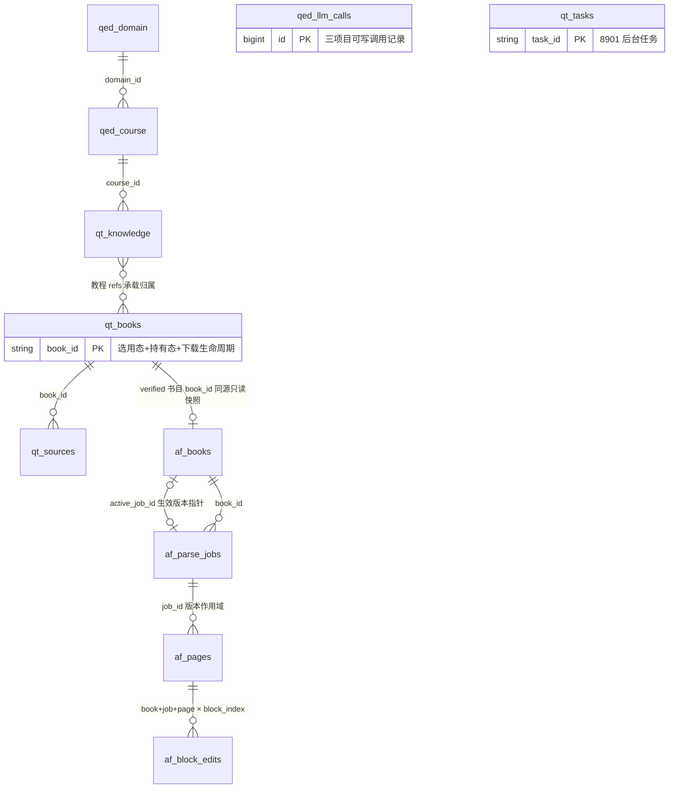

# 数据库设计（共享 qed 库总纲）

设计状态：Accepted
实现状态：In Progress
最后更新：2026-10-01
需求方：QED-Tracker（课程体系 `qed_domain`/`qed_course`）、QED-Engine（LLM 调用记录 `qed_llm_calls`、学习域 `qed_learn_*`、知识点体系 `qed_knowledge_point`/`qed_learn_kp_detail`）、Axiom-Flow（解析管理 `af_*` 四表）
确认状态：已确认
关联代码：`.env.example`（`QED_DB_*` 变量模板）
关联测试：`tests/contract/test_architecture_documents.py`、`tests/test_llm_call_log.py`
关联 ADR：`docs/history/adr/v0.1/0003-shared-qed-database-independence.md`、`docs/history/adr/v0.1/0009-shared-qed-tables.md`（新增 `qed_*` 共享表族，部分补充 0003）、`docs/history/adr/v0.1/0010-documentation-versioning.md`、`docs/adr/0014-parsing-ownership-and-model-boundary.md`

> 本文件是 **QED-Engine 的固定数据库设计文档（总纲）**（ADR 0010）：只登记共享 `qed` 库的
> 命名空间隔离规则、表清单总览、关系视图、读写矩阵与跨项目契约要点；**任何表的完整
> DDL/字段结构一律不在本文件维护**（事实源唯一铁律，ADR 0017 同源），指向各所有权方
> 文档：QED-Tracker `docs/architecture/database-shared-tables.md`（`qed_*`）与
> `database-private-tables.md`（`qt_*`）为其全部表**结构**唯一事实源；Axiom-Flow
> `docs/architecture/database-design.md` 为 `af_*` 四表结构唯一事实源。
> 版本末期确认更新后，前版本进 `history/`。

## 目的与边界

本文件是根仓库对共享 MySQL `qed` 库的**登记与指引**：只维护命名空间隔离规则、表清单
总览、关系视图、读写矩阵与跨项目契约要点。**结构事实源唯一**：`qed_*`/`qt_*` 在
QED-Tracker（其 Alembic 建表维护），`af_*` 在 Axiom-Flow；根仓库不复制任何 DDL，
只登记「一行 = 什么」与消费语义（`qed_llm_calls` 例外：根仓库定义结构，DDL 仍不落地
本文件，见该表小节）。exploration_stage 的**写权限与降级口径**是根侧消费语义，事实源在
[downloads-flow.md](../design/downloads-flow.md) §5.2/§5.4（终态写点矩阵），本文件不重复。
跨项目对接语义见[三项目协同与对接契约](../design/cross-project-contracts.md)。

**数据边界**：dataset 只管理数据资料（原始数据 +
整理后解析产物，见 [dataset-conventions.md](../design/dataset-conventions.md)）；**元数据默认存数据库**
——登记、状态、进度、评价、课程体系、任务记录等一律入本库，`meta/` JSON 不再作为事实源
（退役，REQ-032）。

## 库与命名空间

- MySQL 8，库名 `qed`，三个项目共用同一实例与库——独立性铁律的明确例外（[ADR 0003](../history/adr/v0.1/0003-shared-qed-database-independence.md)）。
- 表命名空间隔离：QED-Tracker 使用 `qt_*` 前缀，Axiom-Flow 使用 `af_*` 前缀；互不读取对方表。
- **共享 `qed_*` 前缀表族**（[ADR 0009](../history/adr/v0.1/0009-shared-qed-tables.md) 补充 0003）：
  三项目共用的基础元数据；所有权 QED-Tracker（Alembic 建表维护），其他项目只读不写
  （降级直写例外见[downloads-flow.md](../design/downloads-flow.md) §5.2/§5.4）；
  schema 变更须先经根仓库登记（ADR 0009，变更顺序见
  [cross-project-contracts §4](../design/cross-project-contracts.md)）。`qed_llm_calls` 例外：
  三项目均可写入调用记录，表结构由根仓库迁移定义后在 QED-Tracker `shared-tables.md` 登记。
- **`qed_learn_*` 子族（根自建例外，用户裁决 2026-09-28 方案②）**：所有权 QED-Engine，由根侧
  幂等建表（建表 SQL 与补列清单在 `services/learn/base.py`，判例 `qed_llm_calls` / `call_log.py`），
  **根不引入 Alembic**；虽居 `qed_*` 命名空间但**非三项目共享**——8901/8902 不读（根对
  `qt_*`/`af_*` 仍一律走 HTTP，铁律不破）。命名避让：`qed_learn_course`（学习课程）≠
  `qed_course`（课程体系主数据，所有权 QED-Tracker，只读引用）。
- 凭据与库名唯一事实源：根 `.env` 的 `QED_DB_*` 变量（见
  [project-configuration.md](../design/project-configuration.md) 统一数据库小节）。
- 存量库现状：MySQL 面**仅业务库 `qed` 与测试库 `qed_test`**（后者隔离真实数据，保留）；
  遗留库已收敛清零（备份、还原演练与删除执行记录见
  [completed.md](../trackers/completed.md) 数据操作行，决策 [ADR 0014](../adr/0014-parsing-ownership-and-model-boundary.md)）。

## 表清单总览

| 表 | 前缀 | 一行= | 状态 | 结构事实源 |
| --- | --- | --- | --- | --- |
| `qed_domain` | 共享 | 一个学科（math；扩展预留），含 stages | QED-031，迁移 0006 已落地 | QED-Tracker database-shared-tables.md |
| `qed_course` | 共享 | 一门课程（阶段/先修 DAG/别名/顺序），取代 courses/math.json | QED-031 | QED-Tracker database-shared-tables.md |
| `qed_llm_calls` | 共享 | 一次 LLM 调用记录（prompt/回答/耗时/成败） | ARCH-016，根仓库迁移 | 结构在 QED-Tracker database-shared-tables.md 登记；字段语义见 [llm-gateway.md](../design/llm-gateway.md) |
| `qt_knowledge` | 私有 | 一套教程（tutorial）或课程延展资料归类（other_material），两态 draft→confirmed | QED-031，2026-09-03 重构 | QED-Tracker database-private-tables.md |
| `qt_books` | 私有 | 一册/一本书：选用态（candidate/decided/parallel/retired）+ 持有态（owned/missing）+ 下载生命周期（downloading/downloaded/verified/failed，QED-060） | QED-031 + QED-060 | QED-Tracker database-private-tables.md |
| `qt_sources` | 私有 | 一次渠道尝试（外键挂 book_id），ok 标达成败 | QED-031，0014 重建 | QED-Tracker database-private-tables.md |
| `qt_tasks` | 私有 | 一个后台任务记录（queued→running→succeeded/failed） | REQ-032，迁移 0016 建 | QED-Tracker database-private-tables.md |
| `af_books` | 私有 | 一册已验证书（qt_books 只读快照 + ingest/解析进度 + 生效版本指针） | **已落地**（Axiom-Flow Alembic 维护） | Axiom-Flow database-design.md |
| `af_parse_jobs` | 私有 | 一次解析任务＝一个解析版本（逐页/全本，状态与进度） | **已落地**（同上） | Axiom-Flow database-design.md |
| `af_pages` | 私有 | 一页解析状态与质量信号（按解析版本作用域） | **已落地**（同上） | Axiom-Flow database-design.md |
| `af_block_edits` | 私有 | 一次块级人工编辑（判定/备注/文字/范围，绑定解析版本） | **已落地**（同上） | Axiom-Flow database-design.md |
| `qed_learn_course` | 根自建 | 一门学习课程（引用式注册 + 坐标三引用 + 素材引用 + 编译作业态自 carry） | **契约冻结（2026-09-28）**；三表 DDL 已写（`services/learn/base.py`），**尚未在任何库执行** | 本文件「QED-Engine 学习表族」节（DDL 指针＝`services/learn/base.py`） |
| `qed_learn_unit` | 根自建 | 单元树一个节点（章节树 + 块序列合一，最深三级；confirmed/covered 人工位） | 同上 | 同上 |
| `qed_learn_unit_progress` | 根自建 | 一个单元的学习进度行（派生重算的基座，重编译不丢） | 同上 | 同上 |
| `qed_knowledge_point` | 共享 | 一个**已确认**知识点或目录节点（领域→课程→章节(outline)→知识点(point) 层级主数据；多版本叙述留 detail 表，不存掌握态） | **契约正式冻结（2026-10-01，D1~D6 批复）→ M6 层级化 v2（2026-10-03 裁决 ⑥）**：DDL 已写，由首个知识点端点请求幂等建表（判例 `qed_llm_calls`，不等 M-1 存储接入）；v1→v2 按「可删除重建」授权重设计（不做 ALTER）；生产库 DDL 属 D 类转人工，随发布批次执行 | DDL 指针＝`backend/qed_engine/services/learn/knowledge.py`；Tracker 侧 database-shared-tables.md 登记行待追认后补 |
| `qed_learn_kp_detail` | 根自建 | 一条候选叙述/版本（知识点生成待选明细池，同一知识点可多条并存；M6 起带 `parent_kp_id`/`intent`/`book_ref` 层级与用途列） | **契约正式冻结（2026-10-01）→ M6 v2 扩列（2026-10-03 裁决 ⑥，可删除重建）**（同上） | 本文件「QED-Engine 学习表族」节（DDL 指针＝`backend/qed_engine/services/learn/knowledge.py`） |
| `qed_learn_question` | 根自建 | 一道题或一张卡（抽取式题源入库的题面＋判分依据＋溯源与产出事实；`retired` 人工退役位） | **契约冻结（2026-10-03 M2 壳，三表收敛＝J1~J5 判据）**：DDL 已写，由首个练习端点请求幂等建表（判例 `qed_llm_calls`）；生产库 DDL 属 D 类转人工 | 本文件「QED-Engine 学习表族」节（DDL 指针＝`backend/qed_engine/services/learn/practice.py`） |
| `qed_learn_attempt` | 根自建 | 一次作答事实（判分结果＋`score_trend`/`resolved`/`bookmarked`＋`origin`/`review_date` 唯一键） | 同上 | 同上 |
| `qed_learn_review_task` | 根自建 | 一个间隔复习调度态（题粒度与知识点粒度双行，`target_kind`+`target_id` 唯一） | 同上 | 同上 |

> 所有权与写权限见「读写矩阵」；本表不复制列结构（事实源唯一铁律）。

## 关系视图

跨命名空间连线均为**逻辑引用**（应用层维护，不建跨命名空间外键；同命名空间内允许外键）。

- `qed_course → qed_domain`：DAG 先修关系存 `prerequisites` JSON，图中不展开。
- `af_pages.job_id='legacy'` 为根视图存量哨兵（非真实版本行）。
- 单行语义与列级关系明细以各结构事实源文档为准，本图只表达表间逻辑引用。

## 读写矩阵

R＝可读，W＝可写，–＝不直连（经对应服务 HTTP API 消费）。降级直写例外与终态写点矩阵
事实源：[downloads-flow.md](../design/downloads-flow.md) §5.2/§5.4。

| 表 | 8901 QED-Tracker | 8902 Axiom-Flow | 8900 QED-Engine |
| --- | --- | --- | --- |
| `qed_domain` | R/W（所有权，Alembic 维护） | R | R + 离线降级直写（限 description/stages/exploration_stage/explore_pending，REQ-064④） |
| `qed_course` | R/W（同上） | R | R + 离线降级直写（同上口径） |
| `qed_llm_calls` | W（local 直连自写） | W（local 直连自写） | R/W（网关统一写 + 建表维护 + 检索端点） |
| `qt_knowledge` / `qt_books` / `qt_sources` / `qt_tasks` | R/W（所有权） | – | –（经 8901 API 透传消费） |
| `af_books` / `af_parse_jobs` / `af_pages` / `af_block_edits` | – | R/W（所有权） | –（经 8902 API 透传消费；`GET /books/{book_id}/file` 只读 file_path 指向的 PDF 文件本体） |
| `qed_learn_course` / `qed_learn_unit` / `qed_learn_unit_progress` | –（不读） | –（不读） | R/W（所有权，根侧幂等建表；8903 经 8900 `/api/v1/learn/*` 消费） |
| `qed_knowledge_point` | R（**D1 批复**：结构上开三项目可写，当前无写者，8901 写入待其立项） | R（同上） | R/W（结构定义方 + 确认提升与检索端点，**当前唯一写者**） |
| `qed_learn_kp_detail` | –（不读） | –（不读） | R/W（所有权，根侧幂等建表；8903 经 8900 `/api/v1/learn/*` 消费） |
| `qed_learn_question` / `qed_learn_attempt` / `qed_learn_review_task` | –（不读） | –（不读） | R/W（所有权，根侧幂等建表；8903 经 8900 `/api/v1/learn/*` 消费） |

- 命名空间铁律：`qt_*`/`af_*` 互不读取对方表；8900 对两个私有命名空间一律走 HTTP，
  不直连数据库读写（`qed_llm_calls` 的三项目可写是唯一跨项目直写例外；`qed_learn_*` 为
  **反向例外**——居共享 `qed_*` 命名空间但仅根一侧有读写权，8901/8902 不读）。

## qed_* 共享表族要点（消费语义，非结构契约）

三项目共用的基础元数据；所有权与写权限见「读写矩阵」。列结构与 DDL 一律见
QED-Tracker `database-shared-tables.md`，本节只登记根侧消费要点。

### qed_domain（领域表）

一行 = 一个学科领域（当前仅 math，预留扩展）。关键字段语义：
`exploration_stage`（流程状态枚举）+ `explore_pending`（待确认载荷，JSON）构成领域探索
门面读模型；`classic_tracks`/`stages`/`path_results` 为课程体系与学习链路元数据。
**exploration_stage 状态枚举、各态写主体与降级直写规则：事实源
[downloads-flow.md](../design/downloads-flow.md) §5.2/§5.4**（本文件不重复状态机表）。

### qed_course（课程表）

一行 = 一门课程（`domain_id` 归属、`sort_order` DAG 拓扑序、`prerequisites` 先修数组、
`stage` 值域来自 `qed_domain.stages` 四档：基础/主干/分支/前沿）。课程探索为**单步、
单轮**：报告生成即进入待确认，确认后已完成；写主体口径同 qed_domain
（见 [downloads-flow.md](../design/downloads-flow.md) §5.4）。

### qed_llm_calls（LLM 调用记录）

三项目 LLM 调用记录单表（prompt/回答/耗时/成败），用于 prompt 与工具调用调优。所有权
QED-Engine 后端（`backend/qed_engine/services/llm/call_log.py` 幂等建表 + `ensure_comments()`
注释补齐），**三项目可写**（网关统一写 + 子项目 local 直连自写，`service` 字段标识调用方）。
表结构由根仓库迁移定义，DDL 在 QED-Tracker `database-shared-tables.md` 登记；
字段语义与调用记录消费见 [llm-gateway.md](../design/llm-gateway.md)。

### qed_learn_*（QED-Engine 学习域三表）

主链 M-1 冻结契约的表侧要点（列结构见「QED-Engine 学习表族」节指针，端点契约见
[api-contracts.md §⑥](api-contracts.md)）：

- **只引用不复制**：领域/课程坐标（`qed_domain`/`qed_course`）、书目（`qt_books`）、教程
  （`qt_knowledge`）、解析版本（`af_books`）一律存 `ref_id` + `label` 快照，应用层校验
  （素材 `kind` 闭集三值 book/af_version/knowledge）。
- **人工位不可被机器写**：`confirmed`（两级确认）与 `covered`（只能学习者勾选）——编译与
  agent 永不写 `covered`（未确认即勾选返回 409）。
- **进度派生重算非累加**：课程态与百分比读时算，结课位由主链 M-3 掌握门写入。
- 编译作业态挂课程行自 carry（一门课同时只跑一个编译），断点续编位与 `active` 版本位在单元行。

### qed_knowledge_point（知识点主数据表＝层级化：目录节点 + 细知识点）

一行 = 一个**人工确认**的知识点或目录节点（领域→课程→章节→知识点；第四张共享表，结构由根定义）。
消费要点：
坐标只存 `domain_id`/`course_id` 标量列 + label 快照（标量列是为了唯一键可建可查，JSON 列不能进
唯一键）；`node_kind` 闭集 `outline`（大知识点＝书籍目录节点）/`point`（细知识点），**所有「只数
知识点」的查询按它过滤**（星图徽标、检索列表），`type` 四分类只描述 point 行（outline 行必须 NULL）；
`parent_kp_id`+`depth`（1=章 2=节）承载层级，point 行的 `parent_kp_id=NULL` 即未归档池；
`book_ref`＝来源书（`qt_books.book_id`，版本换代不碎树），outline 行必填、point 行恒空串以保
「一课一名」；`source_ref`（JSON）只在 outline 行承载正文位置 `{kind,ref_id,page_start,page_end}`，
页序＝**PDF 页序**（印刷页码只存在于解析草稿）；`(course_id, book_ref, norm_key)` 是**普通索引**
`idx_kp_course_book_norm`（**DEFECT-011 用户裁决＝唯一键降级为普通索引**：真实教材目录里不同章的节名本就
重复——b05 实测「级数」「幂级数」「高阶导数」「积分」各出现两章，全书作用域的唯一约束承载不了），
去重口径改由**服务端显式校验**保证＝同父级下 `norm_key` 唯一（outline 整树写入同父重名 422、
point 提升同课程重名 409），跨章同名合法；生产 `qed` 库的索引变更属 D 类转人工，随发布批次执行。
`norm_key`＝全角转半角＋空白折叠＋小写。
`confirmed` 只能由人工面置位（`POST /learn/kp-details/{detail_id}/confirm` 提升、`PUT
/learn/courses/{course_ref}/outline` 目录确认写入即 1），生成管线与子项目永不写 1；
多版本叙述与分栏内容留在 `qed_learn_kp_detail`，本表只存采纳结果与来源锚点（`anchors`）。
两表按 M6 裁决 ⑥ **可删除重建**（无数据搬迁、不做 ALTER）。
结构由根侧幂等建表维护（所有权例外判例＝`qed_llm_calls` 与 `qed_learn_*`，**D6 批复＝不新立 ADR**，
以本节登记成文为准）；列结构 DDL 指针＝`backend/qed_engine/services/learn/knowledge.py`；
层级化重设计（v1→v2 逐列理由）见 [M6 承载壳（已归档）](../history/plans/2026-10/2026-10-01-toc-knowledge-tree-and-learn-workbench.md)。

**命名避让（D2 批复要求显式说明）**：本表与 Tracker 私有 `qt_knowledge`**语义不同且无引用关系**——
`qt_knowledge` 是「一套教程（tutorial）或课程延展资料的归类」（见「qt_*」节），本表是「领域→课程→
知识点」三层体系的**知识点主数据**；两者分属 `qed_*` 与 `qt_*` 命名空间，8901/8902 不读本表，
教程归类也不因本表存在而改名。

## qt_*（QED-Tracker，私有）

QED-Tracker 定义自身完整数据库定义（`docs/architecture/database-private-tables.md`（qt_*）与
`database-shared-tables.md`（qed_*）为其结构唯一事实源）。根仓库总纲不复制其结构。四张在用表：

- `qt_knowledge`：一套教程（tutorial）或课程延展资料归类（other_material），两态
  draft→confirmed（废弃由 notes 承载）。
- `qt_books`：域级书库，选用态 + 持有态 + 下载生命周期（QED-060）；
  承载补书优先级，下载执行留痕由 qt_sources 承载。
- `qt_sources`：一次渠道尝试（外键挂 book_id），ok 标达成败。
- `qt_tasks`：一个后台任务记录（queued→running→succeeded/failed），替代 `meta/tasks/` JSON 文件。

## af_*（Axiom-Flow，私有）

Axiom-Flow 侧表结构由 Axiom-Flow `docs/architecture/database-design.md` 定义；根仓库只维护
命名空间与敏感字段规则，不复制其结构。`af_*` 为四表：

- `af_books`：一册已验证书（qt_books 只读快照 + sha256/ingest_status/parse_status/
  pages_done + `active_job_id` 生效解析版本指针）。
- `af_parse_jobs`：一次解析任务＝一个解析版本（job_id/book_id/pages/engine/status/progress/
  failed_pages/error/source_sha256/page_count/时间戳）。
- `af_pages`：一个解析版本一页的解析状态（book_id+job_id+page_no PK；status/source/
  quality/error/parsed_at；`job_id='legacy'` 为根视图存量哨兵）。
- `af_block_edits`：一次块级人工编辑，绑定其所属解析版本（book_id+job_id+page_no/
  block_index 唯一；verdict/note/corrected_text/corrected_bbox/时间戳）。

完整 DDL 与字段语义以 Axiom-Flow `docs/architecture/database-design.md` 为唯一事实源
（根侧 DDL 快照已按 ADR 0017 删除）；四表由 Axiom-Flow Alembic 独立建表与维护。
全链路语义与根侧消费要点见[文档解析管理·全链路设计](../design/parsing-flow.md) §2。

## QED-Engine 学习表族（`qed_learn_*`，根自建，2026-09-28 裁决方案②）

原「规划，暂缓」节收口：归属与形态经用户裁决（2026-09-28）定为**方案②根仓库自建**——新前缀
`qed_learn_*`、所有权 QED-Engine、落共享 `qed` 库、根侧幂等建表（不引入根 Alembic，候选方案①
委托 QED-Tracker 托管建表与方案「backend/ 引入 Alembic」均不采用）。

表分工（**收缩原则＝公共表已有的不重复**，初稿六表→三表；M5 增知识点候选明细池为第四张）：

| 表 | 一行= | 承载 |
| --- | --- | --- |
| `qed_learn_course` | 一门学习课程 | 注册信息 + 坐标三引用 + 素材引用列表 + 编译作业态自 carry + 双通道（instructions/agent_notes 限长）；课程态与进度**不落列**（读时派生） |
| `qed_learn_unit` | 单元树一个节点 | 章节树与块序列**合一**（`level` ∈ section/unit，最深三级），块类型闭集、`payload`（只存内容定义不含判分）、`source_ref` 溯源、`gen_status` 断点位、`active` 版本位、`confirmed`/`covered` 人工位 |
| `qed_learn_unit_progress` | 一个单元的进度行 | 派生重算的基座；与 unit 分表是为了重编译换代不丢学习记录（M-3 掌握门行计划并入本表扩列，届时无需第四张表） |
| `qed_learn_kp_detail` | 一条候选叙述/版本 | 知识点**生成待选明细池**（同一知识点多条并存）：`norm_key`、`narrative`（叙述正文）、`payload`（分栏内容不含判分）、`anchors`、`gen_batch`+`map_seed`（版本组与确定性种子）、`gen_status` 闭集 draft/candidate/adopted/rejected、`dedup_of`（合并指针）、`confirmed`（人工位，置位才提升到 `qed_knowledge_point`）；M6 增 `parent_kp_id`（所属目录节点＝右栏「本章候选」过滤）、`intent` 闭集 summary/explanation（批注用途，与 `type` 四分类正交）、`book_ref`（批注来源书） |
| `qed_learn_question` | 一道题/一张卡 | 题面（`stem`/`stem_hash` 去重键）+ 判分依据（`options`/`expected_answer`/`keywords`/`explanation`，只在作答响应回传）+ 形态与题型闭集（`kind`=quiz/flashcard、`question_type`=choice/short/open）+ 题源溯源（`source_kind`/`book_ref`/`source_ref`/`answer_source` 六态）+ 产出事实（`gen_batch`/`model_ref`，人工面不可改）+ `kp_id`/`kp_type`（调度序列与优先级快照，R-6）+ `meta`（杂项只读不筛，J1）+ `retired`（人工退役位） |
| `qed_learn_attempt` | 一次作答 | 作答事实与判分结果（`user_answer`/`is_correct`/`method`/`judge_note`）+ 错题本人工位（`resolved`/`bookmarked`）+ 趋势 `score_trend` + 幂等唯一键 `(question_id,review_date,origin)`（新题 `review_date` NULL 可重复练） |
| `qed_learn_review_task` | 一个调度态 | 间隔复习双粒度持久态（`target_kind`=question/kp + `target_id` 唯一）：`interval_index`/`consecutive_correct`/`consecutive_wrong`/`due_at`/`status`；优先级**不落列**（错题 1 由最近未解决作答读时派生，J5） |

- 结构事实源：`backend/qed_engine/services/learn/base.py`（`CREATE_TABLE_SQL` 三块 DDL +
  `ensure_tables()` 幂等建表 + 补列清单，判例 `qed_llm_calls` / `call_log.py`）。
  **当前状态＝DDL 已写、尚未在任何库执行**（生产存储类随主链 M-2 接入，学习域端点在此之前返回 503；M5 两表状态见下条）。
- M5 知识点两表（`qed_knowledge_point` 共享 + 本族 `qed_learn_kp_detail`）：DDL 指针＝
  `backend/qed_engine/services/learn/knowledge.py`，由**首个知识点端点请求**懒建表挂载（判例
  `qed_llm_calls`，启动路径不触碰 MySQL）；**demo 已在 qed_test 库落地（2026-09-30）**，与本节
  learn 三表「尚未执行」的状态分列。语义与裁决登记＝[M5 壳](../history/plans/2026-10/2026-09-30-knowledge-point-star-map.md)。
- M2 练习三表（本族 `qed_learn_question` / `qed_learn_attempt` / `qed_learn_review_task`）：DDL 指针＝
  `backend/qed_engine/services/learn/practice.py`（`CREATE_TABLE_SQL` 三块 + `ensure_tables()` 幂等建表），
  由**首个练习端点请求**懒建表挂载（判例 `qed_llm_calls`，启动路径不触碰 MySQL）；错题本不是表（J5 读时派生），
  通用作业表 `qed_learn_job` 按「表能少最好」裁决取消（v2 出题作业再立）。语义与裁决登记＝
  [M2 壳](../history/plans/2026-10/2026-09-23-practice-review.md)。

- 消费面契约（32 端点与错误码）：[api-contracts.md §⑥ 学习域](api-contracts.md)；
  设计过程与裁决登记：[学习设计轮主链壳](../plans/2026-09-22-learning-design-mainline.md)。

## 迁移

- `qed` 库由各项目 Alembic **独立初始化**自己的表，互不影响；`qed_*` 共享表由 QED-Tracker
  Alembic 建表与维护（`qed_llm_calls` 结构由根仓库迁移定义后登记，所有权仍 QED-Tracker）。
- 新增表或共享字段变化：先更新本文件与对应契约，再实现迁移；
  **qed_* schema 变更顺序**（所有权方迁移先行 + 按契约演进流程通知消费方）见
  [cross-project-contracts §4](../design/cross-project-contracts.md) 与
  §10 契约演进规则，本文件不复制流程正文。

## 敏感字段规则

- `QED_DB_PASSWORD` 绝不下发到任何接口响应、日志或异常信息。
- 配置中心 `/config/database` 只返回 host/port/name/user/configured/reachable/reason；
  `reachable` 为启动时真实连接探测快照（pymysql 认证，3s 超时），未配置密码不探测
  （契约见 [api-contracts.md](api-contracts.md)）。

## 变量来源

`QED_DB_HOST`/`QED_DB_PORT`/`QED_DB_NAME`/`QED_DB_USER`/`QED_DB_PASSWORD` 的默认值与说明
以 [project-configuration.md](../design/project-configuration.md) 变量表为唯一事实源，
本文件不复制。

## 验证

- `pytest tests/contract -q` 全绿。
- 8900 `/config/database` 实测返回真实连接状态（`reachable`/`reason`），响应不含密码。
- 本文件零建表语句（事实源唯一铁律自证，由 `tests/contract/test_architecture_documents.py` 守护）。
- 子项目数据库冒烟以其各自仓库为准（QED_DB_SMOKE 等）。

## 决策依据

本文档的命名空间/共享表族/数据边界决策承载于
[ADR 0003](../history/adr/v0.1/0003-shared-qed-database-independence.md)、
[ADR 0009](../history/adr/v0.1/0009-shared-qed-tables.md)、
[ADR 0010](../history/adr/v0.1/0010-documentation-versioning.md)、
[ADR 0014](../adr/0014-parsing-ownership-and-model-boundary.md)；
历史备选方案（旧 database-schema.md 三件套替代、meta/ JSON 退役过程）见各 ADR 与
`docs/history/` 计划壳，本文件不保留裁决流水。
