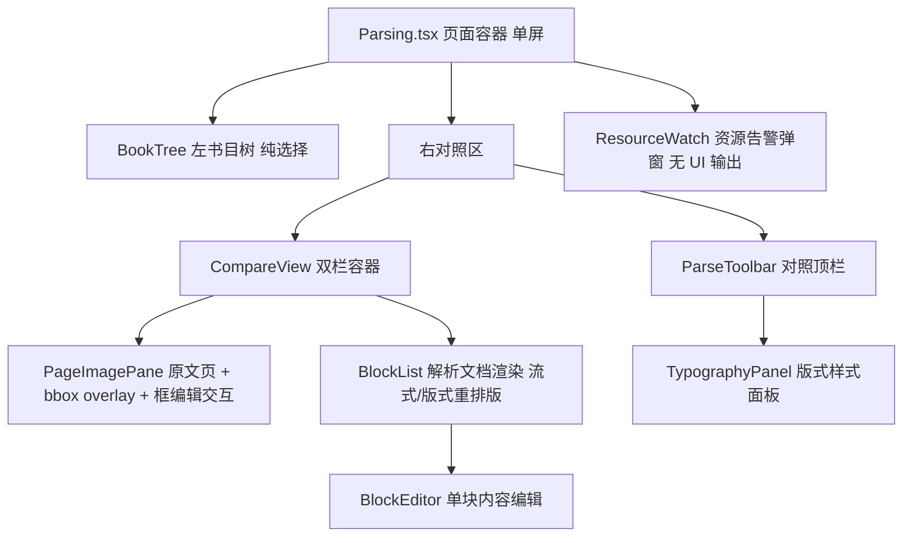

# 文档解析管理 UI 设计（parsing-ui）

设计状态：Accepted
实现状态：In Progress
最后更新：2026-09-28
确认状态：已确认
关联代码：`web-ui/src/pages/Parsing.tsx`、`web-ui/src/stores/parsing.ts`、`web-ui/src/api/axiom.ts`、
`web-ui/src/components/parsing/`（BookTree/ParseToolbar/CompareView/PageImagePane/BlockList/BlockEditor/
TypographyPanel/ResourceWatch/blocks.ts/typography.ts/regions.ts）
关联测试：`web-ui/src/pages/Parsing.test.tsx`、`web-ui/src/components/parsing/typography.test.ts`、
`web-ui/src/components/parsing/regions.test.ts`、`web-ui/src/components/parsing/ResourceWatch.test.tsx`、
`web-ui/src/components/parsing/ParseToolbar.test.tsx`（§8 四行与动作三态/确认弹窗）、
`web-ui/src/components/parsing/PageImagePane.test.tsx`（§10 框编辑交互与右键菜单）、
`tests/contract/test_design_documents.py`（本文件入 CURRENT_DOCUMENTS）
关联 ADR：[ADR 0014](../../adr/0014-parsing-ownership-and-model-boundary.md)（解析能力归属与模型边界）、[ADR 0007](../../history/adr/v0.1/0007-qed-engine-backend-gateway.md)（前端唯一入口 8900）、[ADR 0017](../../adr/0017-design-doc-structure-contract.md)（本文档结构契约与事实源唯一铁律）
关联设计：[frontend-architecture.md](../../architecture/frontend-architecture.md)（8903 信息架构与视觉规范）、
[downloads-ui.md](downloads-ui.md)（左树与状态点风格参照）、
[local-model-management.md](../local-model-management.md)（模型生命周期操作面）、
[parsing-flow.md](../parsing-flow.md)（后端全链路设计）
关联计划：界面形态演进经 git 历史与 `history/plans/2026-09/` 各计划壳追溯；
编辑模式框图与版式重排版由 [REQ-098 壳](../../history/plans/2026-09/2026-09-26-req098-parsing-region-edit-typography.md)
设计与实施（§4.6 顶栏四行重排与编辑两口径；关闭后归档 `history/plans/2026-09/`）

## 1. 定位与目标

本文档是「文档解析管理页」（`#/admin/parsing`）的 **UI 设计事实源**：信息架构、组件
拆分、状态模型、对照交互、bbox 联动、编辑与资源告警的用户可见表现。它回答的是
「用户在这页如何选书、入库、发起解析、对照阅读并逐块判定修正」。

- **目标**：单屏完成「选书 → 书页入库 → 解析 → 原页/解析双栏对照 → 逐块判定与修正」，
  编辑模式提供**框图工作台**（页图上拉伸/移动/新增/删除/合并取字框）与**版式重排版**
  （中文字体排印的成品化阅读面）；交互现场即可感知资源与模型服务风险；
- **成功标准**：任一页面状态（未入库/已入库未解析/已解析/任务在飞/依赖离线/显存爆表）
  均有且只有一种明确的用户可见表现；对照与编辑操作不依赖后端内部结构，后端全链路
  演进（版本布局等）界面契约不变。

## 2. 范围与非目标

本档**不**维护以下内容，逐条给出唯一事实源指针（[ADR 0017](../../adr/0017-design-doc-structure-contract.md) 事实源唯一铁律：UI 文档只写消费语义，不复制端点形状与数据契约）：

| 内容 | 唯一事实源 |
| --- | --- |
| 后端全链路职责、任务状态机、版本激活与续跑规则 | [parsing-flow.md](../parsing-flow.md) |
| 端点路径与请求/响应形状（本档 §6 只登记消费要点） | [api-contracts.md](../../architecture/api-contracts.md) §④ |
| `af_*` 表结构与 `parsed/` 产物布局 | [parsing-flow.md](../parsing-flow.md) §2 指针表所列事实源 |
| blocks 产物 schema 与字段语义 | [parsing-flow.md](../parsing-flow.md) §6 |
| 模型启停/探针/槽位生命周期设计 | [local-model-management.md](../local-model-management.md) |
| 8903 全局信息架构与视觉基线 | [frontend-architecture.md](../../architecture/frontend-architecture.md) |

## 3. 信息架构与路由（单屏：左树 + 右对照）

- 路由 `#/admin/parsing`（AdminLayout 嵌套，菜单项「文档解析管理」）；
- **一屏完成**：`Row`＝左 **书目树 lg=5**（§7，纯选择）＋ 右 **对照区 lg=19**（§8 顶栏 + §9 双栏）；
  点树中书名 → 右侧直接切到该书对照，**无列表态/工作台态切换**；
  URL hash 携带 `?book=<id>&page=<n>`，刷新/书签恢复；
- 页面容器：`Layout.Content`（`padding 24`、`maxWidth 2400`、`width 98%`、居中）
  + 顶部标题行（标题「文档解析管理」＋「刷新」（含同步书目））；
- **尺寸口径（无缩放控件）**：左右各占对照区半幅。**左原文页**容器宽＝宿主栏宽 100%，高由
  `aspect-ratio` 按页图**自然尺寸**推（未载入前按 A4 794×1123 比例回退），页图不被拉伸变形；
  **右解析纸面**维持 A4「Word 100%」基准宽 794px（@96dpi，`minHeight` 1123px），栏窄于纸面时
  出横向滚动条看全页；
- **原始文件优先**：未解析页隐藏解析模块、页图/PDF 直显（§9 态分流）。

## 4. 组件树与职责



| 文件 | 职责 |
| --- | --- |
| `web-ui/src/pages/Parsing.tsx` | 页面容器：单屏布局（左树 + 右对照）、URL hash 同步、全局横幅（8900 错误 / 8902 降级 / 同步结果） |
| `web-ui/src/components/parsing/BookTree.tsx` | 左书目树：领域→课程→书三级（数据源 `/parsing/tree`），**纯选择**，无状态徽标/筛选 |
| `web-ui/src/components/parsing/ParseToolbar.tsx` | 对照顶栏（**四行**，§8）：行1 书名独行｜行2 解析动作族（三态文案 + 全动作确认弹窗）+ 任务进度 + 页码导航｜行3 编辑模式开关 / 滚动模式 / 滚动同步 / 渲染模式（+ 版式样式面板）｜行4 编辑口径（框图修改｜解析修正）动作与审阅统计（**无 engine 选择**） |
| `web-ui/src/components/parsing/CompareView.tsx` | 双栏容器：态分流（§9）、单页模式 / 连续滚动模式、滚动同步 |
| `web-ui/src/components/parsing/PageImagePane.tsx` | 原文页 + bbox overlay（hover/选中联动）+ **框编辑交互**：8 手柄拉伸、框体移动（落 `corrected_bbox`）、画框模式下空白拖拽画新框、Ctrl/Shift 多选、**框右键菜单**（修改/删除/恢复，§10） |
| `web-ui/src/components/parsing/BlockList.tsx` | 解析文档渲染：**流式**（按块顺序，可读性优先）/ **版式=重排版**（§9 版式重排版规格，非原页复刻）+ 选中联动；KaTeX/Markdown/表格 |
| `web-ui/src/components/parsing/BlockEditor.tsx` | 单块**内容**编辑：文字替换（公式为 LaTeX 源码）+ 判定/备注 Popover（框几何修改归左栏框编辑，弹层不含 bbox 数值输入） |
| `web-ui/src/components/parsing/TypographyPanel.tsx` | 版式样式面板：正文字体（宋/黑/楷）+ 正文字号（五号～一号阶梯）+「显示页眉页脚/页码」开关；偏好存 localStorage |
| `web-ui/src/components/parsing/ResourceWatch.tsx` | 资源告警弹窗（§12）：10s 轮询 `/monitor/gpu` + `/models/vision`，显存 ≥95% 与模型服务中断各一路 notification（中断发界见 §12），无自身界面 |
| `web-ui/src/components/parsing/blocks.ts` | 块渲染工具（`tryRenderKatex`/`renderInlineMath`/`blockText`/`TYPE_LABELS`/`effectiveBbox`） |
| `web-ui/src/components/parsing/typography.ts` | 版式排印纯函数：字号阶梯、标题级差推导、字体角色映射、目录启发式识别、pt↔px 换算 |
| `web-ui/src/components/parsing/regions.ts` | 框图几何纯函数：resize 位移、坐标换算、夹紧、并集、阅读序文本拼接 |
| `web-ui/src/stores/parsing.ts` | 树/选中书/页/任务/编辑状态与动作 + 框图编辑态（口径、多选、本地删/合/新框）+ 版式偏好 |
| `web-ui/src/api/axiom.ts` | 8900 适配端点封装与类型 |

块渲染与判定为两套独立能力：渲染在 `BlockList`（+`blocks.ts`/`typography.ts`），判定/内容编辑在 `BlockEditor`；框图几何编辑在 `PageImagePane`（+`regions.ts`）。

## 5. 状态模型（stores/parsing.ts）

```ts
interface ParsingStore {
  // 书目树（数据源 /parsing/tree：领域→课程→书，纯选择）
  tree: ParsingTreeNode[];
  treeLoading: boolean;
  treeError: string | null;
  treeSources: ParsingTreeSources | null;  // /parsing/tree 信封 sources（DEFECT-015 S3）
  // 书目元数据（GET /books，用于选中书的 ingest/parse/file_path/page_count）
  books: BookMeta[];
  booksLoading: boolean;
  // 全局降级
  error: string | null;        // 8900 不可达
  dataError: string | null;    // 8902 离线（503）
  syncMessage: string | null;
  syncError: string | null;
  // 对照区选中
  compareBookId: string | null;
  comparePageNo: number;
  compareBook: BookMeta | null;
  pages: Record<number, PageEntry>;  // 页数据缓存（连续滚动窗口）
  selectedBlock: number;       // -1 无选中（两口径共享联动选中）
  hoveredBlock: number;        // -1 无 hover
  editMode: boolean;           // 只读 / 编辑
  editPane: 'box' | 'content'; // 编辑口径：box=框图修改，content=解析修正（§8 行4）
  boxSelection: number[];      // 框图口径多选（合并对象，Ctrl/Shift 点框）
  drawMode: boolean;           // 画框模式（顶栏「新增」开关）：开启后空白拖拽画新框
  regionDraft: {               // 框图本地预览态（删/合/新框；落库禁用，REQ-099 R2 承接后接通）
    added: BBox[];             // 新画框（原页图像素坐标）
    deleted: number[];         // 待删块索引（右键「删除」）
    merged: number[][];        // 待合并组（并集框预览）
  };
  viewMode: 'compare' | 'original' | 'parsed';
  scrollMode: 'single' | 'continuous';
  renderMode: 'stream' | 'layout';  // 版式=重排版（§9.1，非原页复刻）
  syncScroll: boolean;
  typography: TypographyPrefs; // 版式偏好（正文字体/字号级/页眉页脚；localStorage 持久）
  // 解析任务
  activeJob: ParseJob | null;
  jobError: string | null;
  ingestBusy: Record<string, boolean>;
  edits: Record<string, BlockEdit>;   // editKey(bookId,pageNo,index)
  editSubmitting: boolean;
  engine: string;              // 固定默认（UI 不暴露选择）
  // 动作
  fetchTree: () => Promise<void>;
  fetchBooks: (sync?: boolean) => Promise<void>;  // 刷新按钮：sync=true 先 POST /books/sync
  openWorkbench: (bookId: string, pageNo?: number) => Promise<void>; // 点树选书（含未 ingest 态分流）
  loadPage: (pageNo: number) => Promise<void>;
  ensurePage: (pageNo: number) => Promise<void>;   // 连续滚动窗口预取
  gotoPage: (delta: number) => void;
  selectBlock: (index: number) => void;
  setEditMode: (on: boolean) => void;
  setEditPane: (pane: 'box' | 'content') => void;
  toggleBoxSelect: (index: number) => void;   // Ctrl/Shift 多选
  setDrawMode: (on: boolean) => void;         // 画框模式开关（顶栏「新增」）
  addRegionDraft / deleteRegion / restoreDeletedRegion / mergeSelectedBlocks / resetRegionDraft;  // 框图本地预览动作（右键删/改、合并、清空）
  confirmPageBlocks: (blockCount: number, skipIndex: number) => Promise<{ confirmed: number; skipped: number }>;  // 整页确认：逐块写 verdict=ok
  setTypography: (patch: Partial<TypographyPrefs>) => void;  // 版式偏好（写 localStorage）
  setViewMode / setScrollMode / setRenderMode / setSyncScroll / setEngine;
  submitEdit: (blockIndex: number, input: BlockEditInput) => Promise<boolean>;
  ingestBook: (bookId: string) => Promise<void>;
  createParseJob: (pages?: number[]) => Promise<void>;  // 本页 [n] / 全本 undefined / 失败页 [..]
  clearCompare: () => void;
}
```

规则：

- 树中点选书即 `openWorkbench(bookId, pageNo)`，无视图态分支；
- 「刷新」按钮 = `fetchBooks(true)`（`POST /books/sync` → 重拉 `GET /books` → `fetchTree()`）：
  同步失败不阻塞查看（`syncError` 提示）；
- `openWorkbench`：`GET /books/{id}` 判 `ingest_status`，未 ingest 走 §9 分流
  （iframe PDF 直显 + 顶栏「书页入库」按钮）；
- `loadPage` 并发保护；404 = 未解析（非错误）；切页/切书清空 `selectedBlock` 并作废
  任务轮询令牌；
- **防重复建任务（三重闸门）**：`jobSubmitting`（POST 在途禁用「解析本页/全本」，与书页入库
  `ingestBusy` 同口径）+ store 内非终态 `activeJob` 直接拒绝再次提交 + **重开工作台恢复**：
  `openWorkbench` 经 `GET /parse-jobs?book_id=&status=queued&status=running` 查服务端在飞任务，
  有则回填 `activeJob` 并续轮询（列表端点不可用时保守降级为不回填）；
- 运行中任务轮询 `GET /parse-jobs/{id}`，终态自动刷新当前书 + 当前页（进度回显于顶栏）；
- 编辑提交后以响应合并回 `edits`（不整页重拉），保证回显；
- **解析动作全量前置确认**：行2 四个动作（书页入库/重新、解析本页/重新、全本族）一律走
  `modal.confirm`，正文写明覆盖范围与风险，取消不产生任何请求；
- **编辑口径（`editPane`）只切交互面**：`框图修改`/`解析修正` 两口径共享 `selectedBlock` 与左右栏
  双向联动；口径=框图修改时拉伸/移动即时落 `corrected_bbox`，删除/合并/画新框**只进 `regionDraft`
  本地预览**（§10 右键菜单与画框模式），落库待 REQ-099 R1/R2（§12 降级行）；切出框图口径时
  `drawMode` 自动关闭；
- 口径=解析修正时 `BlockEditor` **只修改内容**（文字/LaTeX/判定/备注），不含 bbox 数值输入
  （框几何修改归框图修改口径）；**「确认」不新增状态**——单块与整页确认均复用 `verdict=ok`，
  且提交前合并该块既有 `corrected_text`/`note`/`corrected_bbox`（`PUT …/edit` 整条替换）；
- 版式偏好 `typography` 初始化读 localStorage、变更即写回；只作用于版式（重排版）渲染，
  流式模式不受影响；切书切页不清空。
- `compareBookId/comparePageNo` 双向同步 URL hash（`?book&page`），支持刷新恢复。

## 6. 数据契约（消费要点）

端点路径与请求/响应形状以 [api-contracts.md](../../architecture/api-contracts.md) §④ 为
唯一事实源（本档不复制维护）；下表只登记 UI 消费口径——动作、判据与节奏。

| UI 动作 | 端点 | 消费要点（判据 / 节奏 / 超时） |
| --- | --- | --- |
| 书目元数据 / 打开书目 | `GET /books`、`GET /books/{id}` | `ingest_status`/`parse_status`/`pages_done`/`page_count`/`file_path` 是 ingest 与解析按钮态判据 |
| 同步书目（顶部「刷新」） | `POST /books/sync` | 成功后重拉 `GET /books` + 树；失败不阻塞查看 |
| 书目树数据 | `GET /parsing/tree` | 信封 `{nodes, sources}`：`sources.axiom_flow=offline` → 仅领域→课程、`sources.shared_tables=empty` → 全空，两种空态分话术（§12 降级行） |
| 书页入库（ingest） | `POST /books/{id}/ingest` | 页图渲染分钟级 → 请求超时 8903/8900→8902 均 300s |
| 载入页 / 原页图 | `GET /books/{id}/pages/{no}`（+ `/image`） | 404=未解析（非错误）；页图经 8900 代理，浏览器只连 8900 |
| 解析本页/全本/失败页 | `POST /parse-jobs` | 单页 `pages:[n]`、全本省略；提交期探活失败 503 **不建任务**（§12） |
| 轮询任务 / 重开恢复在飞 | `GET /parse-jobs/{id}`、`GET /parse-jobs?status=…` | 受理后轮询进度；重开工作台按在飞状态回填续轮询（§5 三重闸门） |
| 保存编辑 / 页内编辑列表 | `PUT …/blocks/{index}/edit`、`GET …/edits` | 提交后以响应合并回显；edits 列表用于独立刷新编辑态 |
| 显存水位 / 模型健康（告警） | `GET /monitor/gpu`、`GET /models/vision` | ResourceWatch 10s 轮询（§12 两行判据） |

- 类型封装收在 `api/axiom.ts`（`syncBooks`/`getParsingTree`/`getBook`/`ingestBook`/
  `getBookPage`/`putBlockEdit`/`getPageEdits`/`createParseJob`/`getParseJob`/`listParseJobs`；
  ResourceWatch 复用控制域既有封装 `monitorGpu`（`api/services.ts`）与 `getSlotStatus`（`api/llm.ts`））；
- UI 依赖的跨层口径（正文事实源见指针）：任务对象主键字段名为 `id`；块编辑判定三态
  `''/ok/bad`；空白页分显判据 `quality.blank_page`（[parsing-flow.md](../parsing-flow.md) §6）；
- 8900 侧另有 `/review` 兼容门面（内部转 `/edit`），仅存量兼容，本设计消费面一律 `/edit`。

## 7. 左侧栏：书目树（BookTree，纯选择）

- 三级折叠树：**领域 → 课程 → 书目**，数据源 `GET /parsing/tree`（8902 离线时仅领域→课程，
  黄色降级横幅 + 树空态）；树空态话术按信封 `sources` 分流（`web-ui/src/components/parsing/treeEmptyHint.ts`，
  「共享表登记为空」与「8902 离线」两种同形空态自此可区分，DEFECT-015 S3）；
- **只做选择**：点书名片段 → `openWorkbench(book_id)`，右侧对照区切换；当前选中书高亮；
  无状态 Tag、无进度徽标、无筛选行、无搜索框（侧栏保持干净）；
- 树样式沿用 `downloads.css` 的 `dl-tree-*` 类（与文档下载管理左树同风格）；
- **书节点展示名**（`parsingBookLabel`，顶栏 §8 同用）：`display_title` 非空直用（其契约= title + part），
  否则 `title + ' ' + part` 空格连接——保证「微积分学教程 Vol.1/2/3」「数分习题课讲义 上/下册」等
  同名多卷可区分（口径同下载管理 `bookDisplayName`）；
- 默认展开：第一个领域 + 其下所有课程；
- 「刷新」（含同步书目）按钮放在**页面顶部标题行**（不属于树本体）。

## 8. 对照区顶栏（ParseToolbar）

选中书后常驻，**四行**布局（行4 仅编辑模式出现；**无 engine/模型选择**——引擎固定服务端默认）：

| 行 | 内容（左→右） |
| --- | --- |
| 1 | 书名（§7 `parsingBookLabel` 口径，带卷标识）独行 |
| 2 | 解析动作族（书页入库／解析本页／全本族，**均先弹窗确认**）｜在飞任务进度 `parsed/total` 与错误文本｜页码导航（尾部靠右） |
| 3 | 编辑模式开关｜滚动模式（`单页`／`连续`）｜滚动同步｜渲染模式（`流式`／`版式`，版式态带「排版」）——**无缩放控件**（页图与纸面尺寸口径见 §3） |
| 4 | 编辑口径 Segmented（`框图修改`｜`解析修正`）＋该口径动作＋审阅统计「已判定 x / 共 y 块」（当前页） |

**动作三态文案与确认弹窗**（`modal.confirm`，所有解析动作先确认后提交）：

| 动作 | 文案判据 | 弹窗正文口径 |
| --- | --- | --- |
| 书页入库／重新书页入库 | `ingest_status=ingested` → 重新 | 未入库＝逐页渲染书页图并登记页数（不调模型）；已入库＝重渲染并覆盖全部页图，已解析页的页图与块 bbox 基准可能错位 |
| 解析本页／重新解析本页 | 当前页已解析 → 重新 | 未解析＝识别第 n 页并生成块；已解析＝覆盖第 n 页现有解析结果 |
| 全本族 | `pages_done=0` → 「全本解析」；`0<pages_done<page_count` → 「解析全部未完成页」＋「重新全部解析」；`pages_done=page_count` → 「重新全部解析」 | 全本＝解析全部 N 页并生成解析产物；重新全部＝覆盖全部 N 页现有解析结果并生成新版本 |

- 「解析全部未完成页」在 REQ-099 **R6 承接前禁用** + tooltip（响应面只有 `pages_done` 计数，
  无未完成页清单 / `skip_parsed`，见 §12）；
- **页码导航**：输入框「n / 总页数」（数字 + Enter 跳页）＋上一页/下一页按钮；键盘 `←`/`→` 翻页
  （编辑弹层打开时禁用）；连续滚动模式下页码随视口联动显示；
- 提交后轮询 `GET /parse-jobs/{id}` 显示进度条，完成自动刷新当前页；运行中禁用重复提交
  （`jobSubmitting` 在飞闸门）；失败显示错误文本；
- **滚动同步** Switch 仅单页模式可用（连续模式整体一个滚动面）；
- **渲染模式** `版式` 时行内出现「排版」按钮，打开**版式样式面板**（TypographyPanel：正文字体
  宋/黑/楷、正文字号 五号～一号、显示页眉页脚开关；偏好即时持久，面板仅这三项控制）；
- **视图恒为对照**：无「仅原文/仅解析」切换——未解析页由 §9 态分流天然只显示书页图。

**行4 编辑口径动作**：

- `框图修改`：「新增」= **画框模式**开关（开启后页图空白处拖拽画新框，进 `regionDraft.added`
  本地预览；按钮 primary 表开关态）；「合并」多选 ≥2 才可用（并集 bbox 预览）；草稿非空时出
  「清空草稿」+ 降级说明文字（结构操作落库待 REQ-099 R1/R2）；**删除与修改走框右键菜单**（§10），
  故操作条只有这两个动作按钮；拉伸/移动即时落 `corrected_bbox`，不受承接进度限制；
- `解析修正`：「整页确认」＝确认后本页各块逐个写 `verdict=ok`（已 `ok` 块静默跳过，当前选中块
  跳过并计入回执 toast）；单块确认按钮在右栏各未 `ok` 块上（§9）；
- 口径切换回 `框图修改` 以外的口径时画框模式自动关闭（`editPane` 变更清 `drawMode`）。

## 9. 双栏对照区（CompareView）

态分流（**原始文件优先**；`pageParsed` = 页数据 200 且含 blocks；页图一律 URL 直构、
**不依赖页数据请求成功**）：

1. **已解析页** → 双栏对照：左原文页 + 右解析文档（各占半幅 A4 纸面）；
2. **已 ingest 未解析页**（页数据 404）→ 左原页图占满，**解析栏隐藏**、不出误导性错误横幅；
   顶栏「解析本页/全本解析」为主操作引导；
3. **未 ingest 有 `file_path`** → `iframe` 直显源 PDF（`GET /books/{id}/file`）+「书页入库」引导；
4. **无 `file_path`** → 明确空态「暂无原始文件（书目未登记 PDF 路径）」；
5. 页加载失败（非「未解析」404）：`Alert` + 重试。

**滚动模式**（§8 切换）：

- **单页模式**（默认）：当前页双栏并排，两列各自滚动，「滚动同步」开启时按容器高度比例联动；
- **连续滚动模式**：整本书页纵向流，每页一个「左原文页｜右解析文档」双栏单元（A4 纸面同宽）；
  懒加载预取当前视口 ±2 页 + 虚拟滚动（486 页量级不卡）；滚轮连续翻页，顶栏页码随视口
  所在页联动；未解析/未 ingest 页在其单元内按上述 2/3/4 态呈现。

`PageImagePane`：

- 原文页图（`GET /books/{id}/pages/{no}/image`）+ **bbox 方框叠加**（每块一框，按块类型着色）；
- hover 高亮、点击选中（与 `BlockList` **双向联动**：右栏 hover 块 → 左图高亮对应框；
  左页点击区域 → 右栏定位并选中最近块）。

`BlockList` + `BlockEditor`：

- **两种渲染模式**（顶栏切换）：**流式**=按块顺序排版（可读性优先，含换行保真，见下）；
  **版式**=**重排版**（§9.1）——**不是按原页复刻**：块按阅读序流入 A4（794px）单栏纸面，
  高度不限（长超过原页没问题），文字必须完整展示（禁止 ellipsis / overflow 截断）；
- 块级渲染复用 `blocks.ts`（heading 分级、formula KaTeX、table HTML、list、image、caption 等）；
  formula 块渲染前先经 `unwrapMathDelimiters` **剥成对数学定界符**（`$$…$$`/`\[…\]`/`$…$`）再交
  KaTeX——存量产物的 `latex` 字段可能自带引擎定界符，KaTeX 视 `$` 为解析错误、整块回退原文显示；
  剥后内部仍含同种定界符则保留原文不误剥；
- **image 块＝整页页图内联裁切**：`BlockList` 可选入参 `pageImageUrl`（该页页图
  `GET /books/{id}/pages/{no}/image`）在位、且块带合法 `bbox` 时出裁切图——容器
  `aspect-ratio = bbox 宽/高` + `overflow: hidden`，内层图按「页尺寸 / bbox 尺寸」百分比定位
  （`width = pageW/bw`、`left = −x0/bw`，纵向同理），位移与尺寸全为容器百分比故随栏宽自适应；
  `pageImageUrl` 缺位或 `bbox` 缺失/非有限值时**回退题注文字**，不出 NaN 样式。
  块级图资产（`path: pages/images/<sha>.jpg`）无 HTTP 路由（8900/8902 只暴露整页页图端点），
  故页图裁切是图片回原样的唯一现行通路；引擎侧提供块图端点后改直取（跨项目请求走 REQ-099 通道）；
- **换行保真**：块文本内含 `\n` 时流式与版式两档均以 `white-space: pre-wrap` 呈现行结构（符号表/目录等"多行进一块"的产物不折叠连排）；文本为空的块版式态不渲染；
- 点击块与左图联动选中；选中块高亮并滚动到可视区；
- **单块确认**（编辑口径=`解析修正`）：未 `verdict=ok` 的块出「确认」钮（只读态与已 `ok` 块无钮，
  流式/版式两档均有）；点击＝`PUT …/edit` 写 `verdict=ok`，并**合并该块既有
  `corrected_text`/`note`/`corrected_bbox`**（该端点整条替换，不合并会丢掉已修正字段）；
  确认钮自身拦截冒泡，不触发块选中；
- `BlockEditor`（内容口径）：**只修改内容**——文字替换（公式编辑 LaTeX 源码）+ 判定/备注
  Popover；**不含 bbox 数值输入**（框几何修改归左栏框编辑口径，用户裁决）；
- 保存：`PUT /books/{id}/pages/{no}/blocks/{index}/edit`，
  `{verdict, note, corrected_text, corrected_bbox}`；
- 回显：进入页时拉取页数据（blocks + 已合并 edits），刷新后保持；有编辑的块显示标记
  （判定 Tag + 修正角标）。

### 9.1 版式重排版规格（typography）

- **字号阶梯**（pt，px = pt × 4/3）：L0 五号 10.5｜L1 小四 12｜L2 四号 14｜L3 小三 15｜
  L4 三号 16｜L5 小二 18｜L6 二号 22｜L7 小一 24｜L8 一号 26——最小五号、最大一号（硬约束）；
- **正文**：样式面板手动选一级，默认 **L0 五号**（用户裁决）；覆盖 paragraph / list /
  table / formula（正文统一一个字号）；表格随正文级自适应纸面宽度，不横向截断；
- **标题**：按级差自动推导，不可单独设置——**大标题（一级）= 正文级 + 4，小标题（二级）= +2，
  三级及以下 = +1**，一律封顶 L8；标题恒大于正文；
- **字体角色**（中英文混排：西文一律 Times New Roman 前置）：正文**宋体**
  （`'Times New Roman', SimSun`）、标题**黑体**（`'Times New Roman', SimHei`）、
  目录/题注**楷体**（`'Times New Roman', KaiTi`）；样式面板「正文字体」在宋/黑/楷三档切换正文族；
- **题注（caption）**：正文同级字号、楷体；
- **节题白名单（类标题）**：单行 paragraph 去空白全文命中白名单（目录 / 目次 / Contents /
  重要符号表 / 符号表 / 前言 / 序 / 序言 / 后记 / 附录 / 索引 / 参考文献 / 致谢）即按一级
  标题排版（黑体 + 级差推导），并作为目录组/符号表组的**触发点**；白名单只做全文匹配、
  不做子串匹配（防误伤正文）；
- **目录（TOC）**：正文同级，缩进列表 + 点线引导 + 页码右对齐；识别为启发式——heading 或
  白名单类标题文本为「目录 / 目次 / Contents」起，其后连续 list/paragraph（块内多行按行拆
  条目）直至下一 heading 或组断（引擎侧 TOC 块类型落地后改为按类型识别，REQ-099 R4/R5 兜底）；
- **符号表（三列对齐）**：类标题后连续多行段落，非空行 ≥60% 命中「符号（不含空白）+ 说明 +
  行尾页码（数字/逗号/顿号/破折号）」形态时按三列表式排版——符号列自适应宽、说明列左对齐、
  页码列右对齐；个别未命中行整行进说明列（页码列空）；整块不命中回落正文 pre-wrap
  （数据侧类型修正承接后改按类型识别，REQ-099 R5）；
- **页眉/页脚/页码**（header / footer / page_number）：版式态**默认隐藏**（用户裁决），
  样式面板「显示页眉页脚」开关可恢复；
- 偏好（正文字体、正文字号级、页眉页脚开关）localStorage 持久，见 §5 规则。

## 10. bbox 规范

- **坐标系**：原页图像素坐标 `[x0, y0, x1, y1]`（左上原点），基准为 `pages/pXXXX.png`；
  overlay 用相对百分比定位（`left/top/width/height` = 坐标 / `image_size`），随图自适应缩放；
- **颜色**：按块类型固定色板（heading/paragraph/formula/table/image/…），半透明填充 + 实线边框；
  选中态加粗高亮（`#1677ff`），hover 态提升透明度；
- **框图编辑（编辑口径=框图修改，`PageImagePane` + `regions.ts`）**：选中块显示 8 手柄 + 框体可拖移；
  **拉伸/移动**：pointer 事件实时预览，松手即经 `submitEdit` 落 `corrected_bbox`（与旧数值输入
  同一条 `/edit` 链）；**位移判定按屏像素**（移动 >3px 记为拖拽、画新框 >2px），与页图渲染尺寸无关
  ——按自然像素判阈值会在页图缩小渲染时把点击抖动误判成拖拽而误落库；提交前夹紧到 `[0,0,image_size]`、最小尺寸 8px 防退化，保证 x0<x1、y0<y1；
  **画新框**：顶栏「新增」= 画框模式开关（开启后页图光标十字），空白处拖拽生成，进 `regionDraft.added`
  本地预览（半透明新框，无块编号），落库与区域驱动重解析待引擎承接（REQ-099 R1/R2）；
  **框右键菜单**：修改＝选中该框（出 8 手柄）／删除＝进 `regionDraft.deleted`（框淡出虚线）；
  已删除框右键＝恢复（撤出删除草稿）；菜单 `onClick` 必须 `domEvent.stopPropagation()`——
  antd 弹层经 React 组件树冒泡回页图容器，不阻止会触发「空白点击就近选块」而覆盖菜单动作；
  **合并**：`boxSelection` 多选（Ctrl/Shift 点框）≥2 后经顶栏「合并」触发；合并 = 并集 bbox +
  阅读序（y0 主序、x0 次序）文本拼接预览；删/合/新框均只进 `regionDraft` 本地态，持久化待承接（§12），
  草稿非空时顶栏出「清空草稿」与降级说明；
- **已解析页重解析**：口径=框图修改时「解析本页」按钮语义不变（仍 `pages:[当前页]`）；R1 承接前
  框图改动不影响解析结果，任务完成横幅提示「框图修改暂未生效」（§12）；
- **无 bbox 块**：不在图上画框（仅列表可选中），标注「无坐标」。

## 11. 视觉规范

- 配色与对比度遵循[前端架构](../../architecture/frontend-architecture.md)（蓝白主体、状态色配同色系浅底、
  字体与背景大区分、响应式栅格、theme token 统一）；
- bbox 方框按块类型固定色板，选中态加粗高亮；状态提示复用 downloads 的状态色 token；
- 左树沿用 `downloads.css` `dl-tree-*` 样式；对照两栏纸面 `overflowX auto`
  （沿用容器滚动条样式基调）。

## 12. 状态与降级矩阵

| 场景 | 判定 | 表现 |
| --- | --- | --- |
| 8900 不可达 | 请求失败（非上游 503） | 顶部错误横幅 + 「刷新」重试；树/页显示空态 |
| 8902 离线（503） | 数据域请求 503 | 黄色降级横幅；树仅显示领域→课程、对照不可用 |
| 左树空态（200 + `sources`） | `/parsing/tree` 返 `{nodes: [], sources}`（不抛 503） | 空态话术按 `sources` 分流（`treeEmptyHint`）：`shared_tables=empty` 只说「共享表暂无领域/课程登记」不提离线；`axiom_flow=offline` 只说「8902 离线，书目未加载」不提共享表；两者同时则两句话都出（DEFECT-015 S3） |
| 8901 离线 | `POST /books/sync` 503 | 同步失败提示（不阻塞查看已同步书目） |
| 未入库（ingest） | `ingest_status != ingested` | 对照区 `iframe` 直显源 PDF、解析栏隐藏（§9）；顶栏「书页入库」按钮 |
| 未解析页 | `pageParsed=false`（页数据 404 / blocks 空） | **解析栏整体隐藏**，原页图占满，无错误横幅；解析入口在顶栏 |
| 解析任务进行中 | `activeJob.status ∈ queued/running` | 顶栏进度条 + 「已判定/页数据」完成后自动刷新；禁用重复提交 |
| 解析失败 | `pageError` / `job.status=failed` | 顶栏错误提示 + 重试入口 |
| 模型服务离线 | 提交期 8902 探活失败返回 503 | **不创建任务**（前端显示提交失败提示）；受理后故障才逐页失败、job 记 failed |
| 显存 ≥95% | `/monitor/gpu` 算得占比 | 右上角常驻警告弹窗「显存占用过高（NN%）」（<90% 自动撤下并复位，防抖） |
| 模型服务中断 | `/models/vision` `health_state=down` **且属新近事故或有解析任务在飞**（发界见下「资源告警」段） | 右上角常驻错误弹窗「本地模型服务中断」+ 原因与 `last_flip`；同一事故每个浏览会话至多弹一次（按 `last_flip` 会话级记忆，重挂不重播），恢复即撤下 |
| 框结构操作落库（删/合/新框） | 8902 无块结构编辑 API（REQ-099 R2 未承接） | 操作仅在页图上本地预览呈现（右键删除/恢复、合并、画框模式）；顶栏「清空草稿」+ 降级说明「框图修改暂未生效（本地预览，落库等待引擎承接）」 |
| 「解析全部未完成页」 | 响应面只有 `pages_done` 计数，无未完成页清单 / `skip_parsed`（REQ-099 R6 未承接） | 混合态（`0<pages_done<page_count`）时按钮**禁用** + tooltip 指向 R6 承接；前端不猜测式枚举页 |
| 区域驱动重解析 | REQ-099 R1 未承接 | 「解析本页」按既有全块解析执行；任务完成结果横幅提示「框图修改暂未生效」 |
| 版式重排版 | 纯前端能力，无新增后端依赖 | 正常可用；8902 离线时对照面本身不可用（随既有降级行） |

**资源告警（ResourceWatch）**：显存爆表与模型服务被打挂会直接导致解析任务逐页失败，
须在解析作业现场即时提醒（仪表盘属被动可见面，不构成提醒）。
`components/parsing/ResourceWatch.tsx` 挂载于页面容器、无自身 UI，10s 轮询 `/monitor/gpu` +
`/models/vision`，按上表两行以 `notification` 弹窗告警（`duration: 0` 常驻、可手动关闭，
`key` 去重）；轮询失败静默（8900 不可达由顶部错误横幅承接，不重复打扰）。
中断弹窗的**发界**（BUGFIX-022）：`last_flip` 晚于本次打开页面（新近事故）、或存在进行中
解析任务（`activeJob ∈ queued/running`，含刷新恢复在飞后）才弹；两者皆否的存量 down **不弹**
且不消耗首发权（用户发起任务时仍首发提醒），常驻未启动/中断态由仪表盘·控制台中性徽章
表达。事故去重按 `槽位+last_flip` 会话级记忆（模块级 + sessionStorage），重进页/刷新不重播；
显存路（≥95% 弹 / <90% 撤）行为不变。

## 13. 已知约束与维护规则

- 端点增删与形状变化先落 [api-contracts.md](../../architecture/api-contracts.md) §④，本档
  §6 只回核消费口径（超时/轮询/判据）是否仍成立；
- 任务状态机、版本激活与续跑语义以 [parsing-flow.md](../parsing-flow.md) §4 为准，本档不
  复制状态定义；
- UI 无 engine 选择（固定服务端默认）；图上框编辑（拉伸/移动/画新框/删除/合并）与版式重排版
  已由 REQ-098 轮纳入设计（§9.1/§10），其中框删除/合并/新框落库与区域驱动重解析依赖
  REQ-099（R1/R2）引擎侧承接；版式=**重排版而非原页复刻**，字号五号～一号为硬约束。
