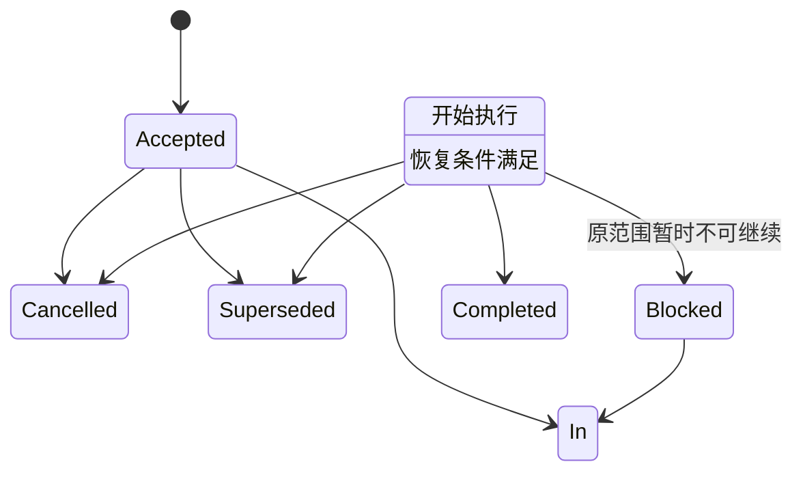
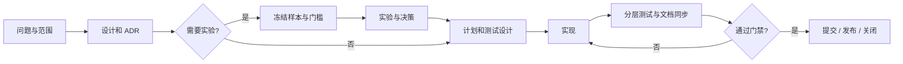

# 任务生命周期

状态：Current
最后更新：2026-09-30
确认状态：已确认
治理对象：任务分类、计划准入、tracker 状态、实施门禁与关闭交付
依据 ADR：`../history/adr/v0.1/0001-root-contract-tests.md`、`docs/adr/0020-task-closure-cadence-and-thin-registration.md`、`docs/adr/0021-round-proliferation-cap-and-per-row-doc-anchor.md`、`docs/adr/0022-task-chain-clarifications.md`、`docs/adr/0023-todo-row-carries-scope-and-criteria.md`
关联测试：`tests/contract/test_plan_governance.py`、`tests/contract/test_tracker_governance.py`

## 目的与边界

本标准规定根仓库工作何时需要计划、如何按风险分类、计划如何流转，以及任务何时可以关闭，
并是任务登记与收口细则的**唯一正文**（分工见下）。
设计契约查 `docs/design/`，决策准入查 [ADR 治理](adr-governance.md)，文档归档查
[文档治理规范](doc-governance.md)。子项目任务生命周期以各自标准为准；本标准的治理模式参照
Axiom-Flow `docs/standards/task-lifecycle.md` 并适配根仓库三仓库结构。

边界：本标准与 [doc-governance.md](doc-governance.md) 互补不重叠——本文管「任务视角」（工作
怎么分类与流转：A/B/C/D 分类、计划准入、状态机、todo 镜像、关闭交付）；doc-governance.md 管
「文档视角」（文档怎么分类与晋升：确认状态、命名、元数据、晋升路径、归档）。两者正交，不重复
维护同一规则。

**任务治理链路叙述的唯一正文分工**：每条规则只有一处准确叙述，其余位置只允许「判据见 X 节」
形式的指针，不得复述判据正文（指针表只写「条目 → 出处」映射）：

| 叙述对象 | 唯一正文 | 其余位置 |
| --- | --- | --- |
| 变更分级判据（改哪类对象须先做什么动作） | 根 `AGENTS.md`「变更分级与边界」 | 一句话指针 |
| 任务登记与收口（A/B/C/D 分类、todo 层级与 6 列契约、计划准入、缺陷两通道、计划状态机与关闭结果、收口节拍 G1~G7、成功标准冻结、承载归属） | **本标准** | 指针（指向具体节名） |
| 六步流程、技能映射、门禁命令与证据格式 | [开发指南](../guides/development.md) | 一句话指针 |
| 文档生命周期、确认状态与事实源唯一铁律 | [文档治理规范](doc-governance.md) | 指针 |
| ADR 编号与生命周期 | [ADR 治理](adr-governance.md) | 指针 |
| 跨项目请求的登记形态（任务描述列「（请求：<目标项目>）」标注）与回执 | [跨项目协作规范](cross-project-collaboration.md) | 指针 |
| 治理技能 `qed-*` | 只写执行步骤与指针（[ADR 0022](../adr/0022-task-chain-clarifications.md) 决定 6） | — |

收敛判据：同一规则的正文出现在两处即为漂移缺陷；新增判据先落上表指定宿主，再在别处加指针。

## 强制规则

### 任务分类

| 类型 | 适用工作 | 必须门禁 |
| --- | --- | --- |
| A 文档/低风险维护 | 中文说明、链接、无行为重命名 | 文档审阅、定向检查。 |
| B 确定性实现 | 状态机、API、迁移代码、重构 | 设计/ADR、测试设计、实现、分层测试。 |
| C 实验性决策 | 模型、提示词、解析路由、供应商选型 | 冻结实验、评分、ADR，再进入 B。 |
| D 发布/数据操作 | 标签、Release、部署、受保护环境、正式迁移或数据变更 | 备份/回滚、全量门禁、人工复核。 |

普通分支或 `main` 的源码提交与推送是原任务的交付步骤，不单独建立 D 类计划；创建或移动标签、
GitHub Release、部署、受保护环境变更、正式数据操作等按既有操作流程执行，以 git 提交/标签留痕，
操作记录写入承载壳的「过程与证据」节（无承载壳时写入 completed.md 的关闭证据列）。

### 任务层级（todo 类别列）

任务台账按**层级**分为三类（与上述 A/B/C/D 风险分类正交）：

| 类别 | 定义 | 示例 |
| --- | --- | --- |
| 主线 | 大类目标，由活跃计划或大任务承载，聚合多条支线 | 学习设计轮（ARCH-027 + M1~M4 子项行）、本地模型稳定性轮（ARCH-028） |
| 支线 | 主线任务的细则，可独立完成（请求类与期次计划为主） | 跨项目请求 REQ-xxx、前端期次计划 |
| 长期 | 持续存在、无单一终态，随项目演进持续生效 | API 接口体系建设（REQ-046）、数据库总纲维护（REQ-047）、版本末期文档梳理（REQ-050）、经验收件箱机制（REQ-062）等维护/建设类；纯流程义务不占长期行——由 standards/ 承载（判例：REQ-002/010 于 2026-09-22 并入标准关闭） |

- 归属原则：支线在任务描述中体现挂靠的主线；一个任务只属于一个类别；类别随任务形态变化
  调整（如支线成长为独立大类时升级为主线）。
- **长期线形态**（ADR 0020）：持续、无单一终态的工作（调试与优化、真机观察窗、复现取证类）用
  `类别=长期` 任务行 + 其唯一计划壳承载；该壳在元数据之后单起一行声明 `长期滚动：无终态`，据此
  豁免「达成即收」守护。该声明**只允许被 长期 类别的任务行镜像**（主线/支线壳不得借它规避收口，
  由契约测试拦截），且长期行同样受状态枚举与成功标准列格式约束。跟进载体不限于 `plans/` 壳——
  项目状态快照或长期任务档案亦可承载叙述，但镜像链接与 `长期滚动：无终态` 声明仍落在该行的
  唯一 `plans/` 壳。
- **主线轮次**：主线由轮次承载（ID 顺序编号，如 ARCH-018），每轮聚焦一个大类目标并聚合
  其支线；支线行在任务描述或成功标准中标注归属主线 ID。轮次登记按**一任务一行一壳**（ADR 0016）：
  主线行「任务描述」列直接链接该轮滚动计划壳，不再另设 PLAN 镜像行；**新增轮次须用户确认后登记**，
  新的小任务原则上并入已有轮次（在对应壳开登记表条目或在 todo 挂支线行），不随意另立新轮次。
- **主线收尾**：每次主线任务完成后梳理一遍——完成的任务从 todo 原子移除并写入 completed.md；
  支线未随主线关闭的仍独立跟踪，不因主线隐去而消失。
- **主线并行**：同一时期可有多条主线并行（如 ARCH-019 课程下载与 ARCH-020 解析联调），
  各自独立推进；跨主线依赖在相关壳的「过程与证据」节标注阻塞关系，不阻塞无关支线。

### 任务台账结构

`trackers/todo.md` 使用以下 6 列固定结构（ADR 0023：行的承载内容是**任务描述 + 成功标准**，
原「证据/下一条件」列退役，过程与证据全部落计划壳）：

| 列 | 允许值 | 说明 |
| --- | --- | --- |
| ID | `TASK_ID`（正则 `[A-Z][A-Z0-9]*-[A-Z0-9]{3}(?:-[A-Z][A-Z0-9]*)?`） | 稳定唯一标识，不复用；前缀自然表达任务类型（**清单为示例、非闭集**：ARCH=主线实现、REQ=请求、PLAN=计划、DEFECT=缺陷、OPS=运维与操作类缺陷）。**ADR 0016 起 `PLAN` 前缀不再新发用于任务行**（一任务一行一壳，任务行直接链接计划壳；存量 PLAN 行保留至自身关闭）。后缀可选，用于同一父任务的子项分组（如 REQ-067-B10、REQ-070-PARS）；建议后缀不超过 6 字符，优先使用简短语义词（PARS=解析管理、LEARN=学习功能、BATCH=批量子项） |
| 类别 | 主线 / 支线 / 长期 | 见「任务层级」节 |
| 优先级 | 高 / 中 / 低 | 见下方规则 |
| 状态 | 见「状态导航」节 todo 状态枚举（**只允许进行中态**，ADR 0020） | 与计划状态机联动 |
| 任务描述 | 计划壳链接 + 一句话「做什么 + 目标/效果」，**必须含至少一个仓库内文档链接**（ADR 0021 文档锚） | 需要计划的任务在任务行直接链接计划壳（ADR 0016，不设独立镜像行）；镜像行整格＝壳链接（可「——」追加一句轮次定位），其余行以**行内链接**取锚，指向承载它的 plans/ 壳登记表或其他事实源文档（standards/、design/、architecture/、guides/、台账文档），**行内链接不进入镜像校验**。找不到锚＝落点还没定，先找承载再登记。本列只写「做什么、达到什么效果」，**不写执行进展**；范围边界、工作项拆解由被锚文档承载 |
| 成功标准 | `S1 …；S2 …；S3 …`（条目化，**≤400 字符**） | 该任务**固定的验收判据**（ADR 0023）：怎么算完成逐条写在此列，逐条可判定（可测、可核、可比）。**写定不改**——冻结义务见「收口节拍、薄登记上限与承载归属」节；**禁止**日期、进展词（已收口 / 已实施 / 已修复 / 已完成 / 已关闭 / 已落地 / 已达成）与「待提交」占位，这类内容属于壳的「过程与证据」节。长期行的 S 条目是**滚动复核判据**（每次取证须满足它），不是关闭前置 |

**任务描述与成功标准的分工**（ADR 0023）：行只回答「做什么」和「怎么算完成」两问；「做到哪了、
拿什么证明、下一步等什么」一律写进承载壳的 `## 过程与证据` 节。因此行的改动只发生在范围或判据
变化时（须用户裁决），日常推进不改行——这是消除「todo 反复改写」与「验收口径漂移」的机制。

**分节标题与承载**（ADR 0021）：台账的分节（`###`）表达「这一组工作归谁承载」。节标题中出现的任务
ID 必须是台账活跃行（已关闭轮次的节必须同批撤销，其残留支线并入普通任务轮或长期任务节）；无 ID 的
通用节（如「长期任务」）不受约束。

**优先级规则**：

| 优先级 | 适用场景 |
| --- | --- |
| 高 | 主线任务、阻塞其他任务的前置项、用户明确指定高优 |
| 中 | 支线任务、常规请求类 |
| 低 | 缺陷修复（非阻塞）、长期流程类日常维护 |

### 计划准入与分拆

- B、C 类必须在 `docs/plans/` 建立独立计划；跨模块、跨会话或需要显式回滚的非平凡 A 类也必须
  建立计划；简单措辞、链接和局部无行为修正由差异、验证与提交记录承接。**缺陷类工作是本条的已裁决
  例外**（ADR 0022 决定 1）：按「缺陷处理」节以承载轮壳的登记表条目 + 回归测试替代独立计划，
  不为其单建 `plans/` 壳。
- D 类（发布/数据操作）不建立独立计划：影响面小且由 git 提交/标签机制天然留痕，操作记录保留
  在提交信息与承载壳的「过程与证据」节；D 类门禁（备份/回滚、全量门禁、人工复核）仍适用于操作本身。
- 每份计划只有一个 `任务类型`。C 输出冻结实验、报告和决策 ADR；B 实现已接受的确定性契约；
  B、C 分别关闭。
- todo 使用稳定 ID 保存全部未关闭任务（ID 格式与前缀清单见本文「任务台账结构」节，该行为唯一
  事实源）。
  候选任务具备范围、前置条件、验证和成功标准后升级为 Plan 并链接 Accepted 计划（一任务对应
  一份计划、只占一个任务行，ADR 0016）；缺陷与关联计划可使用不同 ID 互相引用。
- 涉及子项目改造的请求按[跨项目协作规范](cross-project-collaboration.md)登记与执行。

### 缺陷处理

缺陷（可复现问题、测试失败、环境依赖问题）按以下规则登记与修复：

- **两通道判据**（ADR 0022 决定 2）：改动落在**代码行为**（端点、状态机、UI 逻辑）→ 走本节
  `DEFECT-NNN` 通道入 todo；改动只落在**文档正文**（设计描述错漏、措辞、契约文字）→ 走下方
  「设计类小修/bug」通道登记台账，不入 todo。同一现象两边都有记录时，todo 行为事实源、台账条目
  为文档侧留痕（判例：DEFECT-006 与 BUGFIX-023）。
- **ID 格式**：`DEFECT-NNN`（三位顺序编号），在 todo.md 中登记。
- **列取值**：缺陷行在 todo 的「类别」列取 `支线`（或作为承载轮壳登记表里的条目），todo 没有「类型」列；
  `缺陷` 是 completed.md「类型」列的取值。缺陷与缺陷证据可使用不同 ID 互相引用。
- **计划**：缺陷修复不单独建立计划，顺主线或支线修复并补回归测试。
- **设计类小修/bug**：`design/` 文档的小修改与 bug 修复（行为与设计不符、错漏修正）不单项
  立项，登记[设计类小修与 bug 修复台账](../plans/design-bugfix-log.md)（长期滚动，豁免计划
  治理，ADR 0012），修复时同步补充对应设计文档；超出小修范围的按 B 类计划处理。变更分级
  判据见根 `AGENTS.md`「变更分级与边界」。
- **优先级**：默认低；阻塞主线或影响发布的标高。
- **关闭**：修复后以回归测试通过为关闭条件，关闭结果标 Achieved，completed.md 关闭证据列写明
  修复提交与回归测试结果，取证过程写承载壳的「过程与证据」节。

### 计划契约与状态

活跃计划必须声明 `状态`、`任务类型`、`最后更新`、`关联 ADR`、`关联设计`、`关联 Tracker` 和
`归档判定`，并包含目标与成功标准、范围与非目标、前置条件、工作项、**过程与证据**、验证与验收、
回滚、关闭与归档（ADR 0023：「过程与证据」是活跃壳的必需章节，见下方「过程与证据落壳」）。

**成功标准的落点**（ADR 0023）：验收判据的**唯一正本在 todo 行的「成功标准」列**；壳的
`## 目标与成功标准` 节只写目标陈述与指向该行的指针，不复制判据条目（复制即第二事实源，
按「目的与边界」节收敛判据属漂移）。

**过程与证据落壳**（ADR 0023）：执行进展、裁决记录、取证细节、门禁输出与「待提交」占位
一律写在壳的 `## 过程与证据` 节，按时间**滚动追加**、每条带 `YYYY-MM-DD` 日期戳，不覆盖旧记录；
该节缺失或无日期戳记录由守护 G7 拦截。todo 行不写过程，因此日常推进不改行。

Blocked 计划还必须写阻塞证据、恢复条件、责任位置和复核触发点。

计划只使用以下状态：

`Accepted`、`In Progress`、`Blocked` 可留在活跃 Plans；`Completed`、`Cancelled`、`Superseded`
是终态。终态另写 `关闭结果：Achieved | Rejected | Partial | Not Applicable`。需要新候选、重新
设计或新 ADR 时应关闭旧计划并以新 ID 返回 todo，不得长期维持不可恢复的 Blocked。

**关闭判定**（终态填写 `关闭结果` 的边界）：

| 关闭结果 | 定义 | 关闭证据要求 |
| --- | --- | --- |
| Achieved | 行「成功标准」列的 S 条目全部达成 | 提交 hash、测试结果、验收记录（completed.md 证据列 + 壳的过程与证据节） |
| Partial | S 条目部分达成 | 列出达成项与未达成项、未达成原因 |
| Rejected | 被否决或原诊断误判 | 否决理由或误判分析（参见[跨项目协作规范](cross-project-collaboration.md)） |
| Not Applicable | 需求不存在、已被取代或无实际执行 | 说明取代关系或需求失效依据 |

**关闭判定逐条对照 S 条目**（ADR 0023 决定 6）：判据是 todo 行「成功标准」列的条目本身——关闭时
逐条核对并在 completed.md 证据列写明每条的达成证据，全达成记 `Achieved`，有未做的核心项记
`Partial`，不看工作量大小。

**移交型关闭的取值**（ADR 0022 决定 3）：判据是**本任务成功标准是否全部达成**，不是工作量
大小——成功标准全达成、残余仅为后续观察窗 / 他人排期 / 承接方在途工作记 `Achieved`（判例：REQ-098）；
成功标准中存在未做的核心项，无论其去向（移交、后置、放弃）记 `Partial`（判例：REQ-006）。

### 状态导航

**事实源规则**：

- 计划正文是状态事实源；`trackers/todo.md` 镜像全部活跃计划的标题、链接和状态——每个活跃计划
  由**一个任务行**镜像（任务行直接链接壳，ADR 0016，不再另设 PLAN 镜像行）。
- `plans/index.md` 只解释目录边界并链接 todo，不维护第二张计划状态表。
- 计划不复制通用命令、设计正文、实验结果或逐日工作日志，只链接对应事实源。
- 长期能力依赖只在 roadmap 维护且不写任务状态；任务终态时从 todo 原子移除并写入 completed。

**todo 状态**（ADR 0020：状态列枚举封闭）：

todo「状态」列是计划状态机的简化视图，**只允许进行中态**——`待开始 / 进行中 / 待验收`（中文简化视图）
与 `Accepted / In Progress / Blocked`（带 plans 链接的行须等于壳状态，见镜像规则）：

| todo 状态 | 对应计划状态 | 说明 |
| --- | --- | --- |
| 待开始 | Accepted | 计划已接受但未开始执行 |
| 进行中 / In Progress | In Progress | 正在执行 |
| 待验收 | In Progress（门禁通过后） | 实现完成，等待人工验收或联调 |
| Blocked | Blocked | 原范围暂时不可继续，须声明阻塞证据、恢复条件、责任位置 |

终态**不是 todo 状态**：`Completed / Cancelled / Superseded`（含 `已关闭 / 已完成 / 已实施 / 已达成`
等任何终态措辞）表示任务已终止，必须原子移出 todo 写入 completed.md 并按关闭结果（Achieved /
Rejected / Partial / Not Applicable）留证据；在 todo 保留终态行即视为未收口。非 Plan 类任务
（实现/请求/流程/缺陷）无计划状态机，其 todo 状态由执行者直接维护，**同样只能取上表进行中态**。

**成功标准列格式**（ADR 0023，取代原 evidence/下一条件 列格式）：

「成功标准」列是任务的**固定验收判据**，条目化书写（`S1 …；S2 …；S3 …`），总长 **≤400 字符**，
每条须单独可判定（可测、可核、可比），并满足：

- **写定不改**：改动判据等于改任务范围，须用户裁决并在壳内留一行裁决记录（日期 + 理由）；
  日常执行进展**不改本列**。
- **禁过程叙述**：不得出现日期（`YYYY-MM-DD`）、进展词（已收口 / 已实施 / 已修复 / 已完成 /
  已关闭 / 已落地 / 已达成）与「待提交」占位——守护 G2 拦截。出现即说明内容放错了位置，
  应移入壳的「过程与证据」节，不代表内容无价值。
- 判据可引用事实源指针（文档节名、端点、测试文件），不在列内展开其正文。
- 长期行（`类别=长期`）的 S 条目是**滚动复核判据**：每次取证/操作须满足它们，但不构成关闭前置，
  不触发收口节拍（ADR 0023 决定 7）。
- 跨项目请求的 S 条目须与对方承接壳的判据逐条可对照回执（见
  [跨项目协作规范](cross-project-collaboration.md)）。

**证据与进展的落点**：提交 hash、日志片段、测试结果数字、配置值、裁决全文、逐批实施过程与
「待提交（用户发令提交后由收尾会话补登 hash）」占位，统一写在承载壳的 `## 过程与证据` 节
（滚动追加、带日期戳）与 completed.md 的关闭证据列——**无 hash 不构成拒绝关闭的理由**
（ADR 0022 决定 7，占位落点随 0023 从 todo 列迁至壳）。关闭时 completed.md 证据列必须写明
关闭日期、每条 S 条目的达成证据与关闭理由（参见「关闭判定」节）。

### 收口节拍、薄登记上限与承载归属

ADR 0020 把 ADR 0016 的薄登记与关闭义务落成机械防线，ADR 0021 再补承载归属与文档锚两维，
ADR 0023 改判 G2 判据对象并补过程落点守护，共七条守护（G1~G7）：

| # | 规则 | 判据 | 守护 |
| --- | --- | --- | --- |
| G1 | todo 状态列枚举封闭 | 全表每一行（含无 plans 链接的缺陷行与长期行）状态列取值必须属「进行中态」集合；出现终态词即红 | `test_todo_status_column_uses_open_status_enum_only` |
| G2 | 成功标准列固定且有界 | 「成功标准」单元格须以 `S1` 起头条目化、不含日期/进展词/待提交占位、≤ 400 字符 | `test_todo_success_criteria_column_is_fixed_and_bounded` |
| G3 | 达成即收 | 活跃壳「## 工作项」全部条目达成而状态仍属活跃态即红 | `test_active_plans_close_once_every_work_item_is_settled` |
| G4 | 长期线豁免边界 | 声明 `长期滚动：无终态` 的壳只能被 `类别=长期` 的行镜像 | `test_longterm_rolling_shells_are_mirrored_only_by_longterm_rows` |
| G5 | 一行一文档锚 | 「任务描述」单元格必须含至少一个指向仓库内真实文件的 Markdown 链接 | `test_todo_task_rows_carry_a_document_anchor` |
| G6 | 关闭轮不留节 | 分节标题出现的任务 ID 必须是台账活跃行 | `test_todo_section_headings_point_at_live_rounds_or_generic_sections` |
| G7 | 过程落点存在 | 活跃壳必须有 `## 过程与证据` 节且至少一条 `YYYY-MM-DD` 日期戳记录 | `test_active_plans_carry_a_dated_process_log_section` |

- **达成即收**：工作项全部达成即关闭壳（终态 + 关闭结果）并把任务行移入 completed.md；残余工作只有
  两种合法出口——在状态列**显式写明移交**（去向的壳/行）或按已确认的**降级稳态**收口（判例：REQ-098
  按 parsing-ui.md §4.5 降级稳态关闭、W5 移交 ARCH-025 线 1）。探测器把 `待 / 部分 / 未开始 / 后置 /
  移交 / 阻塞 / 降级 / —` 判为未收口，因此移交与降级必须写进状态列。
- **滚动轮次的存续声明**：主线轮/普通任务轮这类滚动壳以登记表中的「（待登记）」占位行声明滚动存续；占位行消失且全部条目达成，等同「无残余工作」，本壳必须关闭——不得靠长期挂 `In Progress` 等下一条工作上门。
- **新建前先找承载**：新增工作先查可承载的既有轮次/长期线（0016 第 3 条），能在已有壳开登记表条目
  或挂支线行的不另立新行；新增轮次/主线仍须用户确认。
- **轮次非必要不增设**（ADR 0021）：新增工作默认落 `普通任务轮` 壳的登记表条目或既有长期线；只有
  需要**独立设计评审**或**跨模块独立范围边界**的工作才立轮。同一族的规范化/零散收口工作不各自立
  主线轮。轮关闭时其 todo 节同批撤销，残留支线并入普通任务轮或长期任务节（G6 拦截）。
- **归并不删壳**（ADR 0021）：某轮被判定归入普通任务轮、而其壳仍需继续承载执行与取证时，保留壳文件
  与其镜像行，把该行 `类别` 由 `主线` 降为 `支线` 并移入承载节；承载壳只登记一条「承载关系」条目指向
  该壳，不复制其工作项正文。一个壳仍只由一行镜像（整格＝plans 链接），其余条目用行内链接取锚（G5）。
- **成功标准冻结与不扩载**（ADR 0022 决定 4，冻结对象随 ADR 0023 落在行）：todo 行的「成功标准」列
  与壳「目标与成功标准」节的目标陈述一经用户评审确认即为该任务的**范围上限**。后续新工作只能
  ①在同一目标下往壳的「工作项」表加条目，或②另登 todo 行/另建壳（先找承载）；**不得**通过追加或
  改写行判据、壳目标节把新工作并入既有任务，也不得把既有壳改判扩范围。确需改动须经用户确认并在壳
  「过程与证据」节留一行裁决记录（日期 + 理由）。长期滚动壳的「无终态」豁免只免除收口节拍，
  不免除范围冻结。
- **归并、降级与改判他轮归属须用户裁决**（ADR 0022 决定 5）：改动他轮/他行的 `类别`、归属节或承载
  关系（含「归并不删壳」与 G6 触发的残留支线并节）必须由用户发令，agent 不得自行降级、挪节或改归属；
  裁决在承载壳或对应 ADR 留一行记录。
- 判例整改（2026-09-29）：ARCH-028 主线保留 W9 水位门 + W11 网关熔断，掉线根因定谳观察窗移交新建
  长期行 REQ-100（本地模型调试与优化）；DEFECT-005 修复与回归用例已落地，按本节拍关闭移入 completed.md。
- 判例整改（2026-09-30）：ARCH-032 已关闭归档却残留整节（REQ-091/092/096 三行无锚无归属）→ 节撤销、
  三行并入普通任务轮并补锚；ARCH-036（运行时产物与备份面）按「归并不删壳」降级为支线并入同一承载节；
  OPS-001 / REQ-031 入普通任务轮待开始条目，REQ-050 与 DEFECT-007 补锚；REQ-006 管理后台已落地、
  学习界面移交 ARCH-027-M1，按达成即收关闭。

## 执行与门禁

- 计划实施前必须声明定向测试、适用回归或端到端样本，以及不能自动化的人工验收和责任位置。
- 共享模型、状态机、路由或跨领域流程变更必须追加全量回归；阶段关闭追加固定样本端到端验收。
- 测试使用隔离数据和假外部供应商；外部模型质量必须通过冻结评测回答，不能用单元测试替代。
- 可复现失败以 Defect ID 登记 todo 并补回归测试；外部依赖失败保存证据、恢复条件和责任位置。
- 关闭计划按[文档治理规范](doc-governance.md#归档与删除)执行 `Retain` 或 `Delete`；自动规则由
  Plan 与 tracker 治理测试守护。

## 变更与取代

改变任务类型、计划准入、状态、tracker 事实边界或关闭门禁时必须先新增 ADR。措辞、链接和不
改变语义的流程整理可直接修改本标准。标准保持稳定文件名；旧规则由 ADR 和 Git 历史恢复，不在
standards 内保存版本副本。
